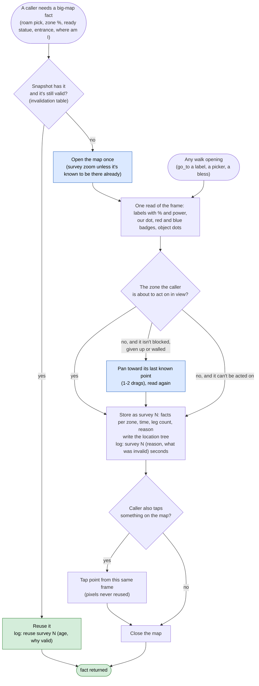
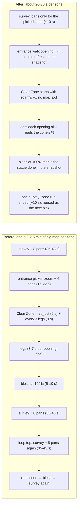

# Big-map survey: why the bot reads the big map again and again, and one survey that replaces the repeats

mae, 2026-11-11: "when our bot scans the big map for zones, it will often do it multiple times in a row." This page
diagnoses where those scans come from, then proposes a design in the same shape as the Clear Zone redesign
([step6-clear-zone.md](step6-clear-zone.md)). **Nothing in the code has changed yet.** Edit the design and the
flowchart below, and the build follows them.

"Big map" and "area map" are the same screen (tap the minimap). A **survey** is one opening of it read for zone
facts: labels, "Exploration: N%" lines, power lines, statue badges, dots.

## Short answer

The bot has **no memory of the last survey**. Seven separate code paths open the big map, and each one reads it
fresh, with its own label reader, and throws the result away when it closes the map. The worst repeat is roam's:
after a zone run it surveys once to check the zone's %, then the loop starts over and **surveys again straight
away**, 11 s later, with nothing changed in between. Each roam survey also **pans the map 8 times**, because
it looks for zones that are blocked or given up on and so can never show. That costs 35-43 s per survey.

The fix: one survey object per run (`BigMap`) that roam and Clear Zone share. Every opening of the map, for a
survey or for a walk, reads everything at once and updates it. A later caller reuses those facts until something
named invalidates them, and every survey logs one line saying why it ran.

## What the logs show

Logs from mae's PC (`logs/`, roam runs vii_r4, run2-run17, Clear Zone runs run15-run22, 2026-11-10/11):

| Pattern | Example | Cost |
|---|---|---|
| Two full surveys back to back after every zone run | vii_r4 00:35:25-00:36:07 then 00:36:18-00:37:00; again at 00:38:27 and 00:39:21. run12 18:38:33 then 18:39:07 | 35-43 s each, so ~40 s wasted per zone |
| Every survey pans the map | 74 of the 109 surveys logged "not in view; panning", every one since lazy panning went in. The "missing" zones are always the same: Hidden Camp (needs Magic Drill), Monolith Ruins I/II (puzzles), Rabbit Vault, Sunrise Isle | 8 pans of ~3 s each, plus OCR on every view |
| Pans thrown away | 182 pans logged "couldn't match it to the last view; reading skipped" | the pan ran, nothing was read |
| Survey, give up, survey the same zone again | run11: "exploring Leafy Corrido" → entrance picker `no_target` (22 s, with 6 pans) → give up → survey → same zone, 3 times in 2.5 min (a name mismatch, since fixed in the tree, but nothing stops it happening again) | ~60 s per round |
| Clear Zone re-reads what roam just read | run22: roam-style label walk at 23:35:22 read Grotto Peninsula, then `map_pct` opened the map again at 23:36:00 for the same label | ~9 s |
| Two readers disagree on the same label | run22: `map_pct` read Grotto Peninsula with "no % line" twice; the big-map picker, in the next opening, read 63%. The run ended "0% → 63%" with no gain in between | a wrong % either way |
| Plain walk openings are cheap | run15 (IX 38→85%): 8 openings, 3-4 s each, 29 s of a 392 s run | fine as they are |

So the problem is not the walk openings. It is the **survey** openings: roam's full survey, the entrance picker,
label walks that zoom and pan, and Clear Zone's % read.

## Every code path that opens the big map

| # | Caller (file) | When it runs | What it reads | Zoom and pans | Typical cost | Why it doesn't reuse the last read |
|---|---|---|---|---|---|---|
| 1 | `Roamer.survey` (`loops/roam.py`) | top of every roam pass; again after every Clear Zone run; again after any statue blessed (`continue`) | all labels, %, power lines, red statue badges, kingdom name, writes the location tree | survey zoom; pans 8 times if any unfinished zone isn't in view | 25-43 s | it returns its areas to the caller and keeps nothing; the next pass starts from scratch |
| 2 | `Roamer.bless_ready` (`roam.py`), also called by Clear Zone's `finish_zone` | after a survey shows a red "!"; at a zone's 100% | the red badge nearest us (a picker) | whatever zoom the map was left at | 5-10 s per statue | it can't use the survey's badge points (pixels from another opening); after it, roam surveys again |
| 3 | `Roamer.bless_near` (`roam.py`) | a zone just finished, or `--area` already explored | its own open-read-close for labels + statues, then a walk opening, up to 3 times | none | ~10 s per statue | reads the same labels the survey just read |
| 4 | `Roamer.approach` (`roam.py`): entrance picker, then label walks (`go_to(name)`, `go_to((via, target, 0.6))`, `go_to(via)`) | every zone roam picks | each `go_to` with a name reads all labels again (`goto.area_labels`) | survey zoom if the label isn't in view, then up to 6 pans (`LABEL_PANS`) | 16-22 s per walk when it zooms and pans | each `go_to` is standalone; it can't know the label was just read |
| 5 | `mapnav.zone_by_map` (`actions/mapnav.py`), via `zone_here` (roam's approach) and `Clearer.in_home` (an unknown name under the minimap, once per name) | when the minimap name isn't a zone the tree knows | our white dot and the nearest label (`mapnav.map_labels`) | survey zoom | ~8 s | its own reader; the dot was in the frame of the last opening too |
| 6 | `Clearer.map_pct` (`loops/clear.py`) | start of a Clear Zone run in a side zone (no tracker quest), then every 3 legs | the zone's label and % line | survey zoom | ~9 s | it doesn't know roam just read the %; the big-map picker (7) reads the % in its own openings, but `map_pct` runs anyway |
| 7 | `Clearer.picker` via `go_to(picker)` (`clear.py`) | each big-map or frontier leg | labels, %, objects in the zone, fog frontier | none, survey zoom only if nothing found | 3-7 s | already reads labels and %; the one opening that does double duty today |
| 8 | `Clearer.check_zone` → `go_to(home)` (`clear.py`) | strayed out of the zone, twice | label walk | as (4) | 4-22 s | standalone `go_to` |

Three different label readers parse the same OCR in different ways:

- `roam.read_areas`: ROI `[0, 120, 720, 1100]`, pairs % and power lines with labels. Used by 1, 3, 6, 7.
- `goto.area_labels`: ROI `[0, 120, 655, 1050]`, names only. Used by 4, 8.
- `mapnav.map_labels`: ROI `[0, 120, 720, 1060]`, names only. Used by 5 and the entrance picker.

On top of those there are four name matchers: `roam.same`, `goto.same_area`, `goto.close_name` and
`mapnav.label_is`. Each caller picks its own mix, so the same label can match in one place and not in another.
The "1X" = IX and "Lakeside" vs "Lakeside Camp" fixes each went into one or two of them.

## Why it repeats: five causes

1. **No shared state.** A survey's result lives in a local variable of the caller. Roam's post-zone survey (line
   ~700) and its loop-top survey (~652) read the same map seconds apart, because the first survey's result goes
   out of scope before the loop comes round.
2. **Pans are driven by the wrong list.** `survey()` pans when *any* zone the tree has unfinished isn't in the
   first view. Blocked zones (Hidden Camp, Monolith Ruins), zones given up on today, and zones over the power wall
   are on that list forever, so every survey pans, and most pans fail to match and get thrown away.
3. **Pixels and facts are mixed.** Tap points are valid only inside the opening that read them, because the map
   reopens centred on the camera. So every caller that needs to *tap* something reopens and re-reads everything,
   even when all it needs from the earlier read is a fact ("VII has a ready statue", "Grotto is at 63%").
4. **Each walk opening reads only what its caller asked for.** A walk opening already has the whole map on
   screen. Today it reads one label or one picker result and drops the rest, so the next caller has to open
   the map again for the % or the badges.
5. **Repeated reads are the only proof.** A zone needs 3 surveys in a row with no % line before it counts as
   finished (`FINISHED_READS`, and `map_pct`'s own 3 reads), so a cautious caller surveys again to collect
   proof. That is right in itself, but each proof read is a full survey, not a glance at the label.

## The design: one survey, shared, with named reasons

### Four rules

1. **One reader, one matcher.** All label OCR goes through one function (today's `read_areas`, which already
   pairs % and power lines). It returns `Area(name, box, pct, gate, unsure)`, our white dot, red and blue badges,
   and the object dots in one pass over one frame. One name matcher, `bigmap.is_zone(label, zone)`, holds every
   OCR rule we've learned (numerals, "1X", clipped left edges, joined labels, first-words names).
2. **Every opening is a survey.** Whoever opens the map (a walk, a picker, a bless) goes through
   `BigMap.opened(reason)`. That records the reading as the new snapshot before the caller taps anything. A walk
   opening costs ~1 s more for the OCR and saves the next survey.
3. **Facts are cached, pixels are not.** The snapshot keeps **zone facts**: per zone the %, power, a ready
   statue, label seen or not, objects in the zone (count and kinds), entrance found or not, the zone our dot sits
   in. Those are valid across openings. **Tap points** are always read in the opening that taps them (as `go_to`
   does now).
4. **A survey runs only for a named reason, and says it.** `BigMap.look(reason)` returns the snapshot if it is
   still valid and opens the map only if it isn't. Each call logs one line:

   ```
   [big map] survey 4 (zone run ended: Verdantglade VII zone_done; last survey 2:10 ago, invalid: % changed)  9.2 s
   [big map] reuse survey 4 (roam pick; 11 s old, nothing changed)
   [big map] walk opening 5 also read: 14 labels, Verdantglade VII 100%, 1 ready statue
   ```

### When the snapshot goes stale (invalidation)

| Event | Which facts are dropped | Who signals it |
|---|---|---|
| Zone entered or left (the minimap name changed) | our dot's zone; the walk openings refresh it anyway | Clear Zone `check_zone`, roam `approach` |
| Object taken or fight won in a zone (leg result `gain`) | that zone's objects | Clear Zone `judge` |
| % changed on the tracker for a zone | that zone's % | Clear Zone `read_pct` |
| Statue blessed | that zone's ready statue | `bless_ready` (marks it, no survey) |
| A Clear Zone run ended | that zone's %, objects and statue | roam, after `clear.run` |
| A side zone's % is older than 3 legs | that zone's %, read in the next big-map leg's opening, or by `map_pct` if no big-map leg comes | Clear Zone |
| Age over 10 minutes, or a new server day (reset 13:00Z) | everything | `BigMap.look` |
| Power went up | power-wall decisions only (no survey needed) | roam |

Anything not on this list does not trigger a survey. Adding a reason means adding a row here.

### Pans only toward what's needed

A survey pans only when **the zone a caller is about to act on** isn't in view. It no longer pans for every
unfinished zone. Blocked zones, zones given up on today and zones over the power wall never trigger a pan. A pan
goes toward the zone's last known point from the location tree (one or two drags, not eight). A zone that
wasn't seen after that is recorded as "off view from here" for this run, so later surveys don't pan for it again.

### Proof reads without full surveys

"No % line" evidence (`FINISHED_READS`, `map_pct`'s 3 reads) counts **openings in which the label was read with
room for a % line under it**, including walk openings. The evidence piles up while the bot walks, without extra
surveys. A % jump that no gain explains (run22: 0% → 63%) needs two matching reads before it's believed, the same
rule as the quest-moved check.

### The flowchart



### Roam's zone cycle, before and after



## What changes in the code

- **New** `bigmap.py` in `sxs/actions/`: `Snapshot` (zone facts, dot, badges, objects, time, legs, reason), `BigMap`
  (`look(reason, need=zone)`, `opened(reason)` context manager for walk openings, `invalidate(event, zone)`),
  `read()` (the one reader, moved from `roam.read_areas` + `merge_readings`), `is_zone()` (the one matcher).
  A new offline check, `check_bigmap.py` in `tests/`, replays saved area-map frames (`docs/screens/world/area_map_*.png`) through the reader
  and checks the invalidation rules offline.
- `sxs/actions/goto.py`: `go_to` takes an optional `bigmap` and records its opening; `area_labels` becomes a thin
  wrapper over the one reader. The map is left at survey zoom, and `go_to` skips `survey_zoom` when it knows the
  map is already there (saves ~3.5 s per opening).
- `sxs/actions/mapnav.py`: `zone_by_map` and `map_labels` go through `BigMap`. The dot from the last opening
  answers "where am I" when it's fresh.
- `sxs/loops/roam.py` (Clear Zone thread's file): one `BigMap` per run; the post-zone survey becomes the next
  pass's survey (the loop-top survey only runs when the snapshot is invalid); `bless_ready` doesn't `continue` into
  a new survey; `bless_near` uses the snapshot's statue facts; the pan list is "the picked zone", not "every
  unfinished zone".
- `sxs/loops/clear.py` (Clear Zone thread's file): `Clearer` takes roam's `BigMap`; `map_pct` at the start is
  skipped when the snapshot has the zone's % from this visit; the every-3-legs read uses the picker's openings
  first; `judge`, `read_pct`, `check_zone` and `finish_zone` call `invalidate`.
- Rules: R-076 (big map) gets a line on the shared survey; no game rule changes.

The Clear Zone thread owns roam and clear. The split is agreed with it before any edit to those two files.

## Questions for mae

1. **Survey zoom for every opening.** Leaving the map at survey zoom saves the 4 zoom taps on every opening, and
   the Clear Zone pickers found objects at that zoom in run22. OK to make it the standard zoom for walks too?
2. **10-minute age limit.** Is anything on the big map likely to change on its own within 10 minutes (respawning
   monsters in explored zones, timed events) that would need a shorter limit?
3. **Pans.** With pans only toward the picked zone, a zone that never shows in the first view (Sunrise Isle,
   Rabbit Vault) is read only when roam picks it. Fine, or should a full panned survey still run once per server
   day to keep the location tree complete?
