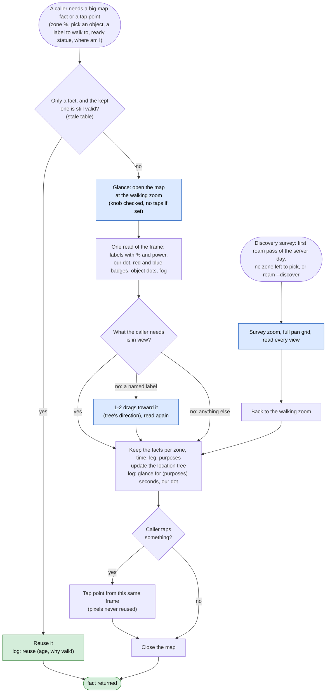
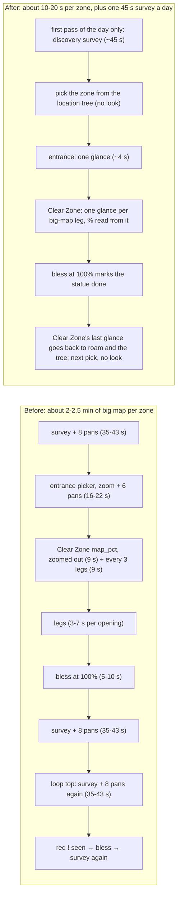

# Big-map survey: why the bot reads the big map again and again, and one survey that replaces the repeats

mae, 2026-11-11: "when our bot scans the big map for zones, it will often do it multiple times in a row." This page
diagnoses where those scans come from, then proposes a design in the same shape as the Clear Zone redesign
([step6-clear-zone.md](step6-clear-zone.md)). mae answered the design questions on 2026-11-11 (see
"Decisions" at the end); the design below follows them, and it is built ("What changed in the code"), offline
checked, not yet run live.

"Big map" and "area map" are the same screen (tap the minimap). A **survey** is one opening of it read for zone
facts: labels, "Exploration: N%" lines, power lines, statue badges, dots.

## Short answer

The bot has **no memory of the last survey**. Nine separate code paths open the big map, and each one reads it
fresh, with its own label reader, and throws the result away when it closes the map. The worst repeat is roam's:
after a zone run it surveys once to check the zone's %, then the loop starts over and **surveys again straight
away**, 11 s later, with nothing changed in between. Each roam survey also **pans the map 8 times**, because
it looks for zones that are blocked or given up on and so can never show. That costs 35-43 s per survey.

The fix (with mae's decisions): **walking never needs a full survey.** The zoomed-out survey with pans is kept
for one job, finding out which zones exist: once per server day, or on purpose when hunting unexplored side areas.
Everything else is a **glance**: the map opens at the walking zoom, the bot reads what's in view, taps, and closes.
One object per run (`BigMap`), shared by roam and Clear Zone, keeps the facts from every glance. A later caller
reuses them until something named makes them stale, and every opening logs one line saying what it was for.

## What the logs show

Logs from mae's PC (`logs/`, roam runs vii_r4, run2-run17, Clear Zone runs run15-run22, 2026-11-10/11):

| Pattern | Example | Cost |
|---|---|---|
| Two full surveys back to back after every zone run | vii_r4 00:35:25-00:36:07 then 00:36:18-00:37:00; again at 00:38:27 and 00:39:21. run12 18:38:33 then 18:39:07 | 35-43 s each, so ~40 s wasted per zone |
| Every survey pans the map | 74 of the 109 surveys logged "not in view; panning", every one since lazy panning went in. The "missing" zones are always the same: Hidden Camp (needs Magic Drill), Monolith Ruins I/II (puzzles), Rabbit Vault, Sunrise Isle | 8 pans of ~3 s each, plus OCR on every view |
| Pans thrown away | 182 pans logged "couldn't match it to the last view; reading skipped" | the pan ran, nothing was read |
| Survey, give up, survey the same zone again | run11: "exploring Leafy Corrido" → entrance picker `no_target` (22 s, with 6 pans) → give up → survey → same zone, 3 times in 2.5 min (a name mismatch, since fixed in the tree, but nothing stops it happening again) | ~60 s per round |
| Clear Zone re-reads what roam just read | run22: roam-style label walk at 23:35:22 read Grotto Peninsula, then `map_pct` opened the map again at 23:36:00 for the same label | ~9 s |
| Two readers disagree on the same label | run22: `map_pct` read Grotto Peninsula with "no % line" twice; the big-map picker, in the next opening, read 63%. The run ended "0% → 63%" with no gain in between | a wrong % either way (the "no % line" half is now guarded: since 5b80215 it only counts from 90%) |
| Plain walk openings are cheap | run15 (IX 38→85%): 8 openings, 3-4 s each, 29 s of a 392 s run | fine as they are |

So the problem is not the walk openings. It is the **survey** openings: roam's full survey, the entrance picker,
label walks that zoom and pan, and Clear Zone's % read.

## Every code path that opens the big map

| # | Caller (file) | When it runs | What it reads | Zoom and pans | Typical cost | Why it doesn't reuse the last read |
|---|---|---|---|---|---|---|
| 1 | `Roamer.survey` (`loops/roam.py`) | top of every roam pass; again after every Clear Zone run; again after any statue blessed (`continue`) | all labels, %, power lines, red statue badges, kingdom name, writes the location tree | survey zoom; pans 8 times if any unfinished zone isn't in view | 25-43 s | it returns its areas to the caller and keeps nothing; the next pass starts from scratch |
| 2 | `Roamer.bless_ready` (`roam.py`), also called by Clear Zone's `finish_zone` | after a survey shows a red "!"; at a zone's 100% | the red badge nearest us (a picker) | whatever zoom the map was left at | 5-10 s per statue | it can't use the survey's badge points (pixels from another opening); after it, roam surveys again |
| 3 | `Roamer.bless_near` (`roam.py`) | a zone just finished, or `--area` already explored | its own open-read-close for labels + statues, then a walk opening, up to 3 times | none | ~10 s per statue | reads the same labels the survey just read |
| 4 | `Roamer.approach` (`roam.py`): entrance picker, then label walks (`go_to(name)`, `go_to((via, target, 0.6))`, `go_to(via)`) | every zone roam picks | each `go_to` with a name reads all labels again (`goto.area_labels`) | survey zoom if the label isn't in view, then up to 6 pans (`LABEL_PANS`) | 16-22 s per walk when it zooms and pans | each `go_to` is standalone; it can't know the label was just read |
| 5 | `mapnav.zone_by_map` (`actions/mapnav.py`), via `zone_here` (roam's approach) and `Clearer.in_home` (an unknown name under the minimap, once per name) | when the minimap name isn't a zone the tree knows | our white dot and the nearest label (`mapnav.map_labels`) | survey zoom | ~8 s | its own reader; the dot was in the frame of the last opening too |
| 6 | `Clearer.map_pct` (`loops/clear.py`) | start of a Clear Zone run in a side zone (no tracker quest), then every 3 legs | the zone's label and % line | survey zoom | ~9 s | it doesn't know roam just read the %; the big-map picker (7) reads the % in its own openings, but `map_pct` runs anyway |
| 7 | `Clearer.picker` via `go_to(picker)` (`clear.py`) | each big-map or frontier leg | labels, %, objects in the zone, fog frontier | none, survey zoom only if nothing found | 3-7 s | already reads labels and %; the one opening that does double duty today |
| 8 | `Clearer.check_zone` → `go_to(home)` (`clear.py`) | strayed out of the zone, twice | label walk | as (4) | 4-22 s | standalone `go_to` |
| 9 | `Clearer.fog_here` (`clear.py`, added after 9200bbb) | once after each frontier leg | our dot and the fog share round it | **none on purpose**: same zoom as the frontier pick, so before and after compare | ~3 s | needs its own frame at the pick's zoom; stays as it is, but its opening can feed the snapshot too |

Three different label readers parse the same OCR in different ways:

- `roam.read_areas`: ROI `[0, 120, 720, 1100]`, pairs % and power lines with labels. Used by 1, 3, 6, 7.
- `goto.area_labels`: ROI `[0, 120, 655, 1050]`, names only. Used by 4, 8.
- `mapnav.map_labels`: ROI `[0, 120, 720, 1060]`, names only. Used by 5 and the entrance picker.

On top of those there are four name matchers: `roam.same`, `goto.same_area`, `goto.close_name` and
`mapnav.label_is`. Each caller picks its own mix, so the same label can match in one place and not in another.
The "1X" = IX and "Lakeside" vs "Lakeside Camp" fixes each went into one or two of them.

## Why it repeats: five causes

1. **No shared state.** A survey's result lives in a local variable of the caller. Roam's post-zone survey (line
   ~700) and its loop-top survey (~652) read the same map seconds apart, because the first survey's result goes
   out of scope before the loop comes round.
2. **Pans are driven by the wrong list.** `survey()` pans when *any* zone the tree has unfinished isn't in the
   first view. Blocked zones (Hidden Camp, Monolith Ruins), zones given up on today, and zones over the power wall
   are on that list forever, so every survey pans, and most pans fail to match and get thrown away.
3. **Pixels and facts are mixed.** Tap points are valid only inside the opening that read them, because the map
   reopens centred on the camera. So every caller that needs to *tap* something reopens and re-reads everything,
   even when all it needs from the earlier read is a fact ("VII has a ready statue", "Grotto is at 63%").
4. **Each walk opening reads only what its caller asked for.** A walk opening already has the whole map on
   screen. Today it reads one label or one picker result and drops the rest, so the next caller has to open
   the map again for the % or the badges.
5. **Repeated reads are the only proof.** A zone needs 3 surveys in a row with no % line before it counts as
   finished (`FINISHED_READS`, and `map_pct`'s own 3 reads), so a cautious caller surveys again to collect
   proof. That is right in itself, but each proof read is a full survey, not a glance at the label.

## The design: glances for walking, a discovery survey once a day

### Two kinds of look (mae, 2026-11-11)

| | **Glance** (small survey) | **Discovery survey** |
|---|---|---|
| What it's for | walking: pick an object, find a label, read our zone's %, where am I, a ready statue nearby | finding out which zones exist and their % and power, for the location tree |
| Zoom | the walking zoom, which the map is kept at; no zoom taps when the knob already shows it; one quick knob drag out when what it needs isn't in view | survey zoom (one knob drag), then back to the walking zoom before closing |
| Pans | none, or 2 short drags toward one named label (from the tree's last known direction); never the sweep | the full pan grid, once |
| When | every opening of the map, for any walk | once per server day; when the location tree has no zone left to pick; when we hunt side areas on purpose (`roam --discover`); never for walking |
| Cost | ~3-4 s, as Clear Zone's legs are today | ~45 s |

"mae: survey zoom should be reserved for situations where we want to see what zones are available, and no
other. Walking should basically never require a full survey, unless we are looking for unexplored side areas
(which we can do on purpose). Small surveys are something I am okay with, but I want to reduce the overhead cost
of navigation."

The **walking zoom** is the zoom Clear Zone's legs use today (run15: 8 openings, 3-4 s each, objects found). Its
knob position is measured from those captures and pinned as a constant, so every glance can check the knob in its
frame and skip the zoom taps when it's already there.

### Rules

1. **One reader, one matcher.** All label OCR goes through one function (today's `read_areas`, which already
   pairs % and power lines). It returns `Area(name, box, pct, gate, unsure)`, our white dot, red and blue badges,
   and the object dots in one pass over one frame. One name matcher, `bigmap.is_zone(label, zone)`, holds every
   OCR rule we've learned (numerals, "1X", clipped left edges, joined labels, first-words names).
2. **Every opening is a glance, and a glance reads everything in view.** Whoever opens the map (a walk, a picker,
   a bless) goes through `BigMap.opened(purposes)`. The reading is stored before the caller taps anything; the OCR
   costs ~1 s and saves the next opening. `fog_here` keeps the frontier's zoom, because its fog before/after
   comparison needs it (at the walking zoom that is the same zoom anyway).
3. **Facts are kept, pixels are not.** `BigMap` keeps **zone facts**: per zone the %, power, a ready statue,
   label seen or not, objects in the zone (count and kinds), entrance found or not, the zone our dot sits in.
   Those last across openings. **Tap points** are always read in the opening that taps them (as `go_to` does now).
4. **Roam picks from the location tree, not from a fresh survey.** The tree already holds every zone's %, power,
   blocked flag and ways in (`Tree.next_zone`); glances and Clear Zone's results keep it current. Roam runs a
   discovery survey only for the reasons in the table above, and says which.
5. **A label not in view: one quick zoom-out, then a short pan, never a sweep.** `go_to` a zone and the pickers
   look in the glance; if it isn't there, one knob drag to the survey zoom (~2 s; mae 18:15: zooming is fine when
   quick); if still not there, 2 drags toward the tree's direction for it; then the walk ends `no_label` and the
   caller decides (roam: give the zone up for today, R-150). The six-drag sweep is gone.
6. **Every opening says what it was for.** One line each:

   ```
   [map] glance for: pct, pick (leg 6) 3.4 s, zoom already set, 9 labels, Grotto Peninsula 63%, our dot: found
   [map] reuse (roam pick; Clear Zone's last glance 40 s ago, same zone)
   [map] discovery survey (first of server day 2026-11-11) 44 s, 8 pans, 27 zones, our dot: found (fallback)
   ```

   Every opening logs whether our white dot was found (strict mask, the `player_dot` fallback added in 8ddc275, or
   not at all). Without the dot, the frontier and object pickers measure from the zone label instead of from us.

### When kept facts go stale

| Event | Which facts are dropped | Who signals it |
|---|---|---|
| Zone entered or left (the minimap name changed) | our dot's zone; the next glance refreshes it | Clear Zone `check_zone`, roam `approach` |
| Object taken or fight won in a zone (leg result `gain`) | that zone's objects | Clear Zone `judge` |
| % changed on the tracker for a zone | that zone's % | Clear Zone `read_pct` |
| Statue blessed | that zone's ready statue | `bless_ready` (marks it, no new look) |
| A Clear Zone run ended | that zone's %, objects and statue, unless its last glance is under ~1 minute old | roam, after `clear.run` |
| A side zone's % is older than 3 legs | that zone's %, read in the next leg's glance | Clear Zone |
| Age over 10 minutes (mae: "good timeline") | other zones' %, power, statues | `BigMap` |
| New server day (reset 13:00Z) | everything; the first roam pass runs the day's discovery survey | `BigMap` |
| Power went up | power-wall decisions only (no look needed) | roam |

Anything not on this list does not open the map. Adding a reason means adding a row here.

### Inside a Clear Zone leg: one glance per leg

The strengthening thread read the Clear Zone code on #60's tip (2026-11-11) and counted up to **three openings in
one leg**: `map_pct` opens, zooms (4 taps and a drag), reads the % and closes. The picker opens again to choose the
objective. After a frontier leg, `fog_here` opens a third time. Each opening re-zooms from scratch. Then roam's
survey opens the map at the zone's end, and again before the next pick. Its suggestions, with mae's zoom decision:

1. **One glance per leg.** A leg opens the map once. That one frame feeds every reader: the zone's %, objects in
   the zone, our dot, the fog share, statue badges and the other labels. `map_pct` stops being an opening of its
   own and becomes a reader of the leg's glance, at the walking zoom (it zooms out today). It opens the map itself
   only when no leg opened it in the last 3 legs.
2. **The last glance is the next "before".** `fog_here`'s frame after a frontier leg is kept as the next leg's
   glance when nothing has happened since. At the end of a zone run, Clear Zone hands its last glance to roam.
3. **Check the zoom knob before zooming.** Read the knob from the frame; skip the taps when it already shows the
   walking zoom (~3 s per opening).
4. **Retry a failed % read from the same frame.** When a label is read but its % line isn't, OCR an enlarged crop
   under the label in the same frame before counting it as "no % line". Never reopen the map to retry.
5. **Say what each opening was for** (rule 6 above).

The strengthening thread estimates 10-15 s saved per leg, on top of the roam savings below.

### Proof reads without extra looks

"No % line" evidence (`FINISHED_READS`, `map_pct`'s 3 reads, which count only from 90% since 5b80215) counts
**glances in which the label was read with room for a % line under it**. The evidence piles up while the bot
walks. A % jump that no gain explains (run22: 0% → 63%) needs two matching reads before it's believed, the same
rule as the quest-moved check.

### The flowchart



### Roam's zone cycle, before and after



## What changed in the code (built 2026-11-11, offline; not run live yet)

- **New** `bigmap.py` in `sxs/actions/`: `BigMap` (one per process, `bigmap.get(dev, det)`, shared by roam and Clear
  Zone) keeps the facts every opening read (`record`), with times; `glance(purposes)` opens at the walking zoom,
  reads, closes; `recent`, `fact`, `reuse`, `invalidate(event, zone)`; `discovery_due` / `discovered` keep the server
  day of the last discovery survey in `logs/bigmap.json`. `knob_y` reads the zoom knob (821 closest, **955 walking =
  the game's default**, 1031 survey, 1089 fully out, measured on the 20 reference area maps); `set_zoom` drags the
  knob only when it isn't there already. `map_text` runs one OCR pass per frame that all three label readers share
  (their filters are unchanged for now; merging them into one reader is a follow-up). `reread_pct` re-reads a
  missing % line from an enlarged crop of the same frame.
- `sxs/actions/goto.py`: `go_to` brings the map to the walking zoom (only when it sees the knob, so a blind "-" tap
  never lands on the island map), records the opening, and gives the picker that same frame. A missing label or
  target: `_widen` zooms out with one knob drag (no "-" taps, nothing when the knob isn't seen), then two drags
  `toward` it when the tree gives a direction (its label points). The old six-drag sweep is gone. The full pan grid
  is only in the discovery survey.
- `sxs/actions/mapnav.py`: `zone_by_map` is a glance (no survey zoom).
- `sxs/loops/roam.py`: `look_around` replaces the survey at the top of every pass: a discovery survey only when
  due (first of the server day, `--discover`, or the tree has nothing left to pick), else the tree's zones
  (`tree_areas`, fresher glance % first) and statues seen in glances. The survey after a zone run is gone: Clear
  Zone's last glance (under a minute old, showing the zone) or one glance. The discovery survey always pans the
  full grid and leaves the map at the walking zoom. Glances update the tree's % but never its label points.
  Blessing drops the ready-statue fact. The run ends with `[map] this run: glance N, reuse N, discovery N`.
- `sxs/loops/clear.py`: `map_pct` reuses this leg's look (or roam's walk-in look) when under a minute old, else
  glances at the walking zoom; retries a missing % line from an enlarged crop. `fog_here` records its frame. A gain
  drops the zone's % and retires the last look. The run summary logs the map counts.
- Tests: `check_bigmap.py` in `tests/` (40 checks). `check_clear`, `check_zones`, `check_loops`, `check_interrupts`,
  `check_upgrade_logic`, `check_rewards_offline` and `check_repo` still pass.
- Not done here: R-076's wording (the docs thread owns rules); merging the three label filters into one reader;
  `scripts/tap_trace.py` counting openings by kind (the `[map]` lines already do).

The Clear Zone thread agreed (2026-11-11) that this branch takes over `map_pct`, the picker's label read,
`in_home` and `finish_zone`; it stays out of `clear.py` until this lands if the picker's signature changes.

## Decisions (mae, 2026-11-11 06:49)

1. **Survey zoom is only for seeing which zones are available.** Walking basically never needs a full survey,
   except when we hunt unexplored side areas on purpose. Small surveys (glances) are fine; the goal is less
   navigation overhead. → Glance / discovery split above.
   Refined 18:15: "I'm okay with the map glance zooming, I just don't want it to do the big pan which takes a while
   regularly. If it is capable of zooming out quickly and accurately and efficiently, I don't mind." → A glance that
   doesn't find its label or target zooms out with **one knob drag** (~2 s, only when the knob is seen) and looks
   again; the slow six-drag sweep is gone, and the full pan grid stays in the once-a-day discovery survey.
2. **Age limits are good:** about 1 minute for the zone being cleared, 10 minutes for other zones.
3. **One full pan per day is okay.** → The first roam pass of each server day runs the discovery survey.
