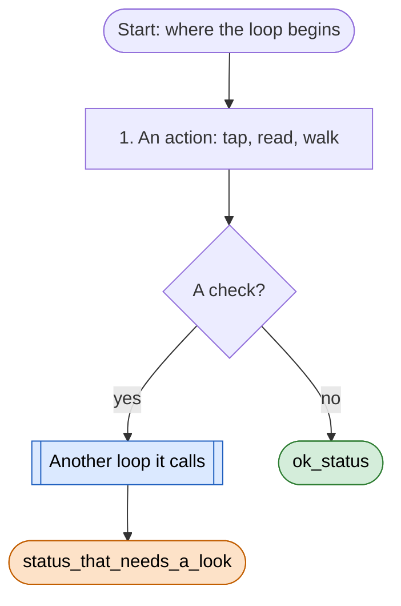
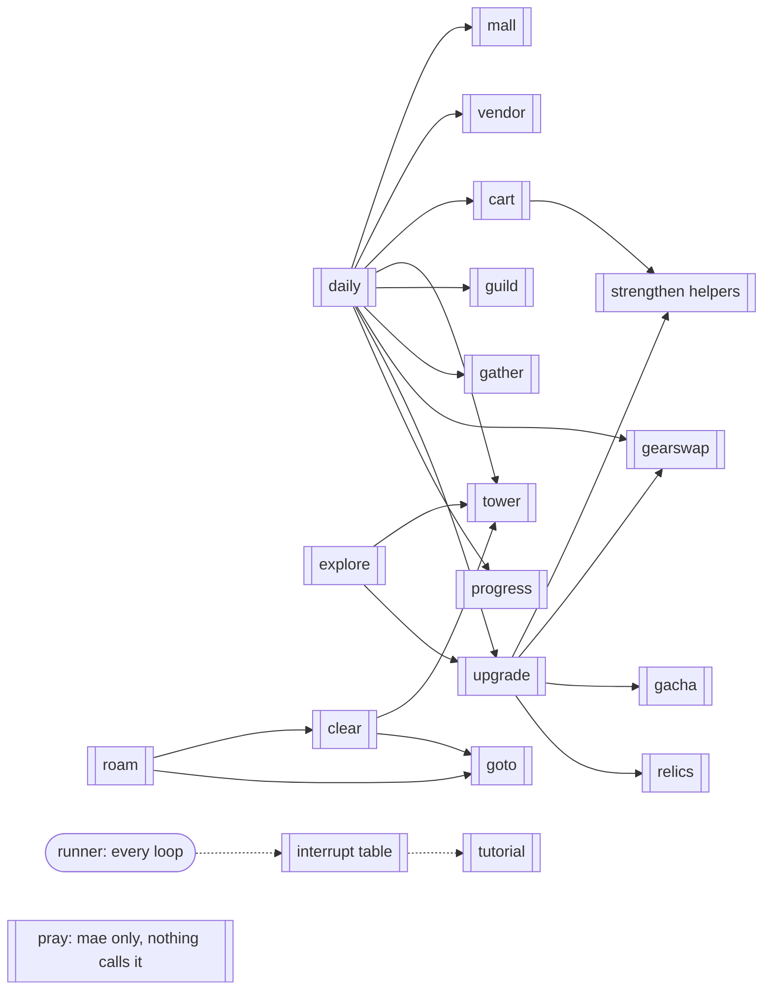

# Loop diagrams

<!-- index: Diagrams of every loop: goal, step order, checks, sub-loops, what it does on each screen; `loops/open-questions.md` lists where code and rules disagree (index `loops/README.md`) -->

The bot's decision flow, one page per loop, drawn from the code as it is on `main` (after PR #42). Each page says
what the loop is for, the order it does and checks things in, which other loops it can call, and what it does on
every screen it can meet. Edit these pages in any text editor; GitHub draws the diagrams.

The code is still the source of truth (`sxs/loops/`): when a page and the code disagree, the code is what runs, and
the page is wrong until someone fixes one of them. [open-questions.md](open-questions.md) lists every place where
the code, the rules (`memory-bank/game/rules/`) and these pages don't line up, or where a screen has no defined
action. Those are mae's calls.

## How to read a diagram

- Steps are numbered in the order they run. A diamond is a check; its arrows are the answers.
- Green ends are statuses in the loop's `ok` set (exit code 0). Orange ends need a look (exit code 1).
- Blue double-edged boxes are other loops or shared actions it calls; each has its own page.
- `R-NNN` points to a rule in `memory-bank/game/rules/` (index: `memory-bank/game/rules/README.md`).

## The pages

| Page | Loop | Command | Goal in one line |
|---|---|---|---|
| [runner.md](runner.md) | Runner and interrupts | every `python -m sxs <loop>` | Time checks, stuck checks, and the screens any loop may meet |
| [daily.md](daily.md) | Dailies | `python -m sxs daily` | Every once-a-day chore, then the upgrade passes |
| [explore.md](explore.md) | Explore (quest follower) | `python -m sxs explore` | Follow the tracked quest line |
| [roam.md](roam.md) | Roam | `python -m sxs roam` | Explore and bless every zone in reach, lowest power first |
| [clear.md](clear.md) | Clear Zone | `python -m sxs clear` | Bring one zone to 100%, one named objective per leg (replaced the Fog Walk, 2026-11-10) |
| [gather.md](gather.md) | Gather | `python -m sxs gather` | Spend stamina above 70 on the priority material |
| [cart.md](cart.md) | Cart Upgrade | `python -m sxs cart` | Claim the Cart, raise Stone and Wood evenly |
| [upgrade.md](upgrade.md) | Upgrade, Strengthen | `python -m sxs upgrade`, `python -m sxs strengthen` | Take every upgrade a Character-screen "!" offers |
| [gacha.md](gacha.md) | Gacha, Relics | `python -m sxs gacha`, `python -m sxs relics` | Draw x10 whenever a full x10 is affordable; activate and enhance relics |
| [gearswap.md](gearswap.md) | Gear Swap | `python -m sxs gearswap` | Equip the better piece in every flagged slot |
| [tower.md](tower.md) | Fantasia Ascent | `python -m sxs tower` | One tower climb a day until the first loss |
| [guild.md](guild.md) | Guild | `python -m sxs guild` | Donate twice, sit at the Forge, use Conquest attempts |
| [small-loops.md](small-loops.md) | Mall, Vendor, Tutorial, Progress, Pray | see page | Free gifts, free stamina, tutorials, reading stats, mae's pulls |
| [states.md](states.md) | All loops | | Every screen the detector knows, and who acts on it |
| [open-questions.md](open-questions.md) | All loops | | Disagreements and undefined actions for mae to decide |

## Who calls whom

`strengthen` here means the `Strengthener` helpers (claim the Cart, banded gear enhance, charms). After 3 losses in a
row `explore` calls `get_stronger` in `upgrade` (Cart, rank first at the cap, gacha, relics, gear swap, charms,
Upgrade loop); the daily `strengthen` step calls it too, without the gear swap.

## Making the diagrams the source of truth (proposed follow-up)

Today these pages describe the code; changing a page doesn't change the bot. If mae wants to steer the bot by
editing the flow, the next step would be a small flow spec per loop, read by the loops at run time:

- `resource/flows/<loop>.yaml`: the ordered steps (daily's step list, upgrade's passes, roam's pick order), each
  step's budget and once-a-day flag, and per state the action to take, using action names the code already has
  (`close_rewards`, `decide_card`, `start_battle`, `heal`, `back_arrow`, `stop:<status>`).
- The loops read their step order and state table from it instead of from Python constants, so reordering daily
  steps, switching a state's action or adding a "stop and ask mae" is a one-line edit.
- A new script in `scripts/` draws these Mermaid pages from the YAML, and a test fails when the
  YAML names a step or action the code doesn't have. The diagrams then can't drift from the bot.

Start with the parts that are already tables in code (daily `STEPS`, upgrade `PASSES`, `cards.json`, the interrupt
`TABLE`, `nav.TOWARD_HOME`); the walking logic inside explore and clear stays in Python.
