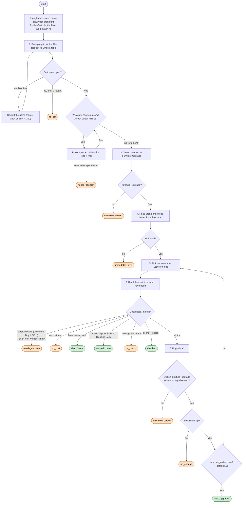

# Cart Upgrade loop

Code: `sxs/loops/cart.py` (`CartUpgrader`), Cart claim in `sxs/loops/strengthen.py` (`Strengthener.claim_cart`).
Command: `python -m sxs cart [--check] [--max N]`; daily steps `cart` (claim) and `cart_upgrade`. Rules: R-020,
R-100, R-126, R-136.

**Goal:** claim the Cart's AFK loot, press every free row Unlock (R-137), then raise the Stone and Wood income rows
with ordinary materials, keeping them level: the lower one first, Stone on a tie. No other row is upgraded.
**End condition:** a cost we can't pay (`short`), the Blessing Level cap (`capped`), a cost we don't recognise, a
level that won't rise, or an unexpected screen.
**Ok statuses:** `done`, `short`, `capped`, `checked`, `max_upgrades`. Needs a look: `needs_decision`, `no_cart`,
`unknown_screen`, `unreadable_level`, `no_change`, `no_cost`, `no_button`.

`short` and `capped` become `done` when at least one upgrade went through this run. Today (05:11, 2026-11-05)
Stone and Wood are Lv 5, capped by Blessing Lv 5: raising the bed's Blessing Level is what unblocks this loop.

The free-unlock step (R-137, `CartUpgrader.unlock_rows`) came in PR #43 and hasn't run live yet.
