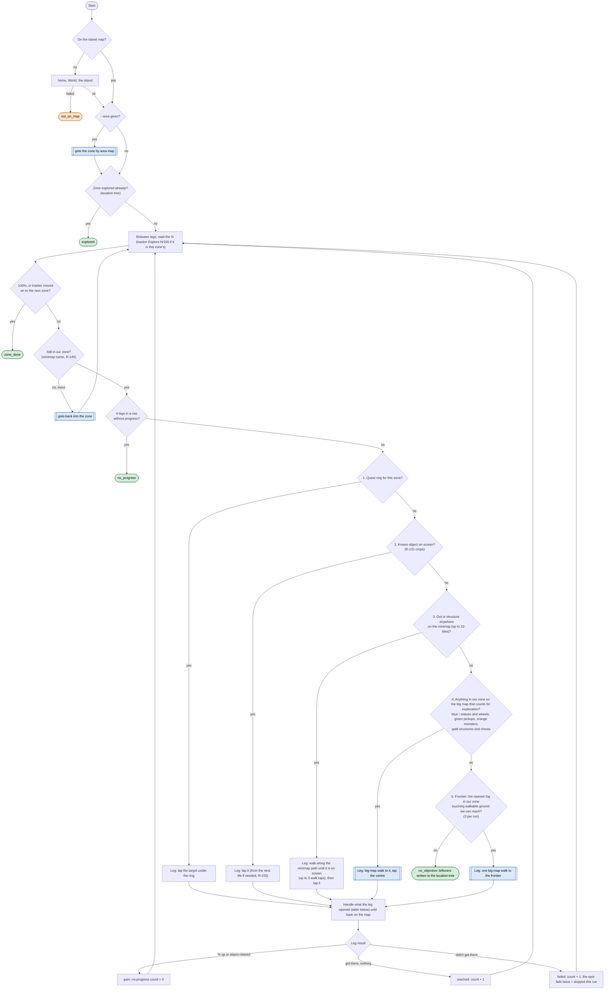

# Clear Zone loop (one zone to 100%, one named objective at a time)

Code: `sxs/loops/clear.py` (`run`), helpers in `sxs/actions/mapnav.py`. Command: `python -m sxs clear [--area NAME]
[--minutes N]`. Called by [roam.md](roam.md). Design and why: [step6-clear-zone.md](../step6-clear-zone.md).
Replaces the Fog Walk (scrapped 2026-11-10, [fogwalk-postmortem.md](../fogwalk-postmortem.md)). Rules: R-065, R-068,
R-131, R-132, R-140, R-142, R-143, R-147, R-148, R-150, R-155.

**Goal:** bring one unexplored zone to 100% by clearing its objects: the quest ring's targets, dots, monsters,
structures, statues. Every leg names its objective; progress is the zone's % or an object cleared, never tiles.
**End condition:** 100% (or the tracker moved on), no objective left, 4 legs in a row without progress, a power
gate met 3 times, a lost fight, an unfamiliar screen, or the time.
**Ok statuses:** `zone_done`, `no_objective`, `no_progress`, `puzzle` (3 gold squares in a row that open nothing and move no %: floor-puzzle tiles, R-153; the zone is marked blocked), `power_gate`, `blocked_item`, `explored`, `timeout`.
Needs a look: `defeated`, `unknown_screen`, `repeating_card`, `left_area:home`, `not_on_map`, `not_in_zone`.

## The leg loop

Each leg logs `[leg N] goal: <source> <what> at <where>` before it starts and `[leg N] result: <gain|reached|failed>
<% before -> after>` after. The runner's stall check sees the leg count and the %, not the coordinates.

## Screens a leg can open

| Screen | Action | Leg result / ends with |
|---|---|---|
| battle_prep | heal from the portrait if HP under 70% (2 tries), else Start Battle; save the monster crop (R-131) | gain (a fight) |
| battle, loading, dialogue, tap_to_continue | wait / pass through | |
| reward_popup | close | gain (a pickup) |
| defeated | OK | `defeated` |
| player_profile | close (a stray tap on our character) | |
| tower screens | tower climb if not done today (R-079), then back to the zone | |
| area_map | close (left open by a big-map walk) | |
| home | | `left_area:home` |
| Lucky Wheel, free spin showing (R-147) | spin once | gain |
| Gate of Elements (Gate of Wind...) | add companions, Open (R-057) | gain, or the spot skipped if still short |
| dialogue_choice (a puzzle NPC) | Leave; puzzle noted on the zone (R-153) | the spot skipped |
| dialogue_choice with no Leave (a story choice) | save the screen to `docs/screens/dialogs/choice_<zone>_<choices>.png`, ask mae (mae, 2026-11-11) | `needs_decision` |
| any other card | card rules (`resource/policy/cards.json`, goal explore) | acted on: gain; dismissed: the spot skipped; Gate of Power: the spot skipped, `power_gate` the 3rd time; "Required Item": `blocked_item` |
| unknown, 5 in a row | frame saved | `unknown_screen` |
