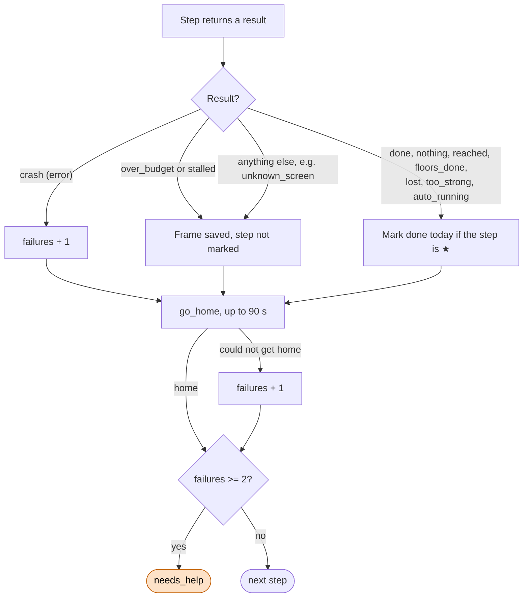

# Dailies loop

Code: `sxs/loops/daily.py` (`Dailies`). Command: `python -m sxs daily [--only a,b] [--force]`. Notes: `docs/step4-dailies.md`.

**Goal:** run every daily chore once per server day (reset 8:00 server time, 13:00 UTC; R-024), then the upgrade
passes.
**End condition:** every step tried once, or 2 failures (a crash or a failed trip home) end it `needs_help`.
**Ok statuses:** `done`. Anything else needs a look: `needs_help`, or the runner's `over_budget` / `stalled`.

## Order of steps

Each step starts from home and ends there. ★ = once a day: skipped when today's mark is set in `logs/daily.json`.
Each step has its own 120 s budget and stall check (the whole run 20 min): a step that runs over is cut, not
retried, not marked done, and the next step starts.

```mermaid
flowchart TD
    S(["Start: any screen"]) --> s1["1. sign_in ★<br/>Thrilling Events, Daily Sign-in, claim today's tile"]
    s1 --> s2[["2. mall_gifts ★ / 3. mall_gifts_2 ★<br/>free gift box on each Mall page"]]
    s2 --> s4[["4. vendor_stamina ★<br/>Vault free x30 stamina"]]
    s4 --> s5["5. cart<br/>claim the Cart bubble"]
    s5 --> s6[["6. cart_upgrade<br/>Stone and Wood, kept even"]]
    s6 --> s7["7. bed ★<br/>collect bed AFK EXP"]
    s7 --> s8["8. growth_trial<br/>claim finished trial quests, tabs Day 1-7"]
    s8 --> s9[["9. fantasia_ascent ★<br/>one tower climb"]]
    s9 --> s10["10. material_realms<br/>Ironvein Pit: use owned hammers, claim Goals"]
    s10 --> s11[["11. guild_donate ★ / 12. guild_afk / 13. guild_conquest ★"]]
    s11 --> s14["14. quests<br/>Menu, Quest: claim finished quests (4 scrolls)"]
    s14 --> s15[["15. gather<br/>stamina above 70 on the priority material"]]
    s15 --> s16[["16. gear_swap"]]
    s16 --> s17[["17. strengthen<br/>Cart claim, charms from profile, Upgrade Loop"]]
    s17 --> Q{"Did step 14 claim anything?"}
    Q -->|yes| s18["18. quests again"] --> s19[["19. strengthen again"]] --> s20
    Q -->|no| s20[["20. progress<br/>read today's numbers"]]
    s20 --> OK(["done"])
    classDef ok fill:#d4edda,stroke:#2e7d32,color:#000
    classDef sub fill:#dbe9ff,stroke:#1f5fbf,color:#000
    class OK ok
    class s2,s4,s6,s9,s11,s15,s16,s17,s19,s20 sub
```

Why the repeat: enhancing finishes quests, and quests pay ore for more enhancing.

## What happens after each step

## What each step does on its screens

| Step | Screens | Action | Result |
|---|---|---|---|
| sign_in | home, featured, daily_signin | Find "Daily Sign" card by text; claim up to 2 Claim buttons, a spend word only blocks its own tile (never Catch Up, R-097) | done / nothing / unknown_screen |
| mall_gifts, mall_gifts_2 | main_menu, mall | See [small-loops.md](small-loops.md#mall-gifts) | done / nothing / unknown_screen |
| vendor_stamina | home, vendor booth | See [small-loops.md](small-loops.md#vendor-booth) | done / nothing / needs_decision |
| cart | home, cart | Sweep home for the bubble, tap, Claim All | done / nothing |
| cart_upgrade | cart, furniture_upgrade | See [cart.md](cart.md); `short`, `capped`, `max_upgrades` count as nothing | done / nothing / other |
| bed | home | Find the bed EXP bubble, panning right twice then up twice; tap, close rewards (R-101) | done / nothing |
| growth_trial | featured, growth_trial | Each of 7 day tabs: free claims only (never Advanced Trial, R-098) | done / nothing |
| fantasia_ascent | journal, tower screens | Skip if climbed today; else [tower.md](tower.md) | tower statuses |
| material_realms | journal, material_realms | Mine while the hammer count is 1+; a spend prompt is cancelled (R-095); claim Goals | done / nothing |
| guild_donate, guild_afk, guild_conquest | guild screens | See [guild.md](guild.md) | done / nothing / unknown_screen |
| quests | main_menu, quests | Free claims, scroll, 4 times | done / nothing |
| gather | journal, map_exploration, world_map | See [gather.md](gather.md); `budget_spent`, `timeout` count as done | done / nothing / other |
| gear_swap | character | See [gearswap.md](gearswap.md) | done / nothing / unknown_screen |
| strengthen | home, player_profile, character | Claim Cart; fill empty charm slots if the profile's charm row is badged; [upgrade.md](upgrade.md) | done |
| progress | home, player_profile, journal | Read only, see [small-loops.md](small-loops.md#progress) | done / nothing |

Rules held throughout: no Dawnium except the 2nd guild donation, no spend buttons, no class choices, no Rcmd
Loadouts, 70% HP before fights, no tower retries (`memory-bank/game/rules/policy.md`).

Not in the daily loop (yet): exploring and roaming, the Notice board's event sign-ins (R-051), Exploration Goals
claims (R-052), the bed's free speed-up (R-035). See [open-questions.md](open-questions.md).
