# Explore loop (quest follower)

Code: `sxs/loops/explore.py` (`Explorer`, `explore`). Command: `python -m sxs explore [--chain] [--minutes N] [--choose REGEX]`.
Notes: `docs/step3-explore.md`.

**Goal:** follow the tracked quest line: walk to its gold marker, fight, open cards by the rules, hand tower screens
to the tower loop, claim finished quests; with `--chain`, carry on with the next quest.
**End condition:** the quest completes (without `--chain`), or a stop reason below.
**Ok statuses:** `complete`, `timeout`, `tower_done_today` (the quest needs a tower climb and today's is used; R-079). Everything else needs a look.

## Outer loop: one quest after another

R-061: retry a lost fight at most twice, then get stronger or stop and ask.

## One quest: what happens on each screen

`Explorer.step()` reads the screen and runs one handler. It repeats until a handler returns a stop reason.

```mermaid
flowchart TD
    D["Read the screen"] --> W{"Screen?"}
    W -->|world_map| HP{"1. HUD HP under 70%?"}
    HP -->|"yes, 3 heals already"| LOW(["low_hp"])
    HP -->|yes| HEAL["Open the portrait to Quick Heal"] --> D
    HP -->|"no, after a fight"| PROF["Open the profile once: heal under 80%, fill charms"] --> D
    HP -->|no| DONE{"2. Tracker shows 100/100 or a gift?"}
    DONE -->|yes| CLAIM["Tap the gift"] --> OKC(["complete"])
    DONE -->|no| STALE{"3. Tracker unchanged for how long?"}
    STALE -->|"5 min"| SP(["stuck_progress"])
    STALE -->|"each ~1 min"| UN["Unstick round: 1st walk to the quest's area by area map<br/>(or go home to travel); then NPC with !, guard, look around"] --> D
    STALE -->|"under 1 min"| MK{"4. Find the marker"}
    MK -->|"edge pointer"| EP["Tap it to pan; tap an NPC with ! if one shows"] --> D
    MK -->|"gold ring on screen"| RING["Tap under the ring (ring itself at an edge)"] --> D
    MK -->|"ring under the HUD"| DRAG["Drag the map toward the centre"] --> D
    MK -->|nothing| MISS{"Misses?"}
    MISS -->|10| NM(["no_marker"])
    MISS -->|odd| PAN["Pan one step"] --> D
    MISS -->|even| TOG["Toggle tracking to re-centre"] --> D
    W -->|"tower_list, tower_floors, tower_result"| TD{"Tower already climbed today?"}
    TD -->|yes| TDH["go_home"] --> TDE(["tower_done_today"])
    TD -->|no| TW[["tower.climb"]] --> TWR{"Tower ok?"}
    TWR -->|yes| HOME1["Mark today climbed, go_home, carry on"] --> D
    TWR -->|no| TWS(["tower status"])
    W -->|battle_prep| BP{"Prep HP bar under 70%?"}
    BP -->|"yes, under 2 back-outs"| BPH["Quick Heal from the portrait"] --> D
    BP -->|no| SB["Start Battle"] --> D
    W -->|"battle, loading, dialogue, reward_popup, tap_to_continue"| PT["Pass through: wait, next, close<br/>(dialogue saved to logs/dialogue.log)"] --> D
    W -->|"defeated, interact, dungeon_floor,<br/>confirm_dialog, quest_detail"| CARD["Card rules: resource/policy/cards.json"] --> CK{"Card kind?"}
    CK -->|"wounded or defeated"| DEF(["defeated"])
    CK -->|"unknown, 3rd time"| UC(["unknown_card"])
    CK -->|"same card 4 times"| RC(["repeating_card"])
    CK -->|"otherwise"| D
    W -->|player_profile| PP{"Opened on purpose?"}
    PP -->|"no, 6th time"| SS(["stuck_self"])
    PP -->|"otherwise"| PPA["Heal under 80%, else fill charms once, else close"] --> D
    W -->|dialogue_choice| DC{"Option matches --choose?"}
    DC -->|yes| PICK["Tap it"] --> D
    DC -->|"no, and it's Ascend to / Change Class"| ND(["needs_decision"])
    DC -->|no| LOWEST["Tap the lowest option"] --> D
    W -->|home| TR{"Tracker on home?"}
    TR -->|no| NT(["no_tracker"])
    TR -->|"yes, 9th tap in a row"| SH(["stuck_home"])
    TR -->|yes| TT["Tap the tracker (claims, or travels)"] --> D
    W -->|unknown| UK{"Unknown in a row?"}
    UK -->|"5 in a row or 20 in all"| US(["unknown_screen"])
    UK -->|"2 to 4"| UD["Try the card rules; a loss card ends defeated"] --> D
    UK -->|1| WAIT["Wait"] --> D
    classDef ok fill:#d4edda,stroke:#2e7d32,color:#000
    classDef look fill:#fde2c8,stroke:#c25e00,color:#000
    classDef sub fill:#dbe9ff,stroke:#1f5fbf,color:#000
    class OKC,TDE ok
    class LOW,SP,NM,TWS,DEF,UC,RC,SS,ND,NT,SH,US look
    class TW sub
```

## Card rules it uses (`resource/policy/cards.json`, goal `explore`)

| Card | Choice |
|---|---|
| Friend, team-up, party requests | Accept / Join / Agree (R-057), else dismiss |
| Incapacitated (defeated) | OK, goes home; the quest run ends `defeated` |
| Return to Home to challenge... | OK (travel only) |
| Gate of Power | Open when it shows Open, else dismiss (a wall) |
| Badly wounded | Quick Heal, else Return to Home; the run ends `defeated` |
| Quest Details | Go / Track |
| Travel to ... now? | OK |
| Portal, Voyage Obelisk | Activate |
| Blessed statue | dismiss; Goddess Statue: Unlock |
| Mini-dungeon (Ruins, Cave, Tower, Pit, Mine, ...) | Explore / Enter / Challenge when HP is fine, else dismiss |
| Dungeon floor | Next Floor |
| Anything else | dismiss and log as unknown |

Any button in the `never` list (Buy, Purchase, Pray, Dawnium, Change Class, hammer, ...) is never tapped (R-043).
