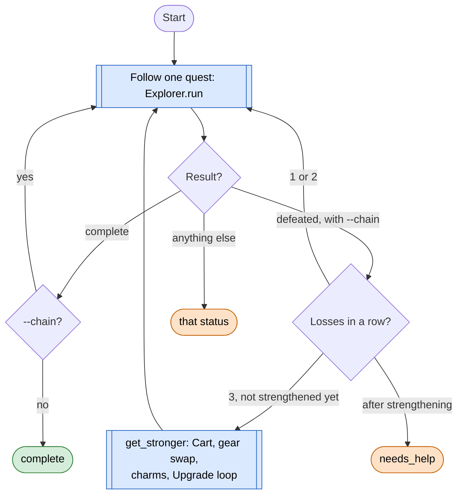

# Explore loop (quest follower)

Code: `sxs/loops/explore.py` (`Explorer`, `explore`). Command: `python -m sxs explore [--chain] [--minutes N] [--choose REGEX]`.
Notes: `docs/step3-explore.md`.

**Goal:** follow the tracked quest line: walk to its gold marker, fight, open cards by the rules, hand tower screens
to the tower loop, claim finished quests; with `--chain`, carry on with the next quest.
**End condition:** the quest completes (without `--chain`), or a stop reason below.
**Ok statuses:** `complete`, `timeout`, `tower_done_today` (the quest needs a tower climb and today's is used; R-079). Everything else needs a look.

## Outer loop: one quest after another

R-061: retry a lost fight at most twice, then get stronger or stop and ask.

## One quest: what happens on each screen

`Explorer.step()` reads the screen and runs one handler (`_on_<screen>`); boxes are grouped by the handler that owns
them. The groups are handlers inside the one Explore loop, not separate loops. It hands over to other loops in two
places: `tower.climb` on tower screens, and `get_stronger` after repeated losses (outer loop). Every handler goes back to reading the
screen until one returns a stop reason. Layout by mae (2026-11-10). Step 4, the guard check, is in PR #46.

```mermaid
flowchart TD
    subgraph SUCCESS_EXITS ["Successful exits"]
        OKC(["complete"])
        TDE(["tower_done_today"])
    end

    subgraph FAILURE_EXITS ["Failures / stopped runs"]
        LOW(["low_hp"])
        SP(["stuck_progress"])
        NM(["no_marker"])
        TWS(["tower status"])
        DEF(["defeated"])
        UC(["unknown_card"])
        RC(["repeating_card"])
        SS(["stuck_self"])
        NT(["no_tracker"])
        SH(["stuck_home"])
        US(["unknown_screen"])
    end

    subgraph USER_INPUT ["User input required"]
        ND(["needs_decision"])
    end

    D["Read the screen<br/>(interrupts run first: runner.md)"] --> W{"Screen?"}

    subgraph WORLD ["World map"]
        subgraph HEALTH ["Step 1 · Health checks"]
            HP{"Step 1 · HUD HP under 70%?"}
            HP -->|"yes, 3 heals already"| LOW
            HP -->|yes| HEAL["Open the portrait to Quick Heal"]
            HP -->|"no, after a fight"| PROF["Open the profile once: heal under 80%, fill charms"]
        end

        subgraph PROGRESS ["Steps 2-3 · Quest progress and recovery"]
            DONE{"Step 2 · Tracker shows 100/100 or a gift?"}
            DONE -->|yes| CLAIM["Tap the gift"] --> OKC
            DONE -->|no| STALE{"Step 3 · Tracker unchanged for how long?"}
            STALE -->|"5 min"| SP
            STALE -->|"each ~1 min"| UN["Unstick round: 1st walk to the quest's area by area map<br/>(or go home to travel); then NPC with !, guard, look around"]
        end

        subgraph MARKERS ["Steps 4-5 · Guard, then marker search"]
            GM{"Step 4 · Red-skull guard on screen?<br/>(under 6 guard taps this run)"}
            GM -->|yes| GF["Tap the monster under it (fight via battle prep)"]
            GM -->|no| MK{"Step 5 · Find the marker"}
            MK -->|"edge pointer"| EP["Tap it to pan; tap an NPC with ! if one shows"]
            MK -->|"gold ring on screen"| RING["Tap under the ring (ring itself at an edge)"]
            MK -->|"ring under the HUD"| DRAG["Drag the map toward the centre"]
            MK -->|nothing| MISS{"Misses?"}
            MISS -->|10| NM
            MISS -->|odd| PAN["Pan one step"]
            MISS -->|even| TOG["Toggle tracking to re-centre"]
        end

        HP -->|no| DONE
        STALE -->|"under 1 min"| GM
        HEAL & PROF & UN & GF & EP & RING & DRAG & PAN & TOG --> WORLD_RETURN(("Merge"))
    end

    subgraph COMBAT ["Tower and battle prep"]
        subgraph TOWER ["Tower states"]
            TD{"Tower already climbed today?"}
            TD -->|yes| TDH["go_home"] --> TDE
            TD -->|no| TW[["tower.climb"]] --> TWR{"Tower ok?"}
            TWR -->|yes| HOME1["Mark today climbed, go_home, carry on"]
            TWR -->|no| TWS
        end

        subgraph PREP ["Battle preparation"]
            BP{"Prep HP bar under 70%?"}
            BP -->|"yes, under 2 back-outs"| BPH["Quick Heal from the portrait"]
            BP -->|no| SB["Start Battle"]
            BP -->|"yes, 2 heals tried"| SB
        end

        HOME1 & BPH & SB --> COMBAT_RETURN(("Merge"))
    end

    subgraph INTERACTION ["Pass-through and dialogue"]
        PT["Pass through: wait, next, close<br/>(dialogue saved to logs/dialogue.log)"]
        DC{"Option matches --choose?"}
        DC -->|yes| PICK["Tap it"]
        DC -->|"no, and it's Ascend to / Change Class"| ND
        DC -->|no| LOWEST["Tap the lowest option"]
        PT & PICK & LOWEST --> INTERACTION_RETURN(("Merge"))
    end

    subgraph CARDS ["Cards and unknown screens"]
        CARD["Card rules: resource/policy/cards.json"] --> CK{"Card kind?"}
        CK -->|"wounded or defeated"| DEF
        CK -->|"unknown, 3rd time"| UC
        CK -->|"same card 4 times"| RC
        CK -->|"otherwise"| CARD_RETURN(("Merge"))
        UK{"Unknown in a row?"}
        UK -->|"5 in a row or 20 in all"| US
        UK -->|"2 to 4"| UD["Try the card rules; a loss card ends defeated"]
        UK -->|1| WAIT["Wait"]
        UD & WAIT --> CARD_RETURN
    end

    subgraph PROFILE ["Profile"]
        PP{"Opened on purpose?"}
        PP -->|"no, 6th time"| SS
        PP -->|"otherwise"| PPA["Heal under 80%, else fill charms once, else close"]
    end

    subgraph HOME ["Home and travel"]
        TR{"Tracker on home?"}
        TR -->|no| NT
        TR -->|"yes, 9th tap in a row"| SH
        TR -->|yes| TT["Tap the tracker (claims, or travels)"]
    end

    W -->|world_map| HP
    W -->|"tower_list, tower_floors, tower_result"| TD
    W -->|battle_prep| BP
    W -->|"battle, loading, dialogue, reward_popup, tap_to_continue"| PT
    W -->|dialogue_choice| DC
    W -->|"defeated, interact, dungeon_floor,<br/>confirm_dialog, quest_detail"| CARD
    W -->|unknown| UK
    W -->|player_profile| PP
    W -->|home| TR

    WORLD_RETURN & COMBAT_RETURN & INTERACTION_RETURN & CARD_RETURN & PPA & TT --> MERGE["Shared return: detect the next screen state"]
    MERGE --> D

    classDef ok fill:#d4edda,stroke:#2e7d32,color:#000
    classDef look fill:#fde2c8,stroke:#c25e00,color:#000
    classDef sub fill:#dbe9ff,stroke:#1f5fbf,color:#000
    classDef inputRequired fill:#fefce8,stroke:#facc15,color:#000
    class OKC,TDE ok
    class LOW,SP,NM,TWS,DEF,UC,RC,SS,NT,SH,US look
    class ND inputRequired
    class TW sub
```

**Entering a new zone (R-150, mae 2026-11-10; being built).** When the quest leads into a zone the character hasn't
explored (the first unstick round's walk to the quest's area, or the marker leading across a zone line), the first
move is not a fog search: find the entrance between the old and new zone on the big map, centre the camera there,
then walk to ground next to the fog working outward from the entrance (never the fog itself, R-146). The quest
marker takes over again once it shows. Clear Zone ([clear.md](clear.md)) follows the same ring as its first objective source.

### Where the code doesn't match this page yet (2026-11-10)

Checked against `sxs/loops/explore.py` on `main` and on PR #46. Details and recommendations: open-questions.md Q16, Q18, Q19.

| Box | Code today | Change that would make it fit |
|---|---|---|
| New-zone entry (R-150) | Not built: no entrance step | Roam's approach walks to the zone's way in (R-150); Clear Zone takes objectives from there |
| Step 4 guard | Not on `main`; PR #46 adds it (`guard_marker`, then `attack_guard`, at most 6 taps a run) | Merge #46 |
| Battle prep, "yes, 2 heals tried" | `_on_battle_prep` taps Start Battle anyway, under 70% HP | Call the shared `start_fight` (`sxs/actions/common.py`); when it returns False end `low_hp` (Q16) |
| Step 5 find the marker | Its own ring follower (`Explore.Marker`, offsets 100/60/140/30 px) beside Clear Zone's live-proven `mapnav.quest_step` (`find_quest_ring`, 80 px, sees edge rings at y≈50) | One shared quest-ring action for both loops (R-142) (Q18) |
| Read the screen | Interrupts (tutorial, Choose Your Reward, rating, chat) run inside `detect()`; Explore registers no `resume_with` | None needed; the marker leads back. Shown as a note on the box |

## Card rules it uses (`resource/policy/cards.json`, goal `explore`)

| Card | Choice |
|---|---|
| Friend, team-up, party requests | Accept / Join / Agree (R-057), else dismiss |
| Incapacitated (defeated) | OK, goes home; the quest run ends `defeated` |
| Return to Home to challenge... | OK (travel only) |
| Gate of Power | Open when it shows Open, else dismiss (a wall) |
| Badly wounded | Quick Heal, else Return to Home; the run ends `defeated` |
| Quest Details | Go / Track |
| Travel to ... now? | OK |
| Portal, Voyage Obelisk | Activate |
| Blessed statue | dismiss; Goddess Statue: Unlock |
| Mini-dungeon (Ruins, Cave, Tower, Pit, Mine, ...) | Explore / Enter / Challenge when HP is fine, else dismiss |
| Dungeon floor | Next Floor |
| Anything else | dismiss and log as unknown |

Any button in the `never` list (Buy, Purchase, Pray, Dawnium, Change Class, hammer, ...) is never tapped (R-043).
