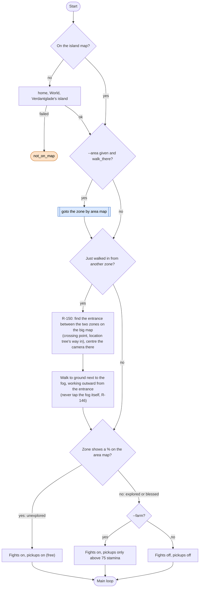
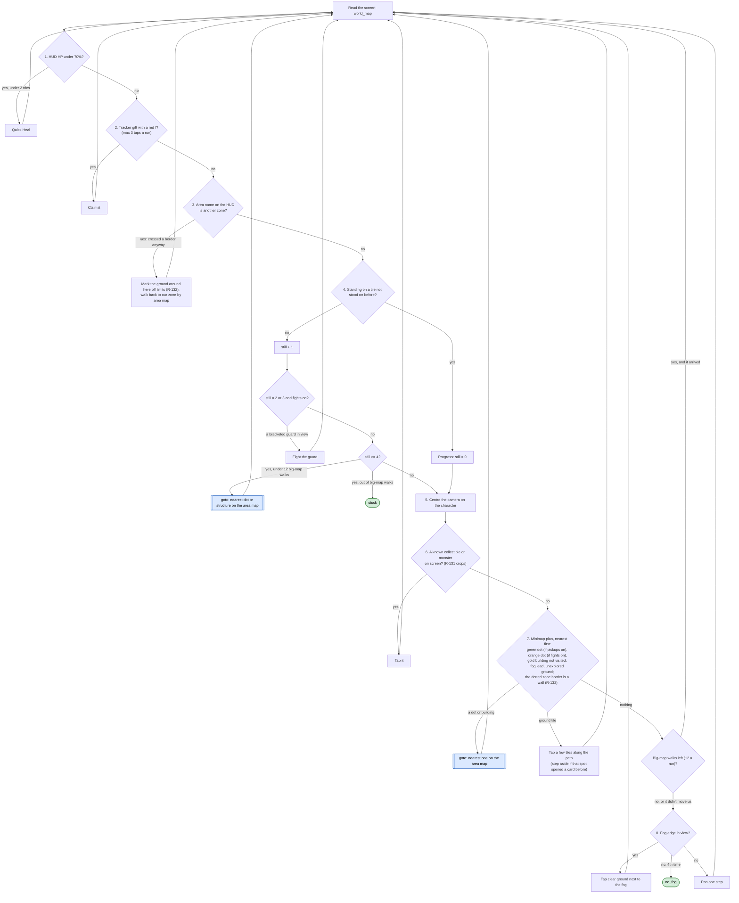

# Fog Walk loop (one zone to 100%)

Code: `sxs/loops/fogwalk.py` (`walk`). Command: `python -m sxs fogwalk [--area NAME] [--farm] [--minutes N]`.
Called by [roam.md](roam.md). Rules: R-065, R-066, R-130, R-131, R-132, R-068, R-061, R-146, R-150.

**Goal:** bring one zone to 100% exploration: collect green dots, fight orange dots, open yellow structures, reveal
fog (R-065). In an unexplored zone fights and pickups are free; in an explored (blessed) zone they cost stamina and
are skipped unless `--farm` (which keeps 70 stamina, R-107).
**End condition:** no fog in view after 4 pans, 4 walk taps without a new tile (after up to 12 big-map walks), a
power gate, a lost fight, an unfamiliar screen, or the time.
**Ok statuses:** `no_fog`, `stuck`, `power_gate`, `timeout`. Needs a look: `defeated`, `unknown_screen`,
`repeating_card`, `left_area:home`, `not_on_map`.

## Before the walk

The new-zone entry step (R-150, mae 2026-11-10) is being built: today the walk goes straight to the main loop and
looks for fog first.

## Main loop: on the island map (`world_map`), checked in this order

## Other screens during the walk

| Screen | Action | Ends with |
|---|---|---|
| battle_prep, fights off | back arrow (monsters respawn in explored zones, R-065) | |
| battle_prep, fights on | heal from the portrait if the prep HP bar is under 70% (2 tries), else Start Battle; save a crop of the monster tapped (R-131) | |
| battle, loading, dialogue, reward_popup, tap_to_continue | pass through | |
| defeated | card rules: OK | `defeated` |
| player_profile | close it | |
| tower_list, tower_floors, tower_result | if today's climb already ran: leave it; else [tower.md](tower.md) climb and mark the day; then go home and walk back to the zone (R-079) | |
| area_map | close it (left open by a big-map walk) | |
| home | | `left_area:home` |
| any card (interact, dungeon_floor, confirm_dialog, quest_detail, ...) | card rules (see [explore.md](explore.md#card-rules-it-uses-resourcepolicycardsjson-goal-explore)); a dismissed card's spot is walked around; a structure's card is saved as a crop | `power_gate` on a Gate of Power without Open; `repeating_card` after the same card 4 times |
| unknown, 5 in a row | frame saved | `unknown_screen` |

After any interrupt (tutorial, reward choice) that leaves the game on home, the loop walks back to its zone before
carrying on (`resume_with`).
