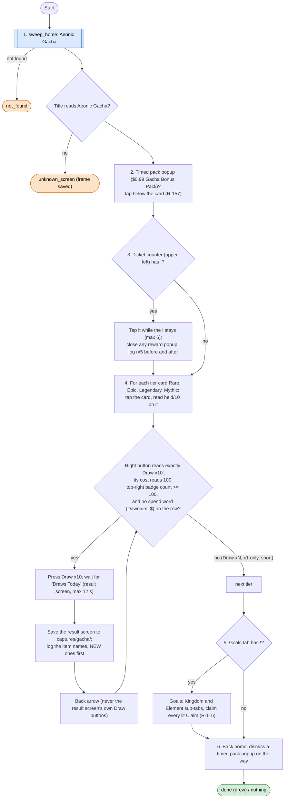
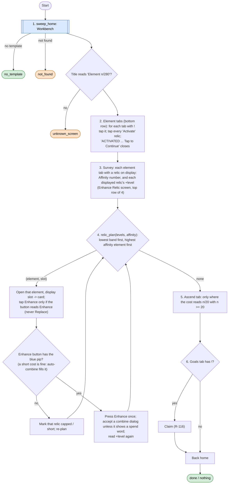

# Aeonic Gacha and Workbench relics

Code: `sxs/loops/gacha.py` (`Gacha`), `sxs/loops/relics.py` (`RelicBench`), shared home finder
`sxs/actions/home.py`. Commands: `python -m sxs gacha [--check]`, `python -m sxs relics [--check]`. Both run inside
`python -m sxs strengthen` right after the rank step ([upgrade.md](upgrade.md), Get stronger).
Rules: R-157, R-166, R-167 (gacha), R-172, R-105 (relics), R-116 (Goals), R-043 (spend words).
Screens: `docs/screens/home/aeonic_gacha*.png`, `timed_pack_gacha_bonus.png`, `workbench_*.png`.

Why: the strengthening pass of 2026-11-11 did both by hand (two Rare x10 draws, four relics activated and enhanced
to +2/+3, power 35.9K → 36.4K). mae, 05:22: "pull gacha whenever a full 10x pull is affordable on any tier; build a
pull function".

## Finding them on Home (`actions/home.py`)

Home pans sideways and keeps its camera (R-126), so both are searched for with the same slow-drag sweep the Cart
uses (now shared: `sweep_home(dev, det, find)`), and every pan goes through `Device.pan`, which falls back to
`adb shell input swipe` when MaaFramework's swipe stops moving the scene ([runner.md](runner.md), Swipe fallback).

| Object | Found by | Opened when |
|---|---|---|
| Aeonic Gacha (stone between the Goddess Statue and the Vendor Booth) | template `home/aeonic_gacha.png` once captured; until then the Vendor Booth template plus an offset (-155, +60) px, measured on `home_stone_open.png` | the title line reads "Aeonic Gacha" |
| Workbench (house, upper floor, where the "Open" crate was) | template `home/workbench.png` once captured; no fallback | the title reads "&lt;Element&gt; n/280" (Relic screen) |

Neither template exists yet: the only reference images show the locked crate and stone. The live test plan's first
step captures both. Without a template the Workbench step ends `no_template` (explicit, not a guess).

## Gacha (`python -m sxs gacha`)

**Goal:** every full x10 draw the account can pay for with Auroral Badges or tickets, on any tier; claim the free
ticket counter and the gacha Goals. **Never** Dawnium, Draw x1, or "Draw xN" with N under 10 (R-167, policy.md).
**End:** no tier can pay a full x10 (`done` or `nothing`), the draw cap for one run (10 x10 draws) is hit, or an
unexpected screen (`unknown_screen`). `--check` reads the four tiers and the counter without tapping anything else.
**Ok statuses:** `done`, `nothing`, `check`.

Screen points (720 x 1280, from `aeonic_gacha_tiers.png`): tier cards (160, 930), (293, 930), (427, 930),
(560, 930) with "held/10" at y ≈ 1000; Draw x1 (210, 1102), Draw x10 (510, 1102), cost text (570, 1102); top-right
badge count (515, 53); ticket counter (95, 185) with "n/5" at (95, 270) and its "!" at (122, 155); bottom tabs
Kingdom (245, 1218), Element (428, 1218), Goals (608, 1218), back (72, 1218). Goals sub-tabs (260, 1120),
(460, 1120). Result screen: "Draws Today" top left, back (72, 1218).

Why four checks before a draw: with fewer than 100 badges the same button turns into "Draw x3 / 30" (seen with 35
Rare badges), and pressing it is a short draw mae ruled out. The text, the cost and the held count must all agree.

Readouts: `[Running Gacha Loop]`, then one line per tier (`Rare 235/10: Draw x10 (100), drawing`), one line per
draw with the result names, and `[Result Gacha] done: 2 draws (Rare 2), counter 4 taps, goals 2`.

## Workbench relics (`python -m sxs relics`)

**Goal:** activate every new relic, then enhance displayed relics with Chrono Sand and Rolla in bands of one level
(R-105), auto-combining a short material when the game offers it, and Ascend a relic only with 20 of its own
shards. **Never** Replace (R-172), never the "universal materials" option, never a "+" slot. **End:** nothing lit, materials short, the press cap (30), or an unexpected
screen. **Ok statuses:** `done`, `nothing`, `check`, `no_template` (until the Workbench template is captured).

Screen points (from `workbench_relic_activate.png`, `workbench_relic_card.png`, `workbench_enhance_relic.png`):
element tabs at y = 1120, x = 80, 175, 268, 360, 452, 545, 637, their "!" about (+35, -23); display slots (110, 335),
(277, 335), (443, 335), (610, 335); relic card Replace (233, 1041) and Enhance (486, 1041); Enhance Relic: top-row
slots (165, 165), (295, 165), (423, 165), (552, 165), "+1 → +2" at y ≈ 548, costs "have/need" at y ≈ 1013,
Enhance (360, 1084) with its pip at (502, 1062); bottom tabs Enhance (290, 1218) / Ascend (563, 1218); Relic screen
tabs Relic (290, 1218) / Goals (563, 1218).

**Auto-combine:** always allowed, in any menu that has it (mae, 2026-11-11 18:15: "a great feature that many systems
will use"). The Enhance Relic screen keeps "Auto-combine on material shortage" ticked and the bot presses Enhance
while the button's blue pip shows, even when a cost reads short. A combine confirmation, if one appears (not seen
yet; its frame is saved), is accepted with its OK unless it shows a spend word (Dawnium, a price).

## What is not known yet (the live test answers these)

- What the unlocked gacha machine and the Workbench look like on Home (templates), and whether tapping the
  Workbench opens the Relic screen straight away or a furniture card first.
- What a ticket-counter tap shows (a reward popup or nothing). The code closes a reward popup if one appears.
- Whether the Mythic card ever shows "held/10" for a tier that is locked (the code reads the button anyway).
- Whether the Enhance Relic top row is one element's display slots or every displayed relic (the "<" ">" arrows
  cycle across elements). The survey reads the row per element tab, so either way each relic is read once.
