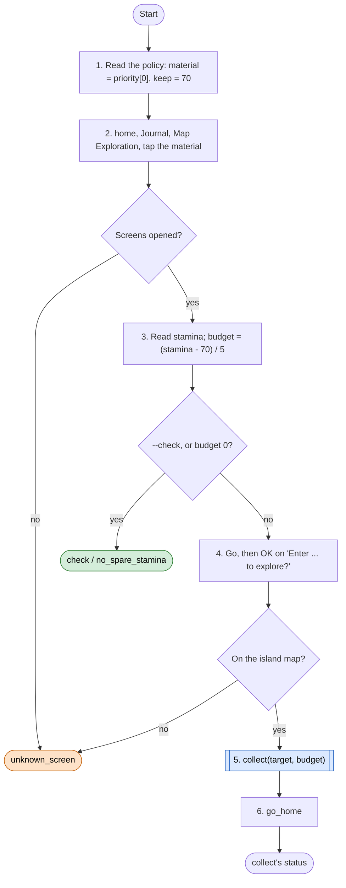
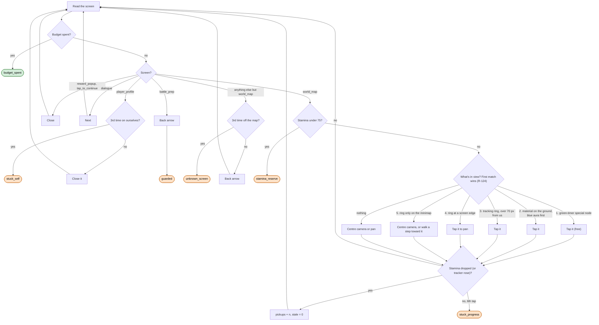

# Gather loop

Code: `sxs/loops/gather.py` (`Gatherer.run`, `Gatherer.collect`). Command: `python -m sxs gather [--material M] [--check] [--harvest [bellflower]]`.
Policy: `resource/policy/gather.json` (`priority`, `keep_stamina`). Rules: R-106 to R-109, R-122 to R-124.

**Goal:** spend stamina above the 70 reserve on the priority material (ore today), 5 stamina a pickup; special
green-timer nodes always, blue-aura pickups first.
**End condition:** the pickup budget is spent, stamina at the reserve, 6 taps without a pickup, an unknown screen,
or 2 minutes.
**Ok statuses:** `budget_spent`, `no_spare_stamina`, `check`, `timeout`, `full`. Needs a look: `stamina_reserve`
(only when it hits the reserve before the budget), `stuck_progress`, `stuck_self`, `guarded`, `unknown_screen`,
`no_tracker`.

## Getting there (stamina materials)

`--harvest bellflower` skips steps 1 to 4: it starts on the map with the item tracker showing (route R-123) and
collects until the tracker reads full (`full`), or `no_tracker` when there is none.

## The collector: one pass per screen read

Never tapped: the ring or icon floating over our own character (R-123), other players, anything inside the
minimap.
