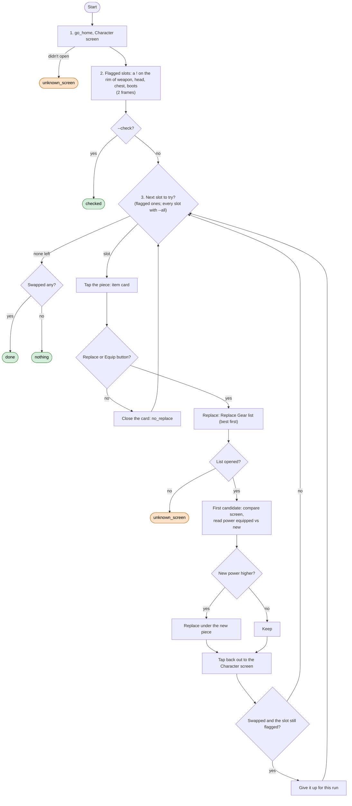

# Gear Swap loop

Code: `sxs/loops/gearswap.py` (`GearSwap`). Command: `python -m sxs gearswap [--check] [--all]`; daily step
`gear_swap`. Rules: R-088, R-080.

**Goal:** wherever a gear slot on the Character screen shows "!", put on the better piece. The badge says where to
look; the power compare decides.
**End condition:** every flagged slot tried once, or an unknown screen.
**Ok statuses:** `done`, `nothing`, `checked`. Needs a look: `unknown_screen`.

Never touched here: Rcmd Loadouts, Change Class, charms, techniques, enhancing (that's the Upgrade loop). The
enhancement level carries over to the new piece (R-088). No offhand slot yet.
