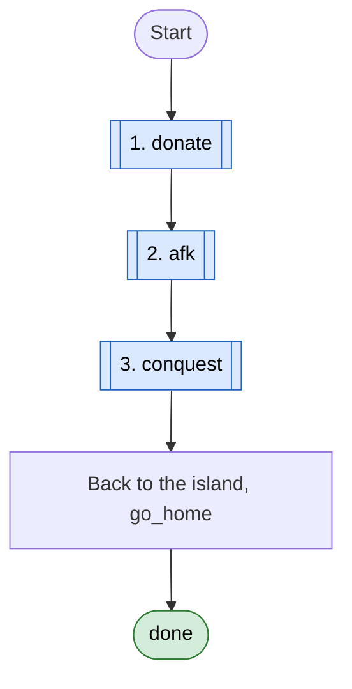
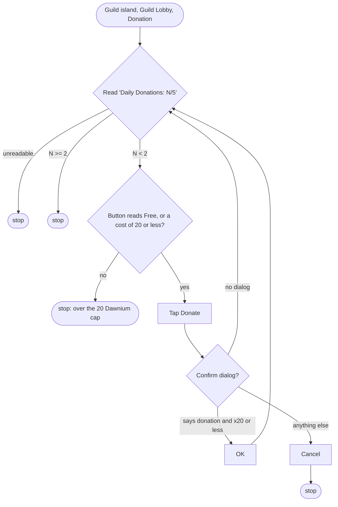
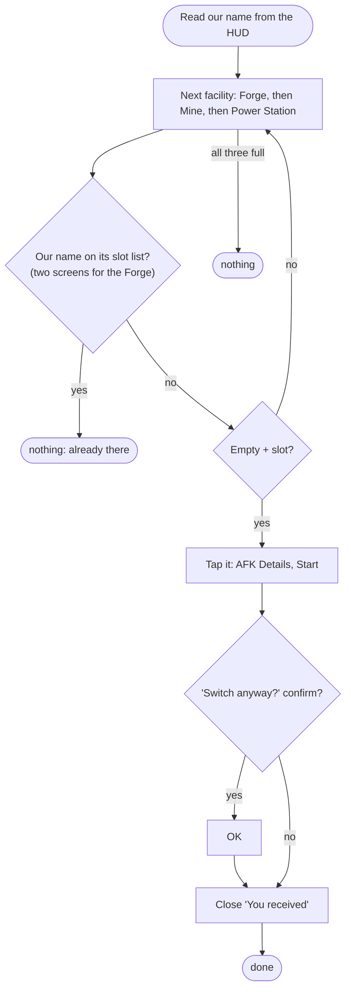
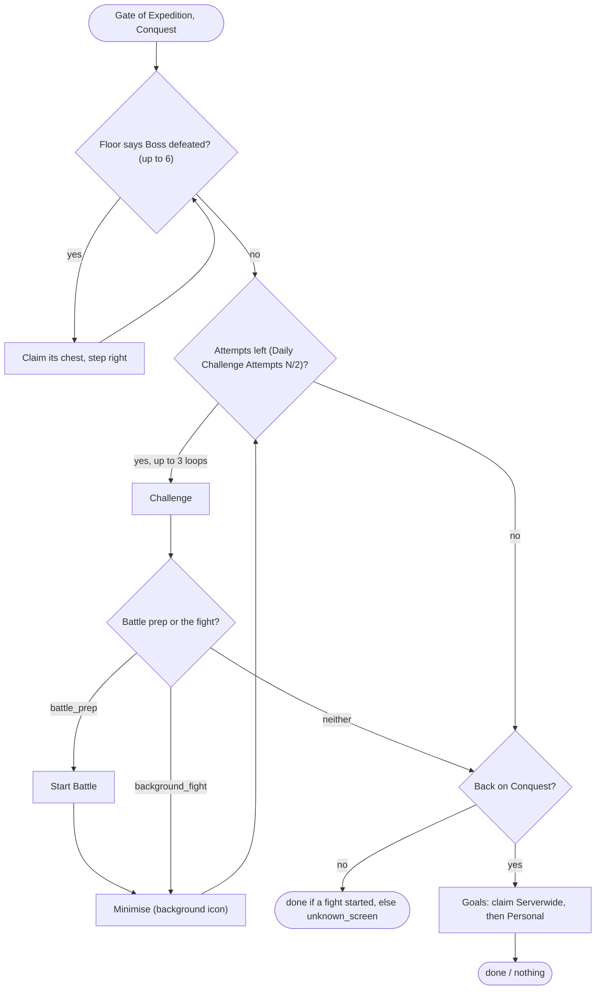

# Guild loop

Code: `sxs/loops/guild.py` (`Guild`). Command: `python -m sxs guild [--only donate,afk,conquest]`; daily steps
`guild_donate` ★, `guild_afk`, `guild_conquest` ★ (★ once a day). Rules: R-102, R-103, R-110, R-111, R-112, R-113, R-114.

**Goal:** the guild dailies: two donations, the character parked at the Forge, both Conquest attempts used in the
background, goals claimed.
**End condition:** each step tried once, then home.
**Ok statuses:** each step reports `done`, `nothing` or `unknown_screen`; the loop itself always ends `done`.

## donate (R-103)

## afk (R-110)

## conquest (R-111, R-112)

Never: Create, Upgrade, Construction, Guildmates actions, chat, the guild Shop (R-114).
