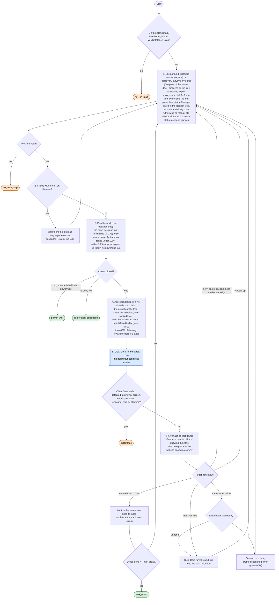

# Roam loop (non-quest exploration)

Code: `sxs/loops/roam.py` (`Roamer`). Command: `python -m sxs roam [--area NAME] [--minutes N] [--max-areas N] [--walk-minutes N]`.
Rules: R-135 (order), R-065 (exploration goal), R-070 (statues), R-127 (1.25x power), R-132 (zone borders).

**Goal:** bring every zone in reach to 100% and bless its statue, lowest recommended power first; then walk any
then exploration is concluded for now.
**End condition:** no zone left in reach, a power wall, a lost fight, an unfamiliar screen, `--max-areas` zones
done, or the time.
**Ok statuses:** `exploration_concluded`, `all_explored`, `power_wall`, `area_done`, `max_areas`, `timeout`.
Needs a look: `not_on_map`, `no_area_map`, `no_progress`, `defeated`, `unknown_screen`, `left_area:home`.

## The loop

With `--area NAME` step 3 is skipped: the named zone is the target; when it shows no % the loop blesses its
statue and ends `area_done`; a pass without progress ends `no_progress`.

## State kept between runs

`logs/roam.json`: statues already opened, zones given up today (with the power at the time), and which neighbours
failed as a way into each zone today. The location tree (`resource/world/zones.json`, `sxs/policy/zones.py`,
`python -m sxs zones`): every zone with kingdom, power, %, blessed, neighbours, and which neighbour a walk got in
from (or failed from). Built in PR #43, not run live yet.

## Screens

Roam itself only sees the island map, the area map and statue cards; everything else happens inside Clear Zone
([clear.md](clear.md)) and `goto` (`sxs/actions/goto.py`).

| Screen | Action |
|---|---|
| home, menus | go_home, then World, then Verdantglade's island |
| world_overview | tap Verdantglade's island |
| world_map | survey, walk, or hand to Clear Zone |
| area_map | read labels, % and power lines, statue badges; close with the back arrow |
| statue card | card rules (`goal explore`): Goddess Statue Unlock, blessed statue dismiss |
