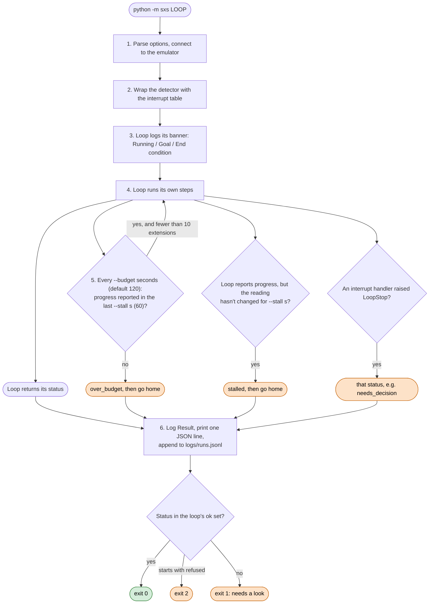
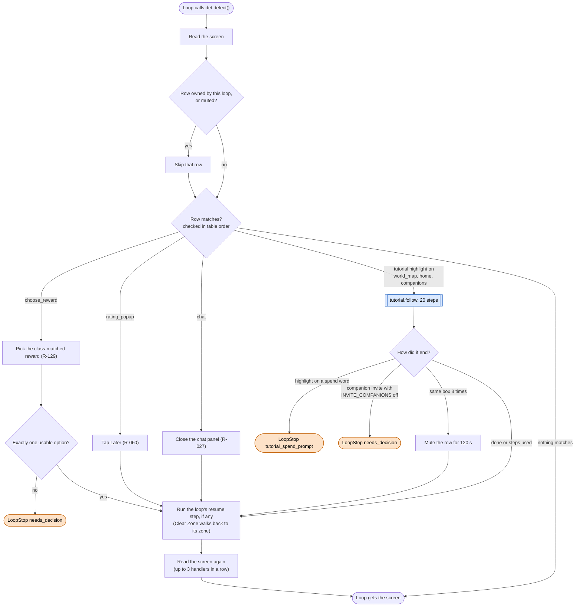

# Runner and interrupt layer

Code: `sxs/core/loop.py` (runner, budgets), `sxs/core/interrupts.py` (mechanism), `sxs/actions/interrupts.py`
(the table), `sxs/core/nav.py` (`go_home`). Design notes: `docs/interrupts.md`.

**Goal:** run any loop the same way: one banner at the start, a stuck check instead of a hard time limit, the same
handling for screens that can show up anywhere, and one readout line at the end.

## A run, start to finish

- Inside a loop, `with task(name, seconds)` gives one step its own budget and stall check: the step is cut and the
  loop goes on with the next one. Daily (120 s per step) and Upgrade (90 s per pass) work this way.
- A loop that never calls `progress(...)` ends at its first budget. Loops that report progress: explore and clear
  (Heartbeat), gather (pickups), roam (statues), cart, upgrade, tower floors, mall pages, gear swaps.

## Interrupts: checked after every screen read

Every `det.detect()` a loop makes goes through this table first, top row first. If a row matches, the loop waits
where it is, the handler runs under its own budget, the loop's resume step runs (if it registered one), and the loop
gets the screen after it.

- A row that fires more than 5 times in 90 s is muted for 120 s, so a false match can't trap a loop.
- On purpose not in the table: fights, loading, dialogue, reward popups (every loop passes through them with
  `actions/common.pass_through`), defeat, battle prep and cards (the loop's goal decides), and `unknown` (each loop
  counts unknown screens itself and stops; mae's rule).

## Getting home: `nav.go_home()`

Every menu loop starts and ends with it, and the runner calls it after `over_budget` or `stalled`. One tap per
screen, from the table `TOWARD_HOME` in `sxs/core/nav.py`:

| Screen | Tap |
|---|---|
| title | Tap to play |
| loading, battle | wait |
| dialogue | next |
| reward_popup, tap_to_continue | close |
| confirm_dialog | Cancel |
| defeated | OK (goes home) |
| chat | close chevron |
| background_fight | minimise |
| rating_popup | Later |
| guild_donation | above the popup |
| cart | below the panel |
| world_overview, character, journal, guild, guild_no_guild | Home button |
| every other menu it knows (area_map, battle_prep, world_map, main_menu, quests, tower screens, enhance_gear, featured, daily_signin, growth_trial, material_realms, notice, guild screens, mall, prayer screens) | back arrow |
| game not running | start the game |
| agreement | stop: a human has to accept it |
| anything else (unknown, and the known screens listed in [states.md](states.md) as "no way home") | wait; every 3rd try tap below the popup, every 6th the back arrow; 40 tries, then give up |
