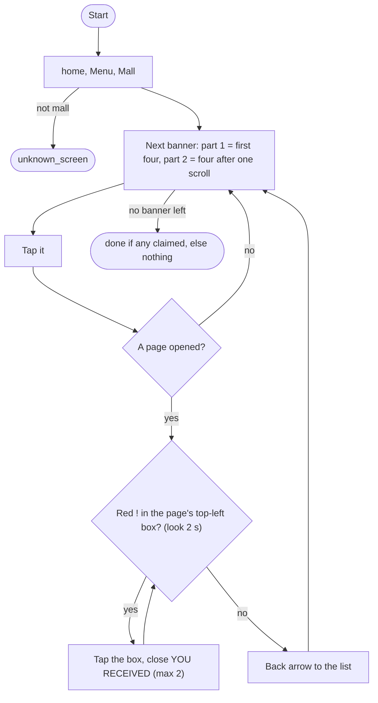
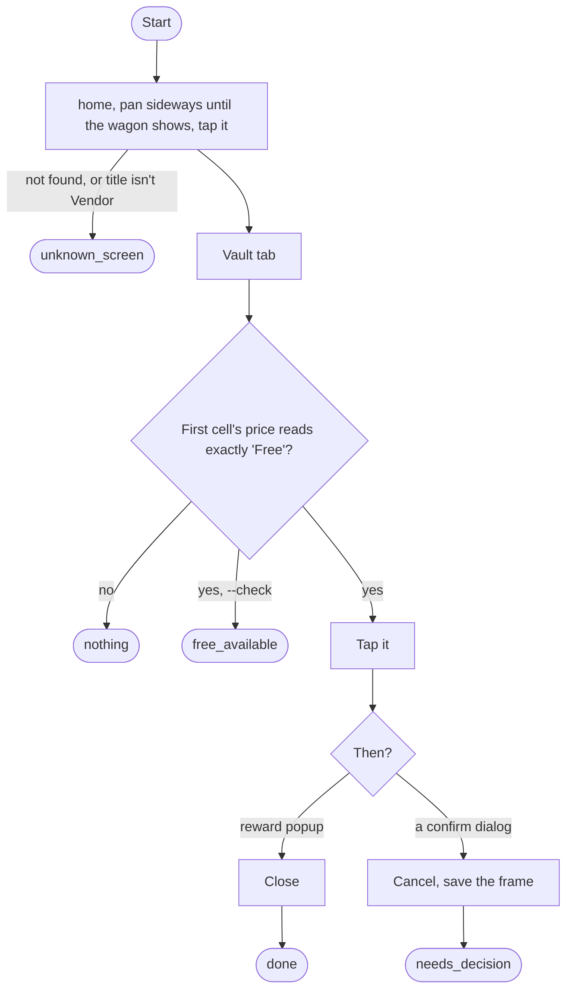
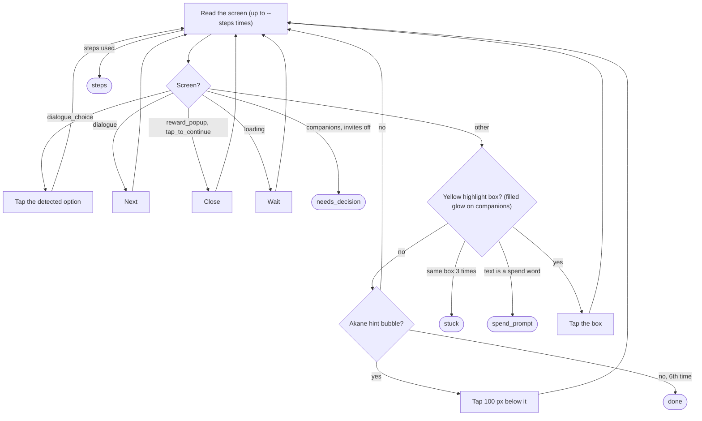
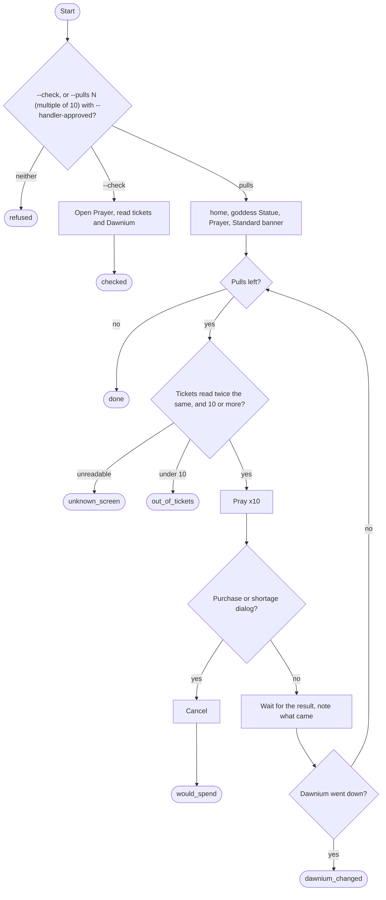

# Small loops: Mall, Vendor Booth, Tutorial, Progress, Pray

## Mall gifts

Code: `sxs/loops/mall.py`. Command: `python -m sxs mall [--part 1|2]`; daily steps `mall_gifts` ★ and `mall_gifts_2` ★.
Rule: R-121. **Goal:** the free gift box on each Mall page; never a price. **Ok:** `done`, `nothing`.

## Vendor Booth

Code: `sxs/loops/vendor.py`. Command: `python -m sxs vendor [--check]`; daily step `vendor_stamina` ★. Rule: R-120.
**Goal:** the Vault's free x30 Stamina; nothing else. **Ok:** `done`, `nothing`, `free_available`.

## Tutorial follower

Code: `sxs/loops/tutorial.py` (`follow`). Command: `python -m sxs tutorial [--steps N]`. Also run by the
interrupt table ([runner.md](runner.md)) on world_map, home and companions. Rules: R-036, R-057.
**Goal:** tap what the game's tutorial highlights, through its dialogue. **Ok:** `done`, `steps`.

## Progress (read only)

Code: `sxs/loops/progress.py`. Commands: `python -m sxs progress [--only hud,profile,...] [--guild-shop]`,
`python -m sxs report [--day D]`; daily step `progress`. Notes: `docs/progress-tracker.md`.
**Goal:** read the account's numbers, keep one snapshot per server day, write the day's report. Taps nothing that
acts. Sections run in order, each with its own budget: `hud` (home top bar), `profile` (portrait), `journal`
(tower floor), `guild` (lobby), `areas` (area map %). The daily step reads only hud, profile and journal.

## Pray (mae only)

Code: `sxs/loops/pray.py`. Command: `python -m sxs pray --check` or `python -m sxs pray --pulls N --handler-approved`.
Rule: R-093. **Nothing calls this loop**; it runs only when mae starts it for that run.

After pulling it claims the Prayer Goals tab (Iron Hammers). No Prayer screen: `no_statue`.
