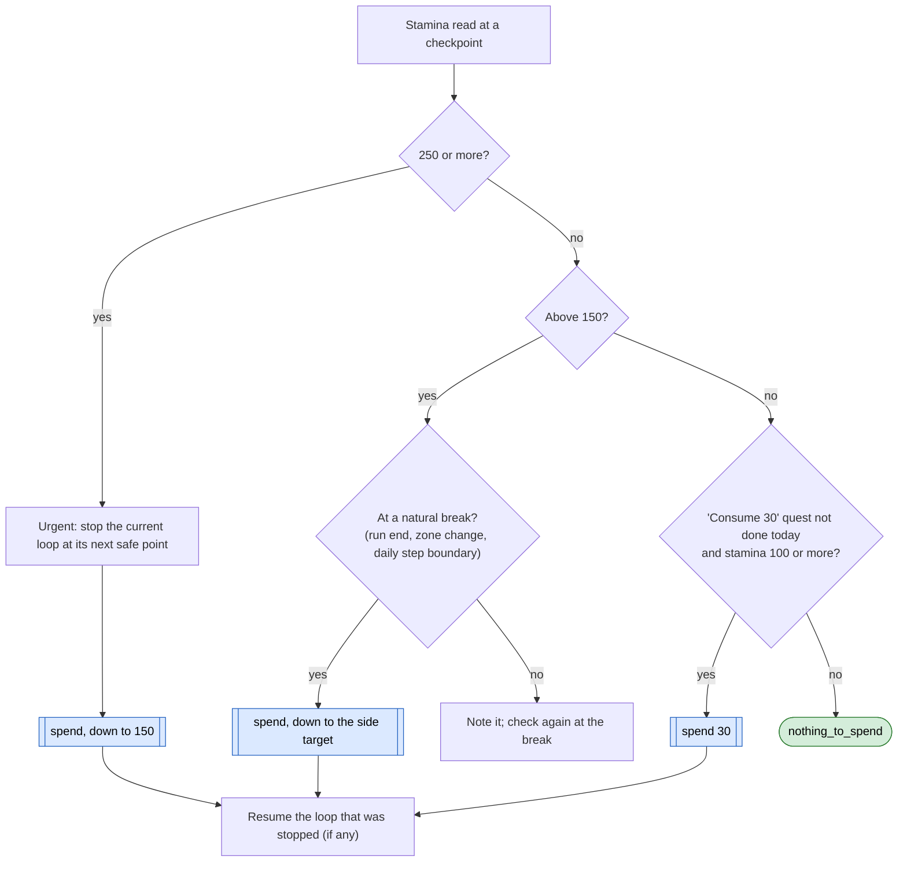
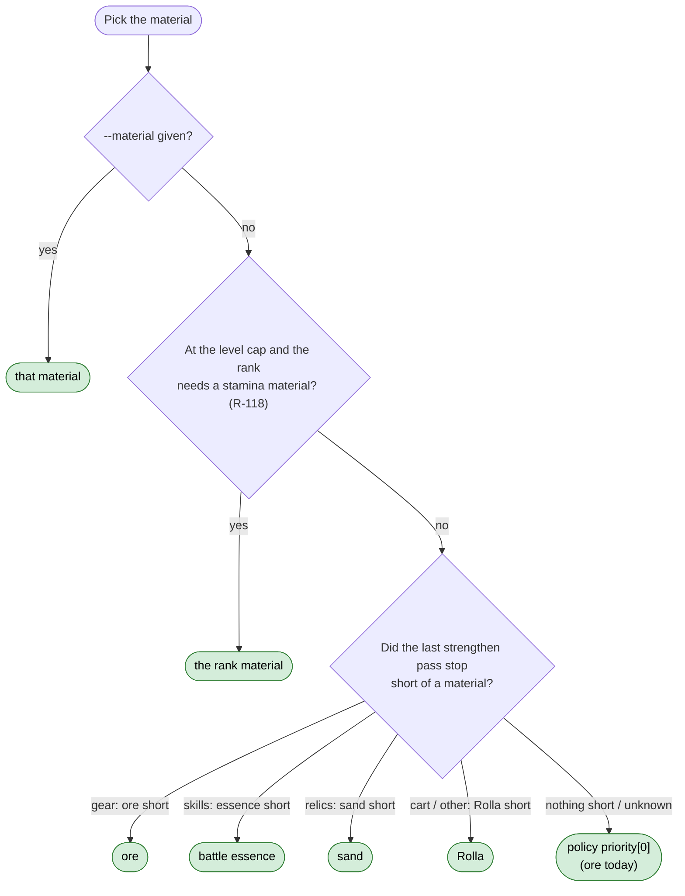
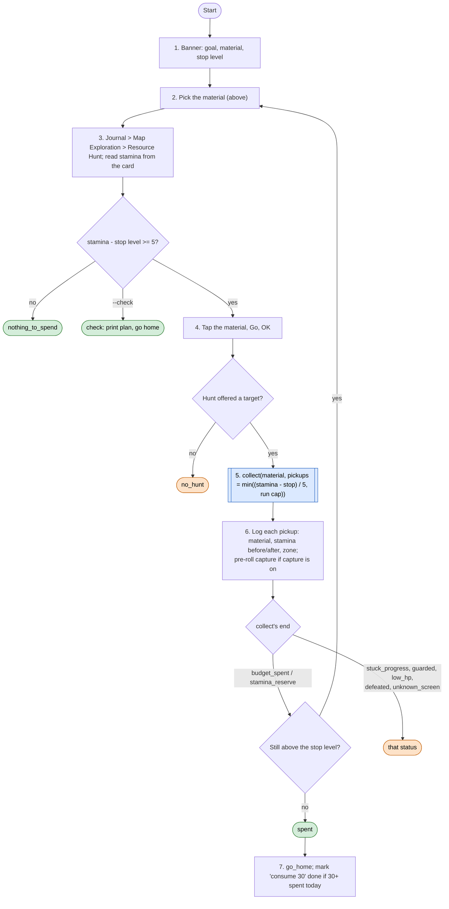

# Stamina Spend loop (design draft, not built)

Status: **draft for mae to edit** (2026-11-11). Nothing here is coded yet. Once mae has edited it, the build
follows this page and the rules thread files the rules listed at the bottom.

Proposed command: `python -m sxs spend [--material M] [--to N] [--check]`. It wraps the existing collector
(`Gatherer.collect` in `sxs/loops/gather.py`, page [gather.md](gather.md)); what is new is *when* it runs,
*what* it spends on, and *who* calls it. Today's `gather` loop becomes the field half of this loop.

**Goal:** spend stamina on purpose, so it is never wasted at the cap and turns into the material the next
upgrade is waiting for. Also finishes the daily quest "consume 30 stamina" (R-128).
**End condition:** stamina at the stop level, or the run's pickups taken, or a named stuck reason.
**Ok statuses:** `spent`, `nothing_to_spend`, `check`. Needs a look: `stuck_progress`, `guarded`, `low_hp`,
`defeated`, `unknown_screen`, `no_hunt` (Resource Hunt offered nothing for the material).

## What the repo already knows (diagnosis)

| Fact | Source |
|---|---|
| Stamina shows top right on the island map ("171/300") and on the Resource Hunt card. Read: `read_stamina` (`sxs/vision/hud.py`). | R-107, R-108 |
| Passive regen stops at 300; overflow is wasted. Items can push it to 1,200. | R-107 |
| Regen rate is written as "5 an hour" ❓. That is only 120 a day, which doesn't fit mae's "above 150 is common". Needs a check (Q6). | R-107 |
| Free +30 a day from the Vendor Booth Vault (daily step `vendor_stamina`). | R-120 |
| Four stamina materials, 5 stamina a pickup: ore (gear), sand (relics), battle essence (skills; from monster fights in blessed zones), Rolla (coin). | R-106 |
| Route to any of them: Journal > Map Exploration > Resource Hunt > material icon > Go > OK. The tracked object gets a gold ring. | R-108 |
| Green-timer special nodes (Grand Mine) are free and always taken. Blue-aura pickups first. | R-109, R-122, R-124 |
| A guard on a pickup is fought, then the pickup resumes (HP 70%, 1.25x power, max 2 retries). | R-139, R-061, R-127 |
| Keep 70 stamina "for the daily commissions". | R-107 |
| Daily quest: consume 30 stamina. | R-128 |
| **Exploration never spends stamina**: in blessed zones monsters and most objects cost 5, and exploring loops must not tap them. | R-065, R-131, `policy.md` |
| Today the only spender is daily step 15 `gather`: ore only (`resource/policy/gather.json`), down to 70, once, *after* the quest-claim step 14, so the "consume 30" quest waits for the second claim pass, which only runs if step 14 claimed something. | `docs/loops/daily.md` |

Gaps this page closes: nothing spends stamina outside the daily run, so stamina sits at 300 for hours between
daily runs while exploration runs; the material is fixed to ore whatever the upgrades need; essence and sand have
never been gathered by the bot; nothing reports stamina that went down for an unknown reason.

## When it runs: three levels

The trigger is one stamina number, read at checkpoints the bot already has (home HUD, island map HUD, the
Resource Hunt card). No new polling.

| Level | Stamina | What happens | Spends down to |
|---|---|---|---|
| **Urgent** | 250 or more, or full within the next planned task ❓ | Spend now: the current loop stops at its next safe point (below), spend runs, the loop resumes. | 150 |
| **Side objective** (mae: "above 150 is important") | 151 to 249 | Spend at the next natural break: end of a Clear Zone run, between roam zones, between daily steps. Never in the middle of a leg or a fight. | 150, or 70 when nothing else is queued ❓ |
| **Daily quest** | 100 or more and "consume 30" not done today | Spend 30 (6 pickups). | 70 floor still holds |
| **Rest** | 150 or less, quest done | Nothing. | |

The 70 floor (R-107) is never crossed. Thresholds live in `resource/policy/gather.json` (`urgent`, `side`,
`keep_stamina`) so mae can move them without code.

**Safe points** for an urgent stop: Clear Zone between legs (never mid-walk, mid-fight, or with a dialogue open);
roam between zones; daily between steps; never inside the tower, a dungeon, Conquest, or a strengthen pass.
Resuming exploration uses the zone already recorded by roam/clear and `goto`, the same as after a fight loss
today. This is a composed call inside an overarching routine, not a change of mae's chosen task (notes.md).

## What it spends on: one material per run, chosen by need

Each run picks one material, then takes up to the run's pickups of it (short runs: about 10 to 20 pickups,
2 minutes, per mae's short-run rule). If more stamina is left above the target, the next run may pick again.

The "short of a material" signal is what the Upgrade loop already finds: the gear pass leaves out pieces short
of their own material, Cart upgrades return `short`. Strengthen writes the shortest material to
`logs/daily.json` (new field `short_material`, today's date); spend reads it. Upgrade order is unchanged and
stays mae's: rank first at the level cap (R-118), then gear (weapon, offhand, head, chest, boots; R-092), skills,
relics. Spending feeds that order; it doesn't reorder it.

After a spend run that brought in a material that was short, call `strengthen` once (it is cheap when nothing is
badged), so the material is used the same session.

### Per material

| Material | How it is found | Notes |
|---|---|---|
| Ore | Resource Hunt ore icon; grey rocks with blue crystals, "lightning 5" label; collector live-tested | Raw Ore was the enhance limit on 2026-11-11 (348 left). |
| Sand | Resource Hunt sand icon | Never gathered live; crop and route unknown ❓. First run is a capture run. |
| Battle essence | Resource Hunt essence icon: the ring points at a monster in a blessed zone; tapping it costs 5 and starts a fight | Each fight follows the fight rules (HP 70%, 1.25x power, at most 2 retries). A loss wastes the 5 stamina: only monsters our power beats (Q4). Many monster types: the collector follows the ring, not a crop. |
| Rolla | Resource Hunt Rolla icon | Lowest default priority: Rolla comes from many free sources. |
| Special nodes | Green-timer circle; free | Taken whenever seen during any spend run, whatever the material. |

## Inside one run

Readouts follow the house rule: banner at start, a PII-free status line about every 2 minutes (material,
pickups so far, stamina now), `[Result]` at the end.

## Where it plugs in

- **Daily run** (`docs/loops/daily.md`): step 15 `gather` becomes `spend`, and moves to **before** step 14
  `quests`, so the "consume 30" quest is claimed in the same pass. It spends down to the side target, not just 30.
  `vendor_stamina` (step 4) stays early, so the free 30 is counted.
- **Exploration** (`clear`, `roam`, `explore`): they read stamina at their leg/zone checkpoints (the HUD read is
  already on the island map). Urgent: end with a new status `stamina_high` at a safe point; roam calls `spend`
  and resumes. Side objective: roam calls `spend` at the zone boundary. Exploring itself still never taps a
  stamina object (R-065): spending only happens inside `spend`, on the Resource Hunt route.
- **Strengthen**: unchanged order; it writes `short_material` and `spend` reads it. Optional follow-up
  strengthen after a spend that filled a shortage.
- **Progress tracker** (`sxs/loops/progress.py`): adds stamina spent today, by material, and whether the quest
  is done.

## Stamina that drops outside a spend run (mae, item 8)

Any loop that reads stamina twice and sees a drop it didn't plan (exploration should never spend) logs an
**unplanned stamina drop**: amount, loop, zone, the last tap, and the frame. When the capture recorder from the
capture thread is running, it also saves the pre-roll sequence of the cause, so mae gets the moment that cost
stamina. These go into the end-of-run `[Result]` and a list in `logs/stamina_drops.json` for mae to review.
The labeler can use the same clips as exemplars of stamina-costing objects (ore, sand, essence, Rolla), the
classes the capture plan wants kept apart from free collectibles.

## Open questions for mae

1. **Spend-down target.** Down to 150 on a side spend and to 70 only in the daily run, or always to 70? And what
   are the "daily commissions" the 70 is kept for: only the consume-30 quest, or something else? If only the
   quest, the floor could drop to 0 once the quest is done that day.
2. **Material choice.** Pick by need (whatever the last strengthen pass ran short of, rank material first at the
   cap), falling back to the policy list? Or a fixed order you set (ore now, sand later)?
3. **Interrupting exploration.** At 250+, may the bot pause a Clear Zone run at a safe point to spend, then go
   back? Or only spend between runs?
4. **Essence fights.** Only monsters at or below our power (a loss wastes 5 stamina), or the usual 1.25x rule?
5. **Stamina items.** Items can push stamina past 300. Leave them unused unless you say otherwise?
6. **Regen rate.** The rule says 5 an hour, which gives only ~150 a day with the Vault. Do you know the real rate?
   Otherwise the bot measures it (two reads an hour apart) on its next live day.

## Rules to file after mae's edit (rules thread)

- New rule (next free R-NNN): stamina levels and spend triggers (urgent, side, daily quest, floor).
- R-107 update: material by need, not a fixed priority; spend before the quest claim.
- New rule: unplanned stamina drops are logged with a pre-roll capture and reported.
