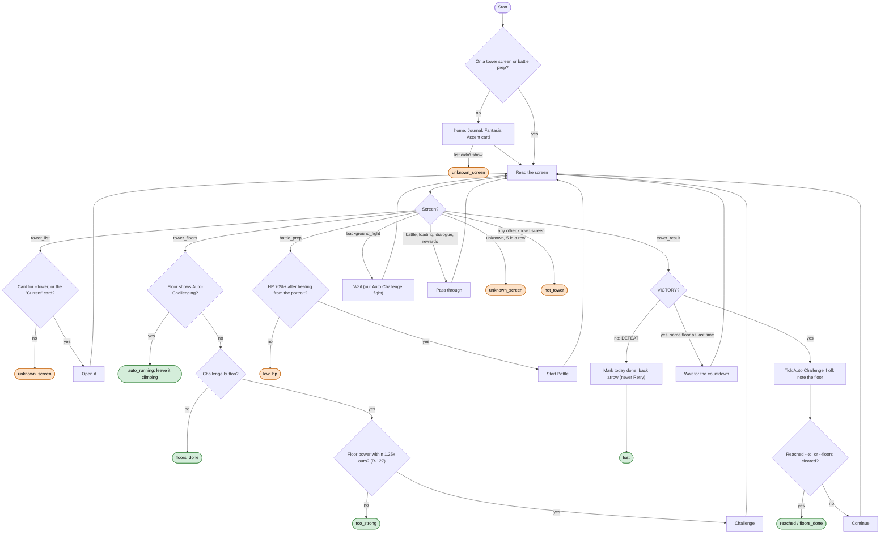

# Fantasia Ascent loop (tower)

Code: `sxs/loops/tower.py` (`open_from_home`, `climb`). Command: `python -m sxs tower [--tower NAME] [--to F] [--floors N]`;
daily step `fantasia_ascent`. Also called by [explore.md](explore.md) and [fogwalk.md](fogwalk.md) when a tower
screen shows. Rules: R-079, R-112, R-127, R-061.

**Goal:** one climb a day with Auto Challenge on, until the first loss. Never Retry a loss.
**End condition:** first loss, a floor more than 1.25x our power, no Challenge left, `--to` floor cleared,
Auto Challenge already climbing, or an unfamiliar screen.
**Ok statuses:** `lost`, `too_strong`, `floors_done`, `reached`, `auto_running`. Needs a look: `low_hp`,
`unknown_screen`, `not_tower`, `timeout`. The daily step marks the day done on any ok status; the loop also marks
it on a loss.

When explore or fogwalk meet a tower screen, they check today's mark first: if the day's climb already ran they
leave the tower; otherwise they climb and mark the day (R-079, [open-questions.md](open-questions.md) Q10).
