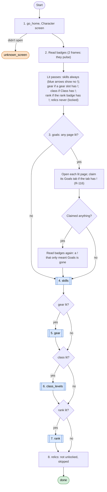
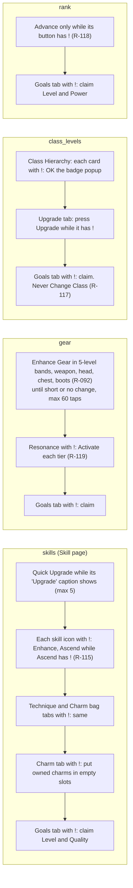
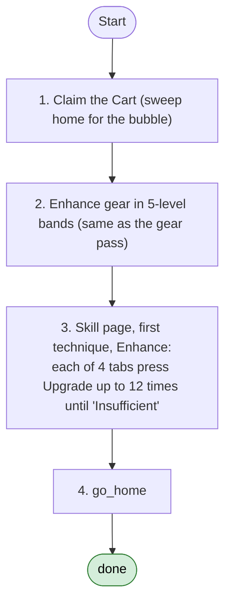

# Upgrade loop and the Strengthen loop

Code: `sxs/loops/upgrade.py` (`Upgrader`), `sxs/loops/strengthen.py` (`Strengthener`). Commands:
`python -m sxs upgrade [--only skills,gear,...]`, `python -m sxs strengthen`. Notes: `docs/step5-upgrades.md`.
Rules: R-080, R-088, R-092, R-104, R-105, R-115 to R-119.

## Upgrade loop

**Goal:** take every upgrade a red "!" on the Character screen offers, using only soft resources (Rolla, ore,
Battle Essence, shards, class badges).
**End condition:** each pass run once (90 s budget each), its tap budget spent, or an unexpected screen.
**Ok statuses:** `done`. `unknown_screen` (Character screen didn't open) needs a look. A pass that fails is
recorded and the next pass runs.

Each pass starts from the Character screen and goes home after. `--only` runs the named passes whether or not
they're lit.

### What each pass does

Every button press first checks that no spend word sits on its row (`policy/claims.SPEND`), and stops when the
"!" goes away. A screen that isn't the expected one saves the frame and ends that pass.

## Strengthen loop (the older, simpler path)

**Goal:** get stronger between fights with soft resources. **Used by:** `explore --chain` after 3 lost fights in a
row. The daily loop's `strengthen` step does *not* use this; it uses the Upgrade loop above.
**Ok statuses:** `done` (it always returns done).

Step 3 levels techniques one by one instead of Quick Upgrade (R-104), and the loop doesn't swap gear (R-088) or run
the Goals, class or rank passes. See [open-questions.md](open-questions.md) Q9.
