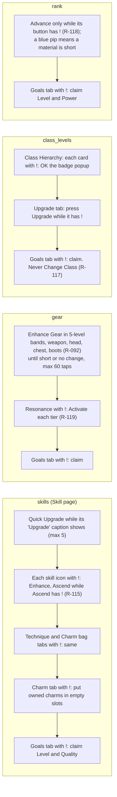
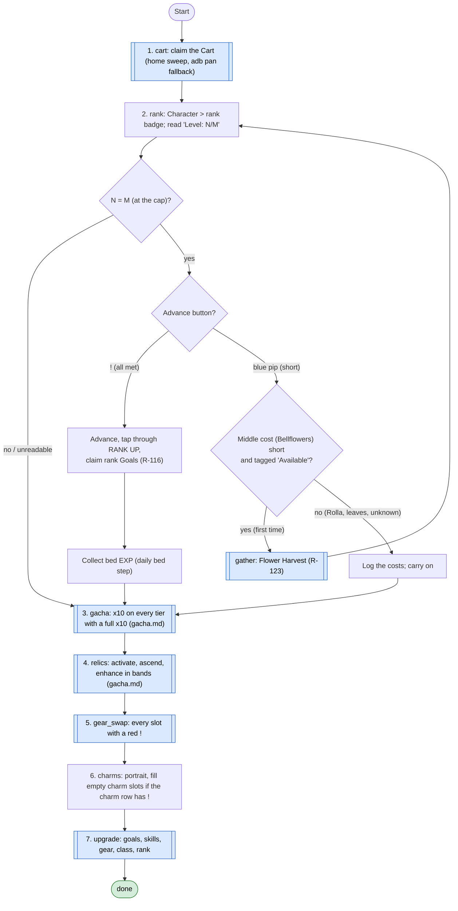

# Upgrade loop and the Strengthen loop

Code: `sxs/loops/upgrade.py` (`Upgrader`), `sxs/loops/strengthen.py` (`Strengthener`). Commands:
`python -m sxs upgrade [--only skills,gear,...]`, `python -m sxs strengthen`. Notes: `docs/step5-upgrades.md`.
Rules: R-080, R-088, R-092, R-104, R-105, R-115 to R-119.

## Upgrade loop

**Goal:** take every upgrade a red "!" on the Character screen offers, using only soft resources (Rolla, ore,
Battle Essence, shards, class badges).
**End condition:** each pass run once (90 s budget each), its tap budget spent, or an unexpected screen.
**Ok statuses:** `done`. `unknown_screen` (Character screen didn't open) needs a look. A pass that fails is
recorded and the next pass runs.

Each pass starts from the Character screen and goes home after. `--only` runs the named passes whether or not
they're lit.

### What each pass does

Every button press first checks that no spend word sits on its row (`policy/claims.SPEND`), and stops when the
"!" goes away. A screen that isn't the expected one saves the frame and ends that pass.

## Get stronger (`get_stronger`, the Strengthen loop)

**Goal:** everything that raises power with soft resources, in one call. **Used by:** `explore --chain` after 3 lost
fights in a row, the daily loop's `strengthen` step (without the gear swap, which is its own daily step), and
`python -m sxs strengthen [--only cart,rank,gacha,relics,gear_swap,charms,upgrade]`. **Ok statuses:** `done`.
Each step has its own time budget and stall check (`STEP_BUDGET_S` in `sxs/loops/upgrade.py`); a step that fails or
runs out is recorded and the next one starts.

Rank comes first when the level is at the cap (mae, 2026-11-11 05:20, R-118): a rank-up is the biggest single power
gain (Apprentice III applied the banked bed EXP, Lv 30 → 37, power 30.6K → 35.9K). Then the Aeonic Gacha (mae 05:22,
R-167) and the Workbench (R-172), so new relics are activated and enhanced in the same pass: both are drawn in
[gacha.md](gacha.md). Built 2026-11-11 (`Upgrader.rank_first`, `get_stronger`); not yet run live.

The Bellflower gather runs at most once per pass; a second shortfall is logged. Rank's own pass in the Upgrade loop
(step 7) stays: after step 2 it usually finds nothing, but it still claims rank Goals when they light up.
