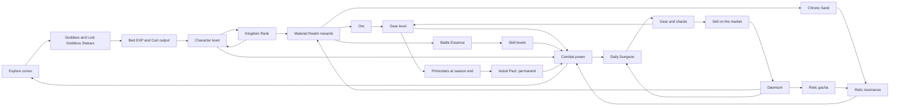

# Strategy: what to do, and in what order

<!-- index: Start here to decide what the account should do next: the ten rules, and which strategy page answers which question -->

> **Summary:** the game is a race to meet dated power thresholds using a daily budget of stamina, attempts and
> Dawnium, while building the power that survives season resets. These pages turn the player guides into ordered
> steps and decision tables. They are advice: the bot still acts only on the rules in `memory-bank/game/rules/`,
> and every place where the advice goes further than a rule is listed in [conflicts](../conflicts.md).
> **Applies:** all seasons
> **Related:** [Glossary](../glossary.md), [Seasons](../systems/seasons.md), [Sources](../sources/README.md)

## Which page

| Question | Page |
|---|---|
| Where is the account on the long road, and what is the next milestone? | [Progression roadmap](progression-roadmap.md) |
| What do I do today, in what order? | [Daily routine](daily-routine.md) |
| What happens once a week or on a calendar? | [Weekly routine](weekly-routine.md) |
| I have resource X: where does it go? | [Resource priorities](resource-priorities.md) |
| How is Dawnium earned and spent? | [Dawnium plan](dawnium-plan.md) |
| Where do stamina and Material Realm attempts go? | [Stamina and Material Realms](stamina-and-realms.md) |
| A season is about to end or has just begun: what now? | [Season playbook](season-playbook.md) |
| How should the Mage be built, and which class comes next? | [Mage path](mage-path.md) |
| The account is stuck below a power wall | [Getting stronger](getting-stronger.md) |
| What will later seasons bring? | [Future content](../systems/future-content.md) |

Numbers behind the pages (second research round, tier C unless noted): pull odds in
[gacha-rates.json](../data/gacha-rates.json), the server-day calendar in
[server-day-roadmap.json](../data/server-day-roadmap.json), season rating weights in
[astral-pact-scoring.json](../data/astral-pact-scoring.json), stamina yields by rank in
[gathering-yields.json](../data/gathering-yields.json), Dawnium-equivalent item values in
[item-values.json](../data/item-values.json), class grades in [class-tier-list.json](../data/class-tier-list.json).
Where these sources disagree with the SOF guides, the pages keep SOF and say so in one line.

## The ten rules

1. **The schedule comes first.** Each dungeon opens on a fixed server day with a power threshold. Meeting the
   newest dungeon's threshold on its opening day outranks every other goal, because its gear is the largest
   source of power and of Astral Pact score [S-01][S-02]. See [Dungeons](../systems/dungeons.md).
2. **You only need to get through the door.** Reach the entry threshold yourself; let stronger players clear.
   Wear drop-bonus gear and show the Lucky Statue when carried [S-01].
3. **Explore to grow.** Exploration lights statues, statues raise passive EXP and Cart output, EXP raises level
   and power. Kingdom tools that open statue areas are the first thing to buy with kingdom currency [S-01].
   See [Exploration](../systems/exploration.md), [Goddess Statues](../systems/goddess-statues.md).
4. **Advance rank the moment the level hits its cap** [R-118]. See [Kingdom Rank](../systems/kingdom-rank.md).
5. **Know what resets.** Up to level 100 (character, skills, Fantomons, gear +100, relic resonance to the season
   cap) is permanent; everything above resets each season. Relic collection, Fantomon aptitudes, companions,
   skill ascensions, Cart level and the Astral Pact are permanent [S-03][S-01].
6. **Sand early, ore later.** At the start of every season, stamina and extra Material Realm runs go to Chrono
   Sand (relic resonance); from mid-season to the end they go to ore (gear) [S-01][S-02].
7. **Gear level decides the season rating.** Gear is the heaviest part of the Primostar score, and Primostars
   buy permanent Astral Pact bonuses once per season. Near season end, all ore goes into gear [S-01].
8. **Spend Dawnium every day, from the top of one list**: guild donations 2 and 3 (the publisher's own tip
   [S-87]), discounted Vault items, dungeon refreshes, Material Realm tools; early-season surplus to the new relic pool [S-01][S-02]. See
   [Dawnium plan](dawnium-plan.md).
9. **Save where saving pays.** Skill pulls before a new class tier, Skill Shard Vouchers for skills that survive
   tiers, event currency on SAVE weeks, Material Realm tools until the kingdom's top rank, speed-ups until new
   statues are lit [S-01][S-02].
10. **Never trade permanent power for a number that resets**, unless rule 1 demands it [S-01].

## How the systems feed each other

## Sources

- [S-01] the F2P guide: philosophy, schedule, economy; [S-02] the Season 2 guide: season phases
- [S-03] Seasonal Systems (the level 100 line); [S-87] official handbook; rule R-118
