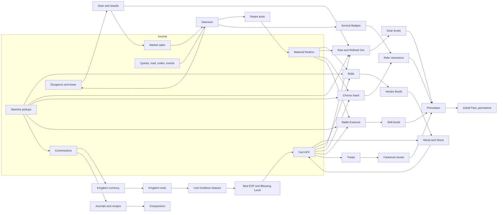

# Currencies and materials

<!-- index: Read when you meet any currency, material or key item and need to know where it comes from, what it buys and whether to spend or save it -->

> **Summary:** Dawnium (free premium currency) is the lever: the SOF guide spends about 2,000 a day on dungeon refreshes, Material Realm tools, guild donations and the Vault, in that order. Ore, Chrono Sand, Battle Essence and Rolla are the four upgrade materials; Wood and Stone only feed the Cart. Kingdom currency goes to kingdom tools first, guild tokens to Fantomon materials first, event currency to the unique relics.
> **Applies:** all seasons
> **Related:** [Shops](shops.md), [Material Realms](material-realms.md), [Cart and home](cart-and-home.md), [Stamina](stamina.md), [Commissions](commissions.md), [Auction house](auction-house.md), [Codes](codes.md), [Gacha](gacha.md), machine-readable copy in [data/currencies.json](../data/currencies.json); rules R-018, R-019, R-043, R-106, R-154

Our bot's binding spending rules are in `memory-bank/game/rules/policy.md` (R-043) and R-018. This page records what the game
offers and what experienced players do; where that differs from a rule, the difference is listed in
[conflicts.md](../conflicts.md), and the rule still binds the bot until mae changes it.

## Quick table

Priority: **H** = never waste, plan around it; **M** = spend steadily; **L** = spend freely or ignore.

| Item | Kind | Main income | Main use | Resets each season | Priority |
|---|---|---|---|---|---|
| Dawnium | premium currency (free and paid) | quests, events, codes, mail, market sales | realm tools, dungeon refreshes, Vault, donations, gacha | ❓ (no source says it resets) | H |
| Luminium | paid currency | Mall top-up only | Auction House bids; converts 1:1 to Dawnium | ❓ | n/a (real money) |
| Voucher | paid currency | top-up, beta rebate | outfits, packs | ❓ | n/a (real money) |
| Rolla | common coin | Cart, Gilded Depths realm, pickups, quests | every upgrade, Vendor Booth General tab and its refresh | ❓ | M |
| Raw Ore / Refined Ore | gear material | Ironvein Pit realm, Cart, pickups, dismantling, tower | gear enhancement | gear levels are seasonal | H (mid-season) |
| Chrono Sand | relic material | sand realm, Cart, pickups | relic enhancement and resonance | resonance above the cap resets | H (early season) |
| Battle Essence | skill material | Dread Hollow realm, Cart, pickups, caskets | technique and charm levels | skill levels are seasonal | M |
| Wood, Stone | furniture material | Cart, Vendor Booth | Cart row upgrades | no: stockpiles carry over | H early, then stockpile |
| Treats | Fantomon food | Cart (Lv 45 row), codes, events | Fantomon EXP | no (Fantomons are permanent) | M |
| Stamina | energy | 5 per hour, Vault free 30, codes | pickups, commissions | no | H |
| Stellatie | skill pull ticket | sign-in, mail, shops, wheels | Standard Prayer | ❓ | H |
| Covenite | class skill pull ticket | Molly's Deals, Wheel of Destiny, events | class-targeted Prayer | ❓ | H |
| Auroral Badges (Rare/Epic/Legendary/Mythic/Elemental) | relic pull token | quests, mail, codes, shops, events | Aeonic Gacha | ❓ | H |
| Bond Trinket | Fantomon pull token | mail, codes, guild shop, events | Arborisfatum summons | ❓ | H |
| Destiny Fruit | relic item | codes, exploration, merchants | relics of pool 1; Wheel merchants | ❓ | M |
| Abundance Leaf (and other kingdom currency) | kingdom currency | commissions, exploration, codes | Kingdom Shop: kingdom tools first | per kingdom | H |
| Guild Tokens | guild currency | donations (300 each), guild AFK (120 an hour) | Guild Shop | ❓ | M |
| Material Realm tools | attempt tokens | goals, commissions, Vault, Dawnium | one realm attempt each | no: can be saved | H |
| Kingdom tools | map keys | Kingdom Shop, Wheel of Destiny | open blocked areas with statues | no | H |
| Temporal Crystal | speed-up | ❓ | 2 hours of Bed and Cart income | no | M (save for new statues) |
| Skill Shard Voucher | skill shard | Wheel of Destiny, events | rank up a chosen skill | no | H (hoard) |
| Divinecraft Stone | gear reroll | dismantling gear | Affix Refinement | ❓ | M (Season 2+) |
| Primostar | season rating | end-of-season rating | Astral Pact levels | granted per season | H |

## The currencies one by one

### Dawnium (premium, earnable free)

- Orange diamond in the top bar [R-018]. It is the premium currency, but the game hands it out through play; the
  paid currency Luminium converts into it 1:1 [S-35][S-38].
- Full list of income and sinks: [Dawnium income and spending](#dawnium-income-and-spending) below.

### Luminium and Vouchers (paid: never)

- Luminium comes only from real-money purchases in the Mall and converts 1:1 into Dawnium [S-35][S-36][S-38].
- Bidding on premium gear in the Auction House needs Luminium [S-03]. Permanent-stat food is bought in the
  Auction House for Luminium [S-31].
- Vouchers are a second paid currency: outfits are priced in them (the launch outfit cost 499 + 299 Vouchers), and
  beta testers got Vouchers back from the Top-Up Rebate event [S-03]. The database lists Voucher as its own wallet
  currency [S-38].
- Real-money purchases are out of scope for this guide and banned for the bot [R-121].

### Rolla

- "Metal coins from Kanstein": the main common currency [S-03]. Gold coin in the top bar [R-019].
- Income: Cart row [R-020], the Gilded Depths realm (Gold Pickaxe) [R-125][S-35], overworld pickups at 5 stamina each
  [R-106], quest and mail rewards (the first Mailbox claim paid 20K) [R-168], commissions [S-01], home critters and
  jars [R-170].
- Sinks: gear enhancement [R-023], relic enhancement [R-172], Rank Advancement (5.5K, then 10.5K) [R-118], Cart row
  upgrades [R-136], healing dishes [R-138], the Vendor Booth General tab and its 4K refresh [R-120].
- The "Rolla strategy" pours Rolla into Vendor Booth refreshes to buy Wood and Stone; SOF thinks it is valid but not
  worth it [S-01]. See [Cart and home](cart-and-home.md).

### Raw Ore and Refined Ore

- Raw Ore (blue crystal) and Rolla pay for gear enhancement; higher steps also need Refined Ore (red crystal), e.g.
  300 for a weapon's +24 to +25 [R-023].
- Income: Ironvein Pit realm, about +115 Raw Ore per Iron Hammer at our rank [R-095]; overworld mine pickups, about
  +178 per 5 stamina [R-108]; Cart row [R-020]; dismantling gear in the Alchemy Pot (Epic gear gives Refined Ore)
  [R-165]; Raw Ore Caskets [R-169]; Guidance quests [R-099]; Fantasia Ascent, more on higher floors [S-35 ❓];
  Vendor Booth (350 Raw Ore for 2.1K Rolla; 180 Refined Ore for 180 Dawnium) [R-120]; Kingdom Shop (100 Refined Ore
  for 100 leaves) [R-134]; code rewards [S-37].
- Raw Ore is the limit on enhancing in our own play [R-023].
- Gear level is the most heavily weighted part of the end-of-season rating, so ore matters most from mid-season to
  the end [S-01]. See [Astral Pact](astral-pact.md) and [Gear](gear.md).
- Buying Refined Ore with Dawnium in the Vault is called too expensive for F2P by one site ❓ [S-04].

### Chrono Sand

- Pays for relic enhancement together with Rolla (1K sand + 1.8K Rolla for the first two steps) [R-172] and so for
  Relic Resonance. SOF: generate as much as you reasonably can and level resonance in all five elements [S-01].
- Income: the sand Material Realm, the Cart's Chrono Sand row (must be unlocked once, free) [R-137], overworld
  pickups and Grand Sand Mines [R-106][R-109], code rewards [S-37].
- Season 1 soft resonance cap was +10, Season 2 +13; levels above the cap reset at season end [S-01].
- Timing: sand first at the start of every season, ore from mid-season [S-01][S-02]. See [Relics](relics.md).

### Battle Essence

- Purple orb; levels techniques and charms, capped by character level [R-037].
- Income: Dread Hollow realm (Worn Knuckles) [R-125], Cart row (about +125 an hour early on) [R-037], pickups [R-106],
  Battle Essence Caskets (T1/T2/T4 = 400/530/840 each) [R-169], Vendor Booth General (250 to 300 for 1.6K to 2.4K
  Rolla) [R-120], codes [S-37].
- Skill levels are seasonal power [S-01]. See [Skills](skills.md).

### Wood and Stone

- Furniture materials: their only known use is upgrading Cart rows [R-125][R-136].
- Income: the Cart's own rows [R-020], Vendor Booth General tab (150 Wood for 3K Rolla, 150 Stone for 2.4K at a 20%
  badge) [R-120], low tiers of the Grand Treasure Hunt [S-33], code SS000 [S-37].
- Stone is the more demanding of the two, so SOF maxes Stone first [S-01]. "Always in short supply" [S-03].
- They do not reset: a maxed Cart keeps producing, and SOF started Season 2 by spending "stored resources from
  Season 1" on the new Cart levels [S-02].

### Treats

- Fantomon food ("Basic Treats") used for Fantomon EXP [S-38].
- Income: the Cart's Treats row, which unlocks at Lv 45 [R-020]; low tiers of the Grand Treasure Hunt [S-33]; code
  SS999 [S-37].
- Lowest Cart upgrade priority [S-01][S-32]. See [Fantomons](fantomons.md).

### Stamina

Covered on its own page: [Stamina](stamina.md).

### Stellatie

- The Standard Prayer ticket: x10 costs 10 [R-093]. Legendary rarity in the item database [S-38].
- Income: Daily Sign-in (10 on the day we saw it) [R-097], first Mailbox claim (10) [R-168], a free Wheel of Destiny
  spin (5) [R-147], Vendor Booth (General for Rolla, Vault 2 for 100 Dawnium at 50% off) [R-120], Kingdom Shop (1
  for 100 leaves at 90% off) [R-134], Guild Shop (500 tokens, 3 a week) [R-114], Molly's Deals at a discount [S-01],
  codes [S-37].
- SOF's late-Season-1 advice was to stop pulling skills and save pull resources for the tier-4 class [S-01].
  See [Gacha](gacha.md).

### Covenite

- A Prayer currency that pulls skills **for your current class** [S-38].
- Income: Molly's Deals at a discount [S-01]; Wheel of Destiny third-priority reward [S-01].
- The premium (pink) banner is said to open in Cinder Ridge ❓ [S-39]. See [Gacha](gacha.md).

### Affection Token

- Pays for the Affection Prayer at the Goddess Statue: x10 costs 250 red tokens [R-093][S-38]. Income ❓.

### Auroral Badges

- Tokens for the Aeonic Gacha (relics). Four rarity tiers plus an elemental one; 10 badges of a tier buy one
  capsule of that tier, and 10 Auroral Elemental Badges buy a capsule of a chosen element [S-38][R-167].
- Income: tracker quest for unlocking the gacha (50) [R-167], Mailbox (50 Rare) [R-168], Guild Shop (10 Rare for
  400 tokens, shop Lv 2) [R-114], Molly's Deals ("relic gacha badges") [S-01], Wheel of Destiny (elemental badges
  second priority, Legendary badges third) [S-01], Grand Treasure Hunt (Legendary badges) [S-33], Vault (Epic
  badges) ❓ [S-35], codes [S-37].
- See [Relics](relics.md) and [Gacha](gacha.md).

### Bond Trinket

- Summons Fantomons at Arborisfatum [S-38].
- Income: Mailbox (10) [R-168], Guild Shop (400 tokens at 50% off, 2 a week, needs shop Lv 3) [R-114], extra Vendor
  Booth refreshes [S-01], Wheel of Destiny (third priority) [S-01], Grand Treasure Hunt [S-33], code SS999 [S-37].
- Fantomon aptitude materials and summon tokens are the first Guild Shop buys every week [S-01].

### Summon Crystals (Fantomon exchange)

- Drop from Fantomon pulls (4.2% per pull, at least one per 10) and buy Mythic Fantomon copies at 60 each ❓ [S-32].
  See [Fantomons](fantomons.md).

### Destiny Fruit

- Used to obtain relics of a season's first relic pool (the second pool is gacha only) [S-02]; one site says to
  stockpile 300 for an event ❓ [S-39] and another keeps a 200 Dawnium reserve for "Destiny Fruit merchants" ❓ [S-35].
- Income: codes (1 to 3 each) [S-37]; the world map's top bar shows a fruit counter [R-019]. See [Relics](relics.md).

### Kingdom currencies

| Kingdom | Currency | Shop | Top buy |
|---|---|---|---|
| Verdantglade | Abundance Leaf | Hermes, Drasilgard | Withering Potion, Gateway Key (about 3K leaves at full price) [S-01] |
| Cinder Ridge | ❓ | ❓ | Magic Drill, Gateway Key [S-01] |
| Aqualis | ❓ | ❓ | Water Mine, Gateway Key [S-01] |
| Loong Haven | ❓ | ❓ | the new season's area item, Gateway Key ❓ [S-34] |

- Abundance Leaves: we held 450 at Lv 30 or so; a commission card in the SOF guide shows a leaf reward of 150
  [S-01]; code SS888 gives 100 [S-37]. One site says exploration tasks pay leaves ❓ [S-04].
- SOF pushes commissions that pay kingdom currency until the next tool is affordable [S-01].
- The Kingdom Shop has levels (1/4, "0/3500 toward Lv 2") [R-134]; what raises the level is unknown ❓.
- Details and stock: [Shops](shops.md#kingdom-shops).

### Guild Tokens and guild resources

- Guild Tokens: 300 per donation [R-103], 120 an hour from guild AFK gathering [R-110]; spent in the Guild Shop
  [R-114].
- Donations also give the guild Steel, Kanstein Cells and Mana Clusters (500 each per donation) [R-103][S-03].
- See [Guild](guild.md).

### Arena currency and tickets

- Arena tickets are saved toward the weekly reset and spent right after it [S-01]; up to 20 can be saved ❓ [S-32].
- Extra fights cost Dawnium on a ladder: 10, 15, 20, 30, 40, 60, 80, 100 [S-30].
- Arena earnings feed an Arena exchange shop ❓ [S-35], which sells permanent-stat food [S-31]. The name of the
  arena currency is unknown ❓. See [Arena and PvP](arena-and-pvp.md).

### Event currencies

| Event | Currency | Use | Advice |
|---|---|---|---|
| Grand Treasure Hunt | Aurodrasil Energy [S-33] | climb reward floors; floor 5 holds the unique relic | save every other week for Lucky Statue and Primal Gem [S-01] |
| Chaos Invasion | Chaos Crystals [S-32] | Mysterious Merchant shop on Home after the event | buy only the Primal Forge until it is maxed [S-01] |
| Wheel of Destiny | Lucky Ticket [R-125] | spins after the free one | pick Skill Shard Vouchers first [S-01] |
| Journey Overture (launch) | Overture Badges, Overture Tickets [S-03] | Overture Shop, Prize Punch | ended 2026-06-01 |
| Vendor Booth | Vendor Booth Pts [R-120] | Goals tab milestones at 5K to 25K points | free claims |

See [Events](events.md).

### Material Realm tools

| Tool | Realm | Gives |
|---|---|---|
| Iron Hammer | Ironvein Pit | Raw and Refined Ore [R-095] |
| Gold Pickaxe | Gilded Depths | Rolla [R-125] |
| Worn Knuckles | Dread Hollow | Battle Essence [R-125] |
| ❓ (a shovel, per one site [S-04]) | ❓ (sand realm) | Chrono Sand [S-01] |

- One tool is one attempt. Income: Goals tabs (10 Standard Prayers paid 3 Iron Hammers) [R-093][R-095], commissions
  ("Delegate Tasks") ❓ [S-36], the Vault at a steep discount (5 Gold Pickaxes for 60 Dawnium, 5 Worn Knuckles for
  40) [R-120], direct purchase at the realm on a rising price ladder [S-30].
- Tools can be kept in the bag and used later; SOF saved Season 1 tools for Season 2 [S-02].
- Full detail: [Material Realms](material-realms.md).

### Kingdom tools (map keys)

| Tool | Kingdom | Opens |
|---|---|---|
| Withering Potion | Verdantglade | a vine blockade [S-01][R-134] |
| Magic Drill | Cinder Ridge (also used in Verdantglade) | a Boulder Blockade [S-01][R-151] |
| Water Mine | Aqualis | ❓ a water obstacle [S-01] |
| Gateway Key | all kingdoms | ❓ a locked gateway [S-01] |

- Each blocked area hides at least one more Lost Goddess Statue, so these are the top Kingdom Shop priority [S-01].
- One Verdantglade area has two statues behind a single Magic Drill: the highest drill priority [S-01]. Our Hidden
  Camp sits behind a Boulder Blockade with a statue behind it [R-151].
- Gateway Keys are also the second-priority Wheel of Destiny reward [S-01].
- See [Exploration](exploration.md) and [Goddess statues](goddess-statues.md).

### Golden Beetle

- Skips a puzzle [R-125]. 50 Dawnium in the Vault [R-120]; Akane's tutorial gives one. The bot never spends them
  [R-153].

### Temporal Crystal and the free speed-up

- A Temporal Crystal gives 2 hours of income for both the Bed and the Cart; one free speed-up a day does the same
  [S-03].
- Use them only after activating every available statue, and at a new season only after the new kingdom's statues
  [S-03][S-02]. One site suggests holding them to cross level milestones (106, 108, 116, 130 in Season 2) ❓ [S-34].

### Skill Shard Vouchers

- Stand in for shards of a chosen skill; "one of the most important items in the game" [S-01].
- Top-priority Wheel of Destiny reward [S-01]. Spend only on a core skill that stays useful across class tiers
  [S-01]. See [Skills](skills.md).

### Divinecraft Stones (Season 2+)

- Consumed by Affix Refinement (rerolling gear affixes); obtained only by dismantling gear [S-02].
- Cost per reroll by locked affixes: 0 locked 100, 1 locked 300, 2 locked 1,200, 3 locked 3,200 [S-02].
  See [Gear](gear.md).

### Primostars

- Not spendable: awarded at season end from five ratings (gear, character, Fantomon, skill and relic level); one
  Primostar is one Astral Pact level [S-01]. F2P target: at least 104 in a season [S-01]. See
  [Astral Pact](astral-pact.md).

### Other items seen

| Item | What it is | Source |
|---|---|---|
| Shapeshifting Mirror | changes appearance at Carol; 100 Dawnium in the Vault | [R-134][R-120] |
| Rename Card | 500 Dawnium, one a week | [R-120] |
| Lucky Ticket | Wheel of Destiny spin; 1.5K Guild Tokens | [R-114] |
| Class Badge | levels classes, 10 per level; +2 per owned skill of the class | [R-117] |
| Bellflower and rank materials | Rank Advancement costs | [R-118][R-123] |
| Companion gifts (Iris, Jungle Fables, journals) | raise companion affinity | [R-134][S-01] |
| Gems | socketed into gear; tradeable | [S-01], see [Gems](gems.md) |

## What feeds what

| From | To | How | Source |
|---|---|---|---|
| Wood, Stone | Cart level | Cart row upgrades cost the other material, the row's own material and Rolla | [R-136] |
| Cart level | every AFK material, Cart gear drops | higher rows produce more; higher Cart rolls better Legendary gear | [R-020][S-01] |
| Lost Goddess Statues | Blessing Level | each statue +1 Blessing Level; Blessing caps Cart rows and raises Bed EXP | [R-035] |
| Kingdom currency | statues | buys Withering Potion, Magic Drill, Water Mine, Gateway Key, which open areas with statues | [S-01] |
| Stamina | kingdom currency | commissions can cost stamina and pay kingdom currency | [S-01] |
| Stamina | ore, sand, essence, Rolla | 5 stamina per pickup | [R-106] |
| Dawnium | ore, sand, essence, Rolla | extra Material Realm tools | [S-01] |
| Dawnium | gear and shards | 2 extra Daily Dungeon runs for 100 + 150 | [S-30] |
| Dungeon shards and gear | Dawnium | sold to other players | [S-01][S-02] |
| Rolla | Wood, Stone, Stellatie, trinkets | Vendor Booth General tab and its refreshes | [S-01][R-120] |
| Chrono Sand + Rolla | relic resonance | Enhance at the Workbench | [R-172] |
| Raw/Refined Ore + Rolla | gear level | Enhance Gear | [R-023] |
| Gear level (and four other ratings) | Primostars, Astral Pact | end-of-season rating; gear weighs most | [S-01] |
| Dismantled gear | Raw Ore, Refined Ore, Divinecraft Stones | Alchemy Pot Dismantle | [R-165][S-02] |
| Premium commissions | companion journals, recipes | journals unlock companions; recipes can be sold | [S-01] |
| Guild donations | Guild Tokens | 300 per donation | [R-103] |
| Guild Tokens | Fantomon aptitude materials, summon tokens | Guild Shop | [S-01] |

## Dawnium income and spending

### Income (free)

| Source | Amount | Notes | Source |
|---|---|---|---|
| Daily quests and activity | 40 to 60 a day ❓ | one site's estimate | [S-39] |
| All daily content together | about 100+ a day | daily dungeons, realms, guild tasks, arena, event missions | [S-35][S-36] |
| First weeks of an account | 200+ a day ❓ | while story chapters remain | [S-39] |
| Story chapters, feature unlocks, achievements | one-time lumps, amounts unknown | | [S-35][S-36] |
| Mailbox | 400 on our first Claim All | compensation, code rewards and event mail arrive here | [R-168] |
| Mall free gift boxes | 30 from the Welcome Benefit box | only the free boxes; packs are real money | [R-121] |
| Gift codes | 80 to 200 per code that pays Dawnium (ZJ777 200, SXSDCTHANKS 180, SXSREDDIT 180, ISLA 80) | see [Codes](codes.md) | [S-37] |
| Wheel of Destiny | 2,888 as one reward option (fourth priority) | | [S-01] |
| Arena | small amounts per match ❓; weekly rank rewards ❓ | climb right after the weekly reset | [S-35][S-01] |
| Events and login campaigns | the largest single spikes, amounts unknown | | [S-35] |
| Selling on the player market | varies; the main way F2P scales income | sell dungeon shards and gear, white and black gems, recipes | [S-01][S-02] |
| Luminium exchange | 1:1 | real money: never | [S-35][S-38] |

The SOF spending plan (2,000 a day) is far above the 100+ a day that guide sites quote for daily content. SOF's own
answer is the market: run the newest dungeon with drop-bonus gear and a carry, then sell the extra shards for
Dawnium [S-01]. How much a typical F2P account earns that way is not documented ❓.

### Spending: the SOF daily target (2,000 Dawnium)

Transcribed from the "Dawnium Daily Spend" picture in guide S-01. The list is in priority order: when short, buy
from the top and cut from the bottom, starting with the Gold Tool and the variable Vault purchases [S-01].

| # | Sink | What exactly | Dawnium a day |
|---|---|---|---|
| 1 | Daily Dungeon | refresh x2 (two extra runs) | 250 |
| 2 | Material Realms | extra tools in the 4 / 2 / 4 / 4 split (ore / Rolla / essence / sand) | 1,080 |
| 3 | Guild donations | donate 3 times only (70 for the two paid ones) plus the Gold Tool (200) | 270 |
| 4 | Vault | variable: "valuable items and limited resources" | 400 |
| | **Total** | | **2,000** |

The numbers agree with prices from other sources: dungeon refreshes cost 100 then 150 [S-30]; realm tools cost 60,
60, 100, 100, 150, 150, 200, 200, 250, 300 per realm per day, so 4 + 2 + 4 + 4 tools cost 320 + 120 + 320 + 320 =
1,080 [S-30][S-35]; the second and third donations cost 20 and 50 [R-103]. The "Gold Tool" is not explained in the
guide; it is probably the 24-hour guild gathering boost that another guide calls expensive for F2P ❓ [S-30].

### Every known sink, with a verdict

| Sink | Cost | Verdict | Source |
|---|---|---|---|
| Daily Dungeon extra runs | 100, then 150 | Buy both every day: top of the list in every guide | [S-01][S-30][S-32] |
| Material Realm tools | 60, 60, 100, 100, 150, 150, 200, 200, 250, 300 per realm per day | The main sink. 4244 (1,080) or 4444 (1,280); 6446 (1,880) if desperate for power; lighter guides say 2222 (480) for F2P | [S-01][S-02][S-30][S-32] |
| Guild donations 2 and 3 | 20, then 50 | Buy both; skip the 4th and 5th | [S-01][S-03][R-103] |
| Guild "Gold Tool" | 200 | Optional; first thing to cut | [S-01] |
| Vault: discounted realm tools | e.g. 5 Gold Pickaxes for 60, 5 Worn Knuckles for 40 | Buy: far cheaper per tool than at the realm | [R-120][S-03] |
| Vault: discounted Stellatie | 2 for 100 at 50% off | Buy when discounted | [S-03][R-120] |
| Vault: Refined Ore | 180 for 180 | Skip as F2P ❓ | [S-04] |
| Vault: Golden Beetle, Shapeshifting Mirror, Rename Card | 50, 100, 500 | Skip | [R-120][R-153] |
| Aeonic Gacha (relic pulls) | ❓ per pull | The long-term choice: best early in a season when the pool is new; aim for 70% completion per region | [S-01][S-02] |
| Molly's Deals | varies (one card showed 225) | Buy: up to 10 a week, "usually very good deals" | [S-01] |
| Arena extra fights | 10, 15, 20, 30, 40, 60, 80, 100 | 2 a day is cheap; max out for two days after a reset | [S-30] |
| Vendor Booth General refresh | paid in Rolla (4K), not Dawnium | See [Shops](shops.md) | [R-120] |
| Skill pulls with Dawnium | ❓ | Stop near season end; save for the next class tier | [S-01] |
| Sign-in "Catch Up", Timed Packs, Starter Pack | Dawnium or real money | Never | [R-097][R-157] |

Balance between the two big sinks: tools if the goal is power this season, relic gacha if the goal is long-term
account strength; early-season Dawnium to the relic gacha, then tools as the pool saturates [S-01][S-02].

## Open questions
- ❓ Names of the Cinder Ridge, Aqualis and Loong Haven kingdom currencies and their merchants: read the shop header in each kingdom.
- ❓ The sand Material Realm's name and tool: read the Material Realms screen once it unlocks.
- ❓ Whether Dawnium, Rolla, Stellatie and badges carry across a season reset: no source states it; watch the first season change.
- ❓ What the guild "Gold Tool" (200 Dawnium) is: open the guild donation and facility screens.
- ❓ Arena currency name and shop stock: open the Arena shop.
- ❓ Sources of Temporal Crystals and Affection Tokens: read the items' info cards (R-125).
- ❓ Dawnium price of an Aeonic Gacha or Prayer pull: read, do not press (R-043).
- ❓ Realistic F2P Dawnium income from the market per week.

## Sources
- [S-01] Resource Economy (Dawnium picture, Material Realms, Cart), Exploration, Additional Tips
- [S-02] Sections I, III, IV, VI
- [S-03] rolla, vendor-booth, progression, commercium, journey-overture, launch FAQ
- [S-04] covenite, withering-potion, material-realms pages (leads only)
- [S-30] Dawnium sink order and price ladders
- [S-31] food sources
- [S-32] refresh ladders, Summon Crystals, Chaos Crystals
- [S-33] Grand Treasure Hunt currency and tiers
- [S-34] season carry-over checklist
- [S-35], [S-36] resource tables, Dawnium income estimates
- [S-37] code rewards
- [S-38] currency database
- [S-39] income estimates, banner note
- Rules R-018, R-019, R-023, R-037, R-093, R-095, R-097, R-103, R-106, R-108, R-109, R-110, R-114, R-117, R-118, R-120, R-121, R-125, R-134, R-136, R-137, R-147, R-151, R-153, R-165, R-167, R-168, R-169, R-172; observed stock in [docs/shop-tables.md](../../docs/shop-tables.md)
