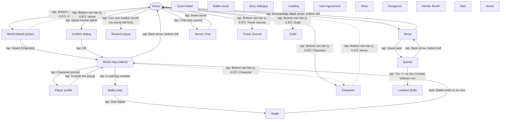

# Navigation graph

> **Last updated**: 2026-11-03
> Generated from `memory-bank/game/nav-graph.json` by `python3 scripts/nav-graph.py render`. Don't edit by hand.

Solid arrows are observed in game; dashed arrows are told or reported and still need confirming.

## Screens

| id | Name | Kind | Confidence | Unlock | Notes |
|---|---|---|---|---|---|
| `home` | Home | hub | observed |  | Scene scrolls horizontally; the Cart (AFK income) and cherry tree are on the left (R-020). The chat strip at y 0.82-0.90 opens server_chat: avoid it. |
| `main_menu` | Menu | menu | observed |  | Also has Photo (0.14,0.85), Notice (0.30,0.85), User Center (0.47,0.85), Settings (0.64,0.85), a 'Coming soon' card (0.72,0.75). Shows the server clock (R-024). |
| `quests` | Quests | menu | observed |  | Tabs Quest (0.40,0.95) and Achievement (0.78,0.95). Each row has 'Go >>' at x 0.83 that jumps to the relevant screen (R-009). |
| `quest_detail` | Quest detail | popup | observed |  | Not detected yet. |
| `world_overview` | World (island picker) | world | observed |  | Pick an island to walk on. |
| `world_map` | World map (island) | world | observed |  | Walkable island map with minimap, fog and pickups (R-002, R-004, R-021, R-022). Shows a fruit counter instead of Rolla in the top bar. |
| `player_profile` | Player profile | popup | observed |  | Gear, techniques, Dish, Quick Heal. Not detected yet. Android back does nothing here. |
| `battle_prep` | Battle prep | menu | observed |  | Enemy line-up, 'Round 0/15'. |
| `battle` | Battle | battle | observed |  | Plays itself (R-001); 15 rounds max. |
| `battle_result` | Battle result | popup | reported |  | Not seen: a won map battle went straight back to world_map within about 4 s. May exist for other modes. |
| `reward_popup` | Reward popup | popup | observed |  | Close by tapping anywhere. |
| `confirm_dialog` | Confirm dialog | popup | observed |  | Cancel (0.32,0.57), OK (0.68,0.57). Returns to whatever the confirmed action leads to. |
| `dialogue` | Story dialogue | overlay | observed |  | Tutorial/story overlay (Akane). Tap (0.5,0.9) to advance; can sit on top of any screen. |
| `loading` | Loading | overlay | observed |  | Wait it out. |
| `agreement` | User Agreement | popup | observed |  | First launch only. Needs a human; the bot must stop and ask. |
| `character` | Character | menu | observed |  | Gear slots; gear slot -> item card (Replace / Enhance) -> Enhance Gear (R-023). No capture yet. |
| `loadout_edit` | Loadout (Edit) | menu | observed |  | Not detected yet. Reached from the Combat Veteran quest's Go button. |
| `server_chat` | Server Chat | overlay | observed |  | Close with the down arrow (0.06,0.96). Never type here. |
| `travel_journal` | Travel Journal | menu | observed | any mode unlocked (toast 'Unlock any mode to unlock Travel Journal') | Locked on our account. |
| `guild` | Guild | menu | observed | Character Lv. 15 (toast on the locked tab) | Donations, Farm, Boss, floating-island AFK farm (R-016, reported). |
| `shop` | Shop | menu | reported |  | Free daily stamina, Daily Shop, Vault (Dawnium) (R-017, R-018). Entry point unknown. |
| `dungeons` | Dungeons | menu | reported |  | Material, Daily and Co-op dungeons (R-015). Entry point unknown. |
| `vendor` | Vendor Booth | menu | reported | account level 18 (R-011) | Entry point unknown. |
| `mail` | Mail | menu | reported |  | Entry point unknown. |
| `arena` | Arena | menu | reported |  | Solo Arena and 3v3 Tournament (R-001). Entry point unknown. |

## Actions

| From | To | Action | Confidence | Notes |
|---|---|---|---|---|
| any screen | previous screen | back Android back key | observed | Unreliable: does nothing on player_profile. Prefer on-screen back arrows. |
| Story dialogue | previous screen | tap Anywhere low on screen to advance at [0.5, 0.9] | observed | Repeat until the ▼ arrow is gone. |
| Reward popup | previous screen | tap Anywhere at [0.5, 0.16] | observed |  |
| Loading | previous screen | wait Until the loading screen ends | observed |  |
| Home | Character | tap Bottom nav bar (y 0.97): Character at [0.11, 0.97] | observed |  |
| World map (island) | Character | tap Bottom nav bar (y 0.97): Character at [0.11, 0.97] | reported | Assumes the nav bar is visible on the map too. |
| Home | Travel Journal | tap Bottom nav bar (y 0.97): Travel Journal at [0.29, 0.97] | observed | Locked: shows a toast and stays on home. |
| Home | Guild | tap Bottom nav bar (y 0.97): Guild at [0.69, 0.97] | observed | Locked below Character Lv. 15: shows a toast and stays on home. |
| Home | World (island picker) | tap Bottom nav bar (y 0.97): World at [0.89, 0.97] | observed |  |
| Character | Home | tap Bottom nav bar (y 0.97): Home at [0.5, 0.97] | reported |  |
| World (island picker) | Home | tap Bottom nav bar (y 0.97): Home at [0.5, 0.97] | reported |  |
| World (island picker) | World map (island) | tap Island (Originisle) at [0.5, 0.42] | observed |  |
| Home | Menu | tap Box/package button at [0.92, 0.79] | observed |  |
| Menu | Quests | tap Quest card at [0.28, 0.75] | observed |  |
| Menu | Home | tap Back arrow, bottom left at [0.08, 0.95] | observed |  |
| Quests | Menu | tap Back arrow, bottom left at [0.08, 0.95] | observed | Closes quests; assumed to return to the menu. |
| Quests | Loadout (Edit) | tap 'Go >>' on the Combat Veteran row at [0.83, None] | observed | y depends on the row; each row's Go button jumps to its own screen. |
| Home | Confirm dialog | tap Quest tracker panel at [0.41, 0.78] | observed | Asks 'Travel to Originisle I now?'. |
| Confirm dialog | World map (island) | tap OK at [0.68, 0.57] | observed | When the dialog was the travel prompt. |
| Confirm dialog | previous screen | tap Cancel at [0.32, 0.57] | observed |  |
| World map (island) | Home | tap Back arrow, bottom left at [0.08, 0.95] | observed |  |
| World map (island) | Player profile | tap Character portrait | observed |  |
| Player profile | World map (island) | tap Outside the popup at [0.5, 0.95] | observed |  |
| World map (island) | Battle prep | tap A roaming monster | observed | Use the minimap or the tracking ring to find one (R-004, R-022). |
| Battle prep | Battle | tap Start Battle at [0.5, 0.75] | observed |  |
| Battle | World map (island) | auto Battle ends on its own | observed | Back on the map within about 4 s after a win. Loss path not seen yet. |
| Home | Reward popup | tap Cart coin bubble (scroll the scene left first) | observed | Collects AFK income (R-020). |
| Home | Server Chat | tap Chat strip (avoid) at [0.5, 0.86] | observed | Accidental; y 0.82-0.90. |
| Server Chat | Home | tap Down arrow at [0.06, 0.96] | observed |  |
