# Navigation graph

> **Last updated**: 2026-11-04
> Generated from `memory-bank/game/nav-graph.json` by `python3 scripts/nav-graph.py render`. Don't edit by hand.

Solid arrows are observed in game; dashed arrows are told or reported and still need confirming.

```mermaid
flowchart TD
    home(["Home"])
    main_menu["Menu"]
    quests["Quests"]
    quest_detail["Quest detail"]
    world_overview["World (island picker)"]
    world_map["World map (island)"]
    player_profile["Player profile"]
    battle_prep["Battle prep"]
    battle["Battle"]
    battle_result["Battle result"]
    defeated["Defeated dialog"]
    interact["Exploration card"]
    reward_popup["Reward popup"]
    confirm_dialog["Confirm dialog"]
    dialogue["Story dialogue"]
    title(["Title screen"])
    loading["Loading"]
    agreement["User Agreement"]
    character["Character"]
    loadout_edit["Loadout (Edit)"]
    server_chat["Server Chat"]
    travel_journal["Journal (Travel Journal)"]
    guild["Guild"]
    shop["Shop"]
    dungeons["Dungeons"]
    vendor["Vendor Booth"]
    mail["Mail"]
    arena["Arena"]
    cart["Cart"]
    home_house(["Home house"])
    bed["Bed"]
    tap_to_continue["Tap to Continue result"]
    skill_loadout["Skill loadout"]
    technique_card["Technique card"]
    technique_upgrade["Technique upgrade"]
    dungeon_floor["Mini-dungeon floor"]
    wounded["Badly wounded dialog"]
    alchemy_pot["Alchemy Pot"]
    rank_advancement["Rank Advancement"]
    notice["Notice board"]
    friends["Friends"]
    settings["Settings"]
    exploration_goals["Exploration Goals"]
    class_choice["Class choice dialogue"]
    class_ascend["Class ascend"]
    prayer["Prayer (skill gacha)"]
    prayer_result["Prayer result"]
    apply_requests["Apply (social requests)"]
    area_map["Area map (full map)"]
    puzzle_energy_circuits["Energy Circuits puzzle"]
    team["Team panel"]
    blessing_level["Blessing level"]
    fantasia_ascent["Fantasia Ascent: tower list"]
    fantasia_floors["Fantasia Ascent: floors"]
    fantasia_result["Fantasia Ascent: floor result"]
    charm_detail["Charm card"]
    rcmd_loadouts["Recommended loadouts"]
    gear_swap_prompt["Gear swap prompt"]
    replace_gear["Replace Gear list"]
    gear_compare["Gear compare"]
    enhance_gear["Enhance Gear"]
    material_realms["Material Realms"]
    ironvein_pit["Ironvein Pit (mining)"]
    purchase_iron_hammer["Purchase Iron Hammer"]
    featured["Thrilling Events: Featured"]
    daily_signin["Daily Sign-in"]
    growth_trial["Growth Trial"]
    home -->|"tap: Bottom nav bar (y 0.97): Character"| character
    world_map -.->|"tap: Bottom nav bar (y 0.97): Character"| character
    home -->|"tap: Bottom nav bar (y 0.97): Travel Journal"| travel_journal
    home -->|"tap: Bottom nav bar (y 0.97): Guild"| guild
    home -->|"tap: Bottom nav bar (y 0.97): World"| world_overview
    character -->|"tap: Bottom nav bar (y 0.97): Home"| home
    world_overview -.->|"tap: Bottom nav bar (y 0.97): Home"| home
    world_overview -->|"tap: Island (Originisle)"| world_map
    home -->|"tap: Box/package button"| main_menu
    main_menu -->|"tap: Quest card"| quests
    main_menu -->|"tap: Back arrow, bottom left"| home
    quests -->|"tap: Back arrow, bottom left"| main_menu
    quests -->|"tap: 'Go >>' on the Combat Veteran row"| loadout_edit
    home -->|"tap: '>' arrow on the quest tracker panel"| confirm_dialog
    confirm_dialog -->|"tap: OK [travel prompt and goal in (explore, dailies)]"| world_map
    world_map -->|"tap: Back arrow, bottom left"| home
    world_map -->|"tap: Character portrait"| player_profile
    player_profile -->|"tap: Outside the popup"| world_map
    world_map -->|"tap: A roaming monster"| battle_prep
    battle_prep -->|"tap: Start Battle"| battle
    battle -->|"auto: Battle ends on its own"| world_map
    home -->|"tap: Cart coin bubble (scroll the scene left first)"| reward_popup
    home -->|"tap: Chat strip (avoid)"| server_chat
    server_chat -->|"tap: Down arrow"| home
    title -->|"tap: Tap to Play"| loading
    character -->|"tap: Back arrow, bottom left"| home
    battle -->|"auto: Battle lost"| defeated
    defeated -->|"tap: OK"| home
    world_map -->|"tap: A map object (portal, chest...), or just below the quest ring"| interact
    interact -->|"tap: Activate (Portal) or another safe verb"| world_map
    interact -->|"tap: Explore (Temple Ruins mini-dungeon) [goal=explore and hp_ok]"| battle_prep
    interact -->|"tap: Outside the card (dismiss) [no policy entry says press, or the button is unsafe]"| world_map
    home -->|"tap: The cart on the home scene (scroll left first)"| cart
    cart -->|"tap: Claim All"| reward_popup
    cart -->|"tap: Above the panel"| home
    home -->|"swipe: Scroll the home scene up"| home_house
    home_house -->|"tap: The bed"| bed
    character -->|"tap: Skill button"| skill_loadout
    skill_loadout -->|"tap: A technique slot (left side)"| technique_card
    technique_card -->|"tap: Enhance"| technique_upgrade
    battle -->|"auto: Floor cleared"| dungeon_floor
    dungeon_floor -->|"tap: Next Floor [hp_ok]"| battle_prep
    dungeon_floor -.->|"tap: Back arrow, bottom left [not hp_ok]"| world_map
    home -->|"tap: Quest tracker panel [tracked quest shows a/b with a = b]"| reward_popup
    home -->|"tap: Quest title on the tracker panel [tracked quest not finished]"| quest_detail
    world_map -->|"tap: A monster [HP low]"| wounded
    wounded -->|"tap: Return to Home"| home
    home_house -->|"tap: Alchemy Pot furniture"| alchemy_pot
    character -->|"tap: Rank badge, bottom right"| rank_advancement
    main_menu -->|"tap: Friends [account Lv 10 or more]"| friends
    main_menu -->|"tap: Notice [account Lv 10 or more]"| notice
    main_menu -->|"tap: Settings [account Lv 10 or more]"| settings
    world_overview -->|"tap: Button, bottom left"| exploration_goals
    class_choice -->|"tap: Ascend to Mage [a human chose the class (--choose)]"| class_ascend
    class_ascend -.->|"tap: Ascend [a human chose the class]"| world_map
    home -->|"tap: Statue furniture (next to the 'Class to Unlock' stone)"| prayer
    prayer -->|"tap: Pray x10 [a human allowed it (never on the bot's own)]"| prayer_result
    world_map -->|"tap: Person icon with badge, left edge"| apply_requests
    world_map -->|"tap: The minimap"| area_map
    area_map -->|"tap: The spot to move the camera over"| area_map
    area_map -->|"tap: Back arrow (closes the map)"| world_map
    world_map -->|"tap: Flag button, top left"| team
    interact -->|"tap: Unlock (Goddess Statue) [area at 100% exploration]"| blessing_level
    interact -.->|"tap: Activate (Voyage Obelisk) [goal needs the next kingdom]"| world_overview
    interact -->|"tap: Explore (mine) [goal=explore and hp_ok]"| battle_prep
    world_map -->|"tap: Ancient Fortress puzzle object"| puzzle_energy_circuits
    interact -.->|"tap: Challenge / Explore on the Fantasia Ascent card [goal=explore and hp_ok]"| fantasia_ascent
    quest_detail -->|"tap: Go on "Into the Moon's Shadow I""| confirm_dialog
    confirm_dialog -->|"tap: OK [Fantasia Ascent prompt and tower not done today]"| home
    fantasia_ascent -->|"tap: The tower's card"| fantasia_floors
    fantasia_floors -->|"tap: Challenge on the current floor [hp_ok]"| battle_prep
    battle -->|"auto: (fight ends)"| fantasia_result
    fantasia_result -->|"tap: Continue [VICTORY]"| battle_prep
    player_profile -->|"tap: An empty (red-badged) charm slot"| loadout_edit
    loadout_edit -->|"tap: Charm tab"| loadout_edit
    loadout_edit -->|"tap: A charm in the Charm tab"| charm_detail
    charm_detail -->|"tap: Equip, then tap an empty slot"| loadout_edit
    loadout_edit -->|"tap: Rcmd [never (bot)]"| rcmd_loadouts
    player_profile -->|"tap: An Equip slot, then Replace on its card [goal=strengthen]"| replace_gear
    replace_gear -->|"tap: A candidate (green up arrow)"| gear_compare
    gear_compare -->|"tap: Replace under the new item [new power > equipped power]"| player_profile
    character -->|"tap: A gear slot, then Enhance on its item card [goal=strengthen]"| enhance_gear
    enhance_gear -->|"tap: Enhance [piece below the current band and materials enough]"| enhance_gear
    travel_journal -->|"tap: Fantasia Ascent card [goal=dailies and tower not done today]"| fantasia_ascent
    travel_journal -->|"tap: Material Realms card"| material_realms
    material_realms -->|"tap: Ironvein Pit"| ironvein_pit
    ironvein_pit -->|"tap: Hammer button with 0 hammers [hammers > 0 only]"| purchase_iron_hammer
    home -->|"tap: Thrilling Events"| featured
    featured -->|"tap: Daily Sign-in [goal=dailies]"| daily_signin
    featured -->|"tap: Growth Trial [goal=dailies]"| growth_trial
    daily_signin -->|"tap: Today's tile (green Claim)"| reward_popup
```

## Screens

| id | Name | Kind | Confidence | Unlock | Notes |
|---|---|---|---|---|---|
| `home` | Home | hub | observed |  | Scene scrolls horizontally; the Cart (AFK income) and cherry tree are on the left (R-020). The chat strip at y 0.82-0.90 opens server_chat: avoid it. After Originisle: top-right 'Thrilling Events' and 'Starter Pack' (shop; never buy) buttons (R-075). If home shows only sky (no Cart bubble, no Statue) and swipes do nothing, restart the game (R-100). Friend Request toasts near the tracker: leave alone (R-057). |
| `main_menu` | Menu | menu | observed |  | Also has Photo (0.14,0.85), Notice (0.30,0.85), User Center (0.47,0.85), Settings (0.64,0.85), a 'Coming soon' card (0.72,0.75). Shows the server clock (R-024). From Lv 10 a Friends button is added and the row shifts: Friends (0.14,0.85), Photo (0.32), Notice (0.49), User Center (0.67), Settings (0.85). Later a second row (Friends, Gallery, Photo, Notice, User Center, Settings) plus Quest and Mall cards; the event banner opens paid packs: never (R-053). |
| `quests` | Quests | menu | observed |  | Tabs Quest (0.40,0.95) and Achievement (0.78,0.95). Each row has 'Go >>' at x 0.83 that jumps to the relevant screen (R-009). |
| `quest_detail` | Quest detail | popup | observed |  | Quest detail card: Details, Goal, Rewards and a Go or Track button (R-044). |
| `world_overview` | World (island picker) | world | observed |  | Pick an island to walk on. Shows each island's exploration score and rank (e.g. 'Originisle 82, Ahead of 59.7% of Players'). Bottom-left button opens Exploration Goals. |
| `world_map` | World map (island) | world | observed |  | Walkable island map with minimap, fog and pickups (R-002, R-004, R-021, R-022). Shows a fruit counter instead of Rolla in the top bar. |
| `player_profile` | Player profile | popup | observed |  | Gear, techniques, Dish, Quick Heal. Not detected yet. Android back does nothing here. Red badges = empty Charm slots (row y≈0.71); blue badges on Equip = gear upgrades (R-080). |
| `battle_prep` | Battle prep | menu | observed |  | Enemy line-up, 'Round 0/15'. HP bar under the character model; read it to decide on healing before Start Battle. Can be backed out of (R-091). |
| `battle` | Battle | battle | observed |  | Plays itself (R-001); 15 rounds max. Loss leads to defeated. Mine battles run up to 25 rounds. |
| `battle_result` | Battle result | popup | reported |  | Not seen: wins return straight to world_map, sometimes with a reward_popup; losses show the defeated dialog. |
| `defeated` | Defeated dialog | popup | observed |  | Confirm dialog 'Your character is incapacitated. Return to Home now?' after losing a map fight (R-031). |
| `interact` | Exploration card | popup | observed |  | Card for a map structure or object: picture, title, one-line description, one button at about (0.5, 0.70). Seen: Portal (Activate), Temple Ruins (Explore). Dismiss by tapping outside. What to press is decided by the card policy (R-042). Also Voyage Obelisk (Activate, kingdom travel), Goddess Statue (Unlock) and mines (Explore at 0.5, 0.80) (R-069 to R-071). Gate of Power cards have no button: dismiss (R-086). Lost Goddess Statue Unlock at (0.5, 0.81) (R-070). |
| `reward_popup` | Reward popup | popup | observed |  | Close by tapping anywhere. |
| `confirm_dialog` | Confirm dialog | popup | observed |  | Cancel (0.32,0.57), OK (0.68,0.57). Returns to whatever the confirmed action leads to. Height varies: the 'Confirm' title sits between y 0.26 and 0.35, so buttons move with it (OK at y 0.57 for travel, 0.65 for defeat). |
| `dialogue` | Story dialogue | overlay | observed |  | Tutorial/story overlay (Akane). Tap (0.5,0.9) to advance; can sit on top of any screen. Sometimes offers reply options (white pill with a black arrow). |
| `title` | Title screen | hub | observed |  | Boot: Android splash, BOLTRAY logos (~10 s), title art with an 'Initializing' bar (~25 s), then 'Tap to Play' with side buttons (Servers, Settings, Notice, User Center, Repair Client...). Full boot sequence: docs/step2-hands-and-eyes.md, 'Interface catalogue'. |
| `loading` | Loading | overlay | observed |  | Covers 'Loading...', 'Logging in...' and the title screen initialising. Wait it out. After login the game resumes on the last screen it was closed on (often world_map), not always home. |
| `agreement` | User Agreement | popup | observed |  | First launch only. Needs a human; the bot must stop and ask. |
| `character` | Character | menu | observed |  | Gear slots; gear slot -> item card (Replace / Enhance) -> Enhance Gear (R-023). |
| `loadout_edit` | Loadout (Edit) | menu | observed |  | Not detected yet. Reached from the Combat Veteran quest's Go button. Techniques left, 4 charm slots right (x≈0.87, y≈0.21/0.30/0.39/0.48; 4th locked at Lv 13). Opens on Technique tab; Charm tab (0.56, 0.62). |
| `server_chat` | Server Chat | overlay | observed |  | Close with the down arrow (0.06,0.96). Never type here. |
| `travel_journal` | Journal (Travel Journal) | menu | observed | any mode unlocked (toast 'Unlock any mode to unlock Travel Journal') | Cards: Fantasia Ascent (0.78, 0.23), Map Exploration, Material Realms, Weekly Events, two Unavailable (R-094). Map Exploration: pick a material and Go to track it (R-108). |
| `guild` | Guild | menu | observed | Character Lv. 15 (toast on the locked tab) | Donations, Farm, Boss, floating-island AFK farm (R-016, reported). Unlocked at Lv 20 with a guild tutorial (mae, 2026-11-04; R-011, R-101). Joined karsa_1515. Island buildings: Lobby, Power Station, Forge, Mine, Shop, Gate of Expedition, Donation. Donate at most twice a day (R-103). |
| `shop` | Shop | menu | reported |  | Free daily stamina, Daily Shop, Vault (Dawnium) (R-017, R-018). Entry point unknown. |
| `dungeons` | Dungeons | menu | reported |  | Material, Daily and Co-op dungeons (R-015). Entry point unknown. |
| `vendor` | Vendor Booth | menu | reported | account level 18 (R-011) | Entry point unknown. |
| `mail` | Mail | menu | reported |  | Entry point unknown. |
| `arena` | Arena | menu | reported |  | Solo Arena and 3v3 Tournament (R-001). Entry point unknown. |
| `cart` | Cart | popup | observed |  | Hourly income per resource, each with a level and an upgrade arrow (R-020). |
| `home_house` | Home house | hub | observed |  | Two-storey house above the home scene (scroll the home scene up). Furniture slots, some locked by level (one 'Unlocks at Lv. 7'). |
| `bed` | Bed | popup | observed |  | AFK EXP and production panel with 'Today's Free Speedup' (R-035). An icon over the bed means AFK EXP to collect: a daily task, or sooner when close to levelling (R-101). |
| `tap_to_continue` | Tap to Continue result | overlay | observed |  | Full-screen result such as 'UNLOCKED Bed, EXP/Hr 50'. |
| `skill_loadout` | Skill loadout | menu | observed |  | 4 technique slots left, 4 charm slots right, Loadout 1 selector; tabs Technique / Charm / Shard; bottom tabs Skill / Goals (R-037, R-038). Tap a skill, then Quick Upgrade beside the lower-right charm (R-104). |
| `technique_card` | Technique card | popup | observed |  | Technique details (e.g. Ice Spike) with Remove / Enhance. |
| `technique_upgrade` | Technique upgrade | menu | observed |  | Tabs Upgrade / Ascend. Costs Battle Essence; level capped by character level (R-037). Upgrade button at (0.5, 0.85) stays on this screen. |
| `dungeon_floor` | Mini-dungeon floor | popup | observed |  | Floor card e.g. 'Temple Ruins: Floor 1' with Next Floor at (0.5, 0.64) and a back arrow bottom left (R-040). Low HP: heal from the portrait here and continue; don't leave (R-091). |
| `wounded` | Badly wounded dialog | popup | observed |  | Confirm 'The character is badly wounded. Use dishes to heal?' with Return to Home / Quick Heal (cost shown; dish count top right) (R-046). |
| `alchemy_pot` | Alchemy Pot | menu | observed | Lv 7 | House furniture: melt down gear and cook dishes. Dish tab: recipes with ingredient costs at the top and a Cook button; shows a 'Cooked' banner (R-047). |
| `rank_advancement` | Rank Advancement | menu | observed |  | Rank up for base stats; needs max level and materials (R-048). |
| `notice` | Notice board | menu | observed |  | Tabs Notice / System / News; lists events (R-051). Red tab badges = unread posts, not claims (R-063). |
| `friends` | Friends | menu | observed | Lv 10 (button appears on the menu) | Friends 0/60; tabs Friends / Add Friends / Requests / Blocklist. |
| `settings` | Settings | menu | observed |  | Tabs Game (language, chat channel visibility on home), Graphics (quality, frame rate 30/60, visible players, bloom), Sound, Alerts, Other (vibration, network boost, auto-download). Captures settings_*.png. |
| `exploration_goals` | Exploration Goals | menu | observed |  | Progress tab (per-region exploration milestones with rewards) and Explore tab (Destiny Exploration Goals) (R-052). |
| `class_choice` | Class choice dialogue | popup | observed |  | Dialogue options Ascend to Mage / Change Class / Leave. The bot never chooses on its own (needs_decision); `python -m sxs.explore --choose "<regex>"` applies a human's choice (R-050, R-054). |
| `class_ascend` | Class ascend | menu | observed |  | Class trait stats and class skill grid; Ascend button at (0.5, 0.86) (R-054). |
| `prayer` | Prayer (skill gacha) | menu | observed | Statue furniture on home | Pray x1 / x10 with prayer tickets; tabs Prayer / Exchange / Goals. The bot never taps Pray (R-055). Statue at about (0.07, 0.63) on the default home camera. Banners Standard (Stellatie) and Affection (tokens). Goals tab: Total Standard Prayers milestones pay Iron Hammers. Pulls only via mae's sxs.pray (R-093). |
| `prayer_result` | Prayer result | popup | observed |  | Skills and shards from a pull. |
| `apply_requests` | Apply (social requests) | popup | observed |  | Tabs Friends / Team Up / Challenge / Room; incoming requests with x / check, Decline All / Agree All. Leave untouched (R-057). |
| `area_map` | Area map (full map) | overlay | observed |  | Full map of the current area, opened by tapping the minimap. Legend: Portal, Lost Statue, Gold Ore, Steel Ore, Sandstone; areas show exploration % and power gates. Tapping a spot centres the camera there (R-068, R-076). The white box is the camera viewport. sxs/goto.py drives it. |
| `puzzle_energy_circuits` | Energy Circuits puzzle | popup | observed |  | Ancient Fortress slab-swap puzzle; not automated (R-072). |
| `team` | Team panel | popup | observed |  | Players 1/9, Team Goal, World Call / Invite / Nearby. Social; left alone (R-077). |
| `blessing_level` | Blessing level | popup | observed |  | Shown after unlocking a Goddess Statue (R-070). |
| `fantasia_ascent` | Fantasia Ascent: tower list | menu | observed |  | One card per tower, 'Current: Fn/110'. State `tower_list` in sxs/tower.py. Turn on Auto Challenge (unlocks after F3); a loss turns it off. Losses are not retried: one run per day, as a daily (R-079). |
| `fantasia_floors` | Fantasia Ascent: floors | menu | observed |  | F1 at the bottom; tabs 'Fantasia Ascent' and 'Goals'. Current floor shows recommended power (F1 6.5K). State `tower_floors`. |
| `fantasia_result` | Fantasia Ascent: floor result | popup | observed |  | VICTORY with '<Tower> Fn' and Clear Rewards, or DEFEAT mid-screen. Continue/Retry at (0.77, 0.95). Auto Challenge checkbox (0.66, 0.90) after F3, with a one-time tutorial; Continue counts down '(3s)'. State `tower_result`. |
| `charm_detail` | Charm card | popup | observed |  | Name, rarity, affinity, source. Equip (0.5, 0.70), then tap an empty slot; reads Replace when the slot is filled. |
| `rcmd_loadouts` | Recommended loadouts | popup | observed |  | Beginner's Pick, AoE DMG, Apply. The bot doesn't use it (R-080). |
| `gear_swap_prompt` | Gear swap prompt | overlay | observed |  | Pops after chests with better gear (+power, swap button bottom right). Closed when the reward popup was dismissed (R-085). |
| `replace_gear` | Replace Gear list | menu | observed |  | Candidates best first; green up arrow = upgrade (R-088). |
| `gear_compare` | Gear compare | popup | observed |  | Equipped left, new right, with power. Replace under the new item; enhancement carries over (R-088). |
| `enhance_gear` | Enhance Gear | menu | observed |  | Tabs per piece with +N; '+21 → +22' at y≈0.42, stat deltas, cost (Raw Ore, Rolla), Enhance (0.5, 0.85), Resonance, Goals tab. Not a detector state yet, so go_home gets stuck here. Level pieces evenly in 5-level bands (R-092). |
| `material_realms` | Material Realms | menu | observed |  | Realm list; Ironvein Pit first, 3 locked (R-095). |
| `ironvein_pit` | Ironvein Pit (mining) | menu | observed |  | Hammer (0.5, 0.72), Iron Mined counter, tabs Ironvein Pit / Rankings / Goals. Needs Iron Hammers (R-095). |
| `purchase_iron_hammer` | Purchase Iron Hammer | popup | observed |  | 60 Dawnium each: never buy. Cancel (0.32, 0.65). |
| `featured` | Thrilling Events: Featured | menu | observed |  | Dawnstar Prelude (never), Growth Trial, Daily Sign-in, Link Account (never) (R-096). |
| `daily_signin` | Daily Sign-in | menu | observed |  | 30-tile calendar; today's green Claim; never Catch Up (R-097). |
| `growth_trial` | Growth Trial | menu | observed |  | Day 1-7 trial quests, points to a chest track; never Advanced Trial (R-098). |

## Actions

| From | To | Action | Confidence | Notes |
|---|---|---|---|---|
| any screen | previous screen | back Android back key | observed | Unreliable: does nothing on player_profile. Prefer on-screen back arrows. |
| Story dialogue | previous screen | tap Anywhere low on screen to advance at [0.5, 0.9] | observed | Repeat until the ▼ arrow is gone. |
| Reward popup | previous screen | tap Anywhere at [0.5, 0.16] | observed |  |
| Loading | previous screen | wait Until the loading screen ends | observed |  |
| Home | Character | tap Bottom nav bar (y 0.97): Character at [0.11, 0.97] | observed |  |
| World map (island) | Character | tap Bottom nav bar (y 0.97): Character at [0.11, 0.97] | reported | Assumes the nav bar is visible on the map too. |
| Home | Journal (Travel Journal) | tap Bottom nav bar (y 0.97): Travel Journal at [0.29, 0.97] | observed | Locked: shows a toast and stays on home. |
| Home | Guild | tap Bottom nav bar (y 0.97): Guild at [0.69, 0.97] | observed | Locked below Character Lv. 15: shows a toast and stays on home. |
| Home | World (island picker) | tap Bottom nav bar (y 0.97): World at [0.89, 0.97] | observed |  |
| Character | Home | tap Bottom nav bar (y 0.97): Home at [0.5, 0.97] | observed |  |
| World (island picker) | Home | tap Bottom nav bar (y 0.97): Home at [0.5, 0.97] | reported |  |
| World (island picker) | World map (island) | tap Island (Originisle) at [0.5, 0.42] | observed |  |
| Home | Menu | tap Box/package button at [0.92, 0.79] | observed |  |
| Menu | Quests | tap Quest card at [0.28, 0.75] | observed |  |
| Menu | Home | tap Back arrow, bottom left at [0.08, 0.95] | observed |  |
| Quests | Menu | tap Back arrow, bottom left at [0.08, 0.95] | observed | Closes quests; assumed to return to the menu. |
| Quests | Loadout (Edit) | tap 'Go >>' on the Combat Veteran row at [0.83, None] | observed | y depends on the row; each row's Go button jumps to its own screen. |
| Home | Confirm dialog | tap '>' arrow on the quest tracker panel at [0.41, 0.78] | observed | Offers travel to the quest's island ('Travel to ... now?'). |
| Confirm dialog | World map (island) | tap OK at [0.68, 0.57] (when travel prompt and goal in (explore, dailies)) | observed | When the dialog was the travel prompt. |
| Confirm dialog | previous screen | tap Cancel at [0.32, 0.57] (when travel prompt and goal=home, or any unknown confirm) | observed |  |
| World map (island) | Home | tap Back arrow, bottom left at [0.08, 0.95] | observed |  |
| World map (island) | Player profile | tap Character portrait | observed |  |
| Player profile | World map (island) | tap Outside the popup at [0.5, 0.95] | observed | Batch 9 says popups close on a tap above them (0.5, 0.05); (0.5, 0.95) worked here earlier. |
| World map (island) | Battle prep | tap A roaming monster | observed | Use the minimap or the tracking ring to find one (R-004, R-022). |
| Battle prep | Battle | tap Start Battle at [0.5, 0.75] | observed |  |
| Battle | World map (island) | auto Battle ends on its own | observed | A win returns to the map, sometimes via a reward_popup. |
| Home | Reward popup | tap Cart coin bubble (scroll the scene left first) | observed | Collects AFK income (R-020). |
| Home | Server Chat | tap Chat strip (avoid) at [0.5, 0.86] | observed | Accidental; y 0.82-0.90. |
| Server Chat | Home | tap Down arrow at [0.06, 0.96] | observed |  |
| Title screen | Loading | tap Tap to Play at [0.5, 0.825] | observed | Once the title reached login without a tap; tapping anyway is safe. |
| Loading | previous screen | wait Login finishes; the game resumes on the last screen | observed | Use the state detector to see where it landed, then route from there. |
| Character | Home | tap Back arrow, bottom left at [0.11, 0.95] | observed |  |
| Battle | Defeated dialog | auto Battle lost | observed | Seen at Lv 3 on Originisle III. |
| Defeated dialog | Home | tap OK at [0.68, 0.65] | observed | Cancel is at (0.32, 0.65). |
| World map (island) | Exploration card | tap A map object (portal, chest...), or just below the quest ring [template resource/image/explore/marker.png] | observed | The ring floats about 0.08 of the screen height above its target (R-022). |
| Exploration card | World map (island) | tap Activate (Portal) or another safe verb at [0.5, 0.7] | observed | Counts toward Explore progress. |
| Exploration card | Battle prep | tap Explore (Temple Ruins mini-dungeon) at [0.5, 0.7] (when goal=explore and hp_ok) | observed | Battle prep shows 6 enemies. |
| Exploration card | World map (island) | tap Outside the card (dismiss) at [0.5, 0.95] (when no policy entry says press, or the button is unsafe) | observed | Exact dismiss point not given; outside the card. |
| Home | Cart | tap The cart on the home scene (scroll left first) | observed | Its coin bubble collects directly instead (R-020). |
| Cart | Reward popup | tap Claim All at [0.5, 0.86] | observed |  |
| Cart | Home | tap Above the panel at [0.5, 0.05] | observed | Popups close on a tap above them, not below (R-060). |
| Home | Home house | swipe Scroll the home scene up | observed |  |
| Home house | Bed | tap The bed | observed |  |
| Tap to Continue result | previous screen | tap Anywhere ('Tap to Continue') at [0.5, 0.95] | reported | Exact tap point not given; bottom of screen assumed. |
| Character | Skill loadout | tap Skill button at [0.41, 0.59] | observed |  |
| Skill loadout | Technique card | tap A technique slot (left side) | observed |  |
| Technique card | Technique upgrade | tap Enhance | observed |  |
| Battle | Mini-dungeon floor | auto Floor cleared | observed | Inside a mini-dungeon. |
| Mini-dungeon floor | Battle prep | tap Next Floor at [0.5, 0.64] (when hp_ok) | observed |  |
| Mini-dungeon floor | World map (island) | tap Back arrow, bottom left at [0.08, 0.95] (when not hp_ok) | reported | Assumed to return to the island map. |
| Home | Reward popup | tap Quest tracker panel at [0.41, 0.78] (when tracked quest shows a/b with a = b) | observed | Claims the finished quest. |
| Home | Quest detail | tap Quest title on the tracker panel (when tracked quest not finished) | observed |  |
| Quest detail | previous screen | tap Go or Track | observed | Go jumps to the relevant screen; Track turns on the map marker. |
| World map (island) | Badly wounded dialog | tap A monster (when HP low) | observed | Shown instead of battle_prep. |
| Badly wounded dialog | Home | tap Return to Home | observed |  |
| Badly wounded dialog | previous screen | tap Quick Heal (costs dishes) (when dishes left) | observed | Repeated taps did not always clear it; it may then offer only Return to Home (R-046). |
| Home house | Alchemy Pot | tap Alchemy Pot furniture | observed |  |
| Character | Rank Advancement | tap Rank badge, bottom right | observed |  |
| Menu | Friends | tap Friends at [0.14, 0.85] (when account Lv 10 or more) | observed |  |
| Menu | Notice board | tap Notice at [0.49, 0.85] (when account Lv 10 or more) | observed | Below Lv 10 Notice is at (0.30, 0.85). |
| Menu | Settings | tap Settings at [0.85, 0.85] (when account Lv 10 or more) | observed | Below Lv 10 Settings is at (0.64, 0.85). |
| World (island picker) | Exploration Goals | tap Button, bottom left | observed |  |
| Class choice dialogue | previous screen | tap Leave | observed | What the bot does until mae picks a class. |
| Class choice dialogue | Class ascend | tap Ascend to Mage (when a human chose the class (--choose)) | observed |  |
| Class ascend | World map (island) | tap Ascend at [0.5, 0.86] (when a human chose the class) | reported | Return screen not recorded. |
| Home | Prayer (skill gacha) | tap Statue furniture (next to the 'Class to Unlock' stone) | observed |  |
| Prayer (skill gacha) | Prayer result | tap Pray x10 (when a human allowed it (never on the bot's own)) | observed | Spends prayer tickets (R-055). |
| World map (island) | Apply (social requests) | tap Person icon with badge, left edge at [0.06, 0.6] | observed |  |
| Apply (social requests) | previous screen | tap Above the popup at [0.5, 0.05] | reported |  |
| World map (island) | Area map (full map) | tap The minimap at [0.86, 0.13] | observed | Minimap circle top right. |
| Area map (full map) | Area map (full map) | tap The spot to move the camera over | observed | Centres the camera there; stays on the map. |
| Area map (full map) | World map (island) | tap Back arrow (closes the map) at [0.08, 0.95] | observed | The camera now shows the tapped spot; then tap the ground there and the player auto-paths to it (memory-bank/handoff.md). |
| World map (island) | Team panel | tap Flag button, top left at [0.08, 0.12] | observed |  |
| Exploration card | Blessing level | tap Unlock (Goddess Statue) at [0.5, 0.7] (when area at 100% exploration) | observed |  |
| Exploration card | World (island picker) | tap Activate (Voyage Obelisk) at [0.5, 0.7] (when goal needs the next kingdom) | reported | Kingdom travel Originisle to Verdantglade; landing screen not recorded. |
| Exploration card | Battle prep | tap Explore (mine) at [0.5, 0.8] (when goal=explore and hp_ok) | observed | Mines put the button lower than other cards. |
| World map (island) | Energy Circuits puzzle | tap Ancient Fortress puzzle object | observed |  |
| Exploration card | Fantasia Ascent: tower list | tap Challenge / Explore on the Fantasia Ascent card (when goal=explore and hp_ok) | told | Entry not captured yet. |
| Quest detail | Confirm dialog | tap Go on "Into the Moon's Shadow I" | observed | Opens 'Return to Home to challenge the Fantasia Ascent?'. |
| Confirm dialog | Home | tap OK at [0.68, 0.57] (when Fantasia Ascent prompt and tower not done today) | observed | When the dialog was the Fantasia Ascent prompt; travels home. How home leads on to the tower list is in sxs/tower.py. |
| Fantasia Ascent: tower list | Fantasia Ascent: floors | tap The tower's card | observed |  |
| Fantasia Ascent: floors | Battle prep | tap Challenge on the current floor at [0.85, 0.86] (when hp_ok) | observed |  |
| Battle | Fantasia Ascent: floor result | auto (fight ends) | observed | In a tower. |
| Fantasia Ascent: floor result | Battle prep | tap Continue at [0.77, 0.95] (when VICTORY) | observed | Straight to the next floor's prep. Turn Auto Challenge on first (0.66, 0.90). |
| Fantasia Ascent: floor result | previous screen | tap Back arrow (when DEFEAT) | observed | After a DEFEAT: don't press Retry (R-079); leave and hand back. |
| Player profile | Loadout (Edit) | tap An empty (red-badged) charm slot at [None, 0.71] | observed |  |
| Loadout (Edit) | Loadout (Edit) | tap Charm tab at [0.56, 0.62] | observed | Switches from the Technique tab. |
| Loadout (Edit) | Charm card | tap A charm in the Charm tab | observed |  |
| Charm card | Loadout (Edit) | tap Equip, then tap an empty slot at [0.5, 0.7] | observed |  |
| Loadout (Edit) | Recommended loadouts | tap Rcmd (when never (bot)) | observed | Never on the bot's own; listed for completeness. |
| Gear swap prompt | previous screen | tap Dismiss the reward popup | observed | Closes with it. |
| Player profile | Replace Gear list | tap An Equip slot, then Replace on its card (when goal=strengthen) | observed | Two taps; the item card in between isn't a node yet. |
| Replace Gear list | Gear compare | tap A candidate (green up arrow) | observed |  |
| Gear compare | Player profile | tap Replace under the new item (when new power > equipped power) | observed | Returns to the profile, presumably; not confirmed. |
| Character | Enhance Gear | tap A gear slot, then Enhance on its item card (when goal=strengthen) | observed | Two taps; the item card isn't a node yet. |
| Enhance Gear | Enhance Gear | tap Enhance at [0.5, 0.85] (when piece below the current band and materials enough) | observed | One level per tap; costs ore and Rolla (R-023). |
| Enhance Gear | previous screen | back Back arrow | reported | Exit not captured; go_home can't recognise this screen yet. |
| Journal (Travel Journal) | Fantasia Ascent: tower list | tap Fantasia Ascent card at [0.78, 0.23] (when goal=dailies and tower not done today) | observed | Home route to the tower (R-094). |
| Journal (Travel Journal) | Material Realms | tap Material Realms card | observed |  |
| Material Realms | Ironvein Pit (mining) | tap Ironvein Pit | observed |  |
| Ironvein Pit (mining) | Purchase Iron Hammer | tap Hammer button with 0 hammers at [0.5, 0.72] (when hammers > 0 only) | observed | Avoid: check the hammer counter first. |
| Purchase Iron Hammer | previous screen | tap Cancel at [0.32, 0.65] | observed | Never buy. |
| Home | Thrilling Events: Featured | tap Thrilling Events at [0.91, 0.125] | observed |  |
| Thrilling Events: Featured | Daily Sign-in | tap Daily Sign-in (when goal=dailies) | observed |  |
| Thrilling Events: Featured | Growth Trial | tap Growth Trial (when goal=dailies) | observed |  |
| Daily Sign-in | Reward popup | tap Today's tile (green Claim) | observed | 'YOU RECEIVED'. |
