# Navigation graph

> **Last updated**: 2026-11-03
> Generated from `memory-bank/game/nav-graph.json` by `python3 scripts/nav-graph.py render`. Don't edit by hand.

Solid arrows are observed in game; dashed arrows are told or reported and still need confirming.

```mermaid
flowchart TD
    home(["Home"])
    main_menu["Menu"]
    quests["Quests"]
    quest_detail["Quest detail"]
    world_overview["World (island picker)"]
    world_map["World map (island)"]
    player_profile["Player profile"]
    battle_prep["Battle prep"]
    battle["Battle"]
    battle_result["Battle result"]
    defeated["Defeated dialog"]
    interact["Exploration card"]
    reward_popup["Reward popup"]
    confirm_dialog["Confirm dialog"]
    dialogue["Story dialogue"]
    title(["Title screen"])
    loading["Loading"]
    agreement["User Agreement"]
    character["Character"]
    loadout_edit["Loadout (Edit)"]
    server_chat["Server Chat"]
    travel_journal["Travel Journal"]
    guild["Guild"]
    shop["Shop"]
    dungeons["Dungeons"]
    vendor["Vendor Booth"]
    mail["Mail"]
    arena["Arena"]
    cart["Cart"]
    home_house(["Home house"])
    bed["Bed"]
    tap_to_continue["Tap to Continue result"]
    skill_loadout["Skill loadout"]
    technique_card["Technique card"]
    technique_upgrade["Technique upgrade"]
    dungeon_floor["Mini-dungeon floor"]
    home -->|"tap: Bottom nav bar (y 0.97): Character"| character
    world_map -.->|"tap: Bottom nav bar (y 0.97): Character"| character
    home -->|"tap: Bottom nav bar (y 0.97): Travel Journal"| travel_journal
    home -->|"tap: Bottom nav bar (y 0.97): Guild"| guild
    home -->|"tap: Bottom nav bar (y 0.97): World"| world_overview
    character -->|"tap: Bottom nav bar (y 0.97): Home"| home
    world_overview -.->|"tap: Bottom nav bar (y 0.97): Home"| home
    world_overview -->|"tap: Island (Originisle)"| world_map
    home -->|"tap: Box/package button"| main_menu
    main_menu -->|"tap: Quest card"| quests
    main_menu -->|"tap: Back arrow, bottom left"| home
    quests -->|"tap: Back arrow, bottom left"| main_menu
    quests -->|"tap: 'Go >>' on the Combat Veteran row"| loadout_edit
    home -->|"tap: Quest tracker panel"| confirm_dialog
    confirm_dialog -->|"tap: OK [travel prompt and goal in (explore, dailies)]"| world_map
    world_map -->|"tap: Back arrow, bottom left"| home
    world_map -->|"tap: Character portrait"| player_profile
    player_profile -->|"tap: Outside the popup"| world_map
    world_map -->|"tap: A roaming monster"| battle_prep
    battle_prep -->|"tap: Start Battle"| battle
    battle -->|"auto: Battle ends on its own"| world_map
    home -->|"tap: Cart coin bubble (scroll the scene left first)"| reward_popup
    home -->|"tap: Chat strip (avoid)"| server_chat
    server_chat -->|"tap: Down arrow"| home
    title -->|"tap: Tap to Play"| loading
    character -->|"tap: Back arrow, bottom left"| home
    battle -->|"auto: Battle lost"| defeated
    defeated -->|"tap: OK"| home
    world_map -->|"tap: A map object (portal, chest...), or just below the quest ring"| interact
    interact -->|"tap: Activate (Portal) or another safe verb"| world_map
    interact -->|"tap: Explore (Temple Ruins mini-dungeon) [goal=explore and hp_ok]"| battle_prep
    interact -->|"tap: Outside the card (dismiss) [no policy entry says press, or the button is unsafe]"| world_map
    home -->|"tap: The cart on the home scene (scroll left first)"| cart
    cart -->|"tap: Claim All"| reward_popup
    cart -->|"tap: Outside the panel"| home
    home -->|"swipe: Scroll the home scene up"| home_house
    home_house -->|"tap: The bed"| bed
    character -->|"tap: Skill button"| skill_loadout
    skill_loadout -->|"tap: A technique slot (left side)"| technique_card
    technique_card -->|"tap: Enhance"| technique_upgrade
    battle -->|"auto: Floor cleared"| dungeon_floor
    dungeon_floor -->|"tap: Next Floor [hp_ok]"| battle_prep
    dungeon_floor -.->|"tap: Back arrow, bottom left [not hp_ok]"| world_map
```

## Screens

| id | Name | Kind | Confidence | Unlock | Notes |
|---|---|---|---|---|---|
| `home` | Home | hub | observed |  | Scene scrolls horizontally; the Cart (AFK income) and cherry tree are on the left (R-020). The chat strip at y 0.82-0.90 opens server_chat: avoid it. |
| `main_menu` | Menu | menu | observed |  | Also has Photo (0.14,0.85), Notice (0.30,0.85), User Center (0.47,0.85), Settings (0.64,0.85), a 'Coming soon' card (0.72,0.75). Shows the server clock (R-024). |
| `quests` | Quests | menu | observed |  | Tabs Quest (0.40,0.95) and Achievement (0.78,0.95). Each row has 'Go >>' at x 0.83 that jumps to the relevant screen (R-009). |
| `quest_detail` | Quest detail | popup | observed |  | Not detected yet. |
| `world_overview` | World (island picker) | world | observed |  | Pick an island to walk on. |
| `world_map` | World map (island) | world | observed |  | Walkable island map with minimap, fog and pickups (R-002, R-004, R-021, R-022). Shows a fruit counter instead of Rolla in the top bar. |
| `player_profile` | Player profile | popup | observed |  | Gear, techniques, Dish, Quick Heal. Not detected yet. Android back does nothing here. |
| `battle_prep` | Battle prep | menu | observed |  | Enemy line-up, 'Round 0/15'. |
| `battle` | Battle | battle | observed |  | Plays itself (R-001); 15 rounds max. Loss leads to defeated. |
| `battle_result` | Battle result | popup | reported |  | Not seen: wins return straight to world_map, sometimes with a reward_popup; losses show the defeated dialog. |
| `defeated` | Defeated dialog | popup | observed |  | Confirm dialog 'Your character is incapacitated. Return to Home now?' after losing a map fight (R-031). |
| `interact` | Exploration card | popup | observed |  | Card for a map structure or object: picture, title, one-line description, one button at about (0.5, 0.70). Seen: Portal (Activate), Temple Ruins (Explore). Dismiss by tapping outside. What to press is decided by the card policy (R-042). |
| `reward_popup` | Reward popup | popup | observed |  | Close by tapping anywhere. |
| `confirm_dialog` | Confirm dialog | popup | observed |  | Cancel (0.32,0.57), OK (0.68,0.57). Returns to whatever the confirmed action leads to. Height varies: the 'Confirm' title sits between y 0.26 and 0.35, so buttons move with it (OK at y 0.57 for travel, 0.65 for defeat). |
| `dialogue` | Story dialogue | overlay | observed |  | Tutorial/story overlay (Akane). Tap (0.5,0.9) to advance; can sit on top of any screen. Sometimes offers reply options (white pill with a black arrow). |
| `title` | Title screen | hub | observed |  | Boot: Android splash, BOLTRAY logos (~10 s), title art with an 'Initializing' bar (~25 s), then 'Tap to Play' with side buttons (Servers, Settings, Notice, User Center, Repair Client...). Full boot sequence: docs/step2-hands-and-eyes.md, 'Interface catalogue'. |
| `loading` | Loading | overlay | observed |  | Covers 'Loading...', 'Logging in...' and the title screen initialising. Wait it out. After login the game resumes on the last screen it was closed on (often world_map), not always home. |
| `agreement` | User Agreement | popup | observed |  | First launch only. Needs a human; the bot must stop and ask. |
| `character` | Character | menu | observed |  | Gear slots; gear slot -> item card (Replace / Enhance) -> Enhance Gear (R-023). |
| `loadout_edit` | Loadout (Edit) | menu | observed |  | Not detected yet. Reached from the Combat Veteran quest's Go button. |
| `server_chat` | Server Chat | overlay | observed |  | Close with the down arrow (0.06,0.96). Never type here. |
| `travel_journal` | Travel Journal | menu | observed | any mode unlocked (toast 'Unlock any mode to unlock Travel Journal') | Locked on our account. |
| `guild` | Guild | menu | observed | Character Lv. 15 (toast on the locked tab) | Donations, Farm, Boss, floating-island AFK farm (R-016, reported). |
| `shop` | Shop | menu | reported |  | Free daily stamina, Daily Shop, Vault (Dawnium) (R-017, R-018). Entry point unknown. |
| `dungeons` | Dungeons | menu | reported |  | Material, Daily and Co-op dungeons (R-015). Entry point unknown. |
| `vendor` | Vendor Booth | menu | reported | account level 18 (R-011) | Entry point unknown. |
| `mail` | Mail | menu | reported |  | Entry point unknown. |
| `arena` | Arena | menu | reported |  | Solo Arena and 3v3 Tournament (R-001). Entry point unknown. |
| `cart` | Cart | popup | observed |  | Hourly income per resource, each with a level and an upgrade arrow (R-020). |
| `home_house` | Home house | hub | observed |  | Two-storey house above the home scene (scroll the home scene up). Furniture slots, some locked by level (one 'Unlocks at Lv. 7'). |
| `bed` | Bed | popup | observed |  | AFK EXP and production panel with 'Today's Free Speedup' (R-035). |
| `tap_to_continue` | Tap to Continue result | overlay | observed |  | Full-screen result such as 'UNLOCKED Bed, EXP/Hr 50'. |
| `skill_loadout` | Skill loadout | menu | observed |  | 4 technique slots left, 4 charm slots right, Loadout 1 selector; tabs Technique / Charm / Shard; bottom tabs Skill / Goals (R-037, R-038). |
| `technique_card` | Technique card | popup | observed |  | Technique details (e.g. Ice Spike) with Remove / Enhance. |
| `technique_upgrade` | Technique upgrade | menu | observed |  | Tabs Upgrade / Ascend. Costs Battle Essence; level capped by character level (R-037). Upgrade button at (0.5, 0.85) stays on this screen. |
| `dungeon_floor` | Mini-dungeon floor | popup | observed |  | Floor card e.g. 'Temple Ruins: Floor 1' with Next Floor at (0.5, 0.64) and a back arrow bottom left (R-040). |

## Actions

| From | To | Action | Confidence | Notes |
|---|---|---|---|---|
| any screen | previous screen | back Android back key | observed | Unreliable: does nothing on player_profile. Prefer on-screen back arrows. |
| Story dialogue | previous screen | tap Anywhere low on screen to advance at [0.5, 0.9] | observed | Repeat until the ▼ arrow is gone. |
| Reward popup | previous screen | tap Anywhere at [0.5, 0.16] | observed |  |
| Loading | previous screen | wait Until the loading screen ends | observed |  |
| Home | Character | tap Bottom nav bar (y 0.97): Character at [0.11, 0.97] | observed |  |
| World map (island) | Character | tap Bottom nav bar (y 0.97): Character at [0.11, 0.97] | reported | Assumes the nav bar is visible on the map too. |
| Home | Travel Journal | tap Bottom nav bar (y 0.97): Travel Journal at [0.29, 0.97] | observed | Locked: shows a toast and stays on home. |
| Home | Guild | tap Bottom nav bar (y 0.97): Guild at [0.69, 0.97] | observed | Locked below Character Lv. 15: shows a toast and stays on home. |
| Home | World (island picker) | tap Bottom nav bar (y 0.97): World at [0.89, 0.97] | observed |  |
| Character | Home | tap Bottom nav bar (y 0.97): Home at [0.5, 0.97] | observed |  |
| World (island picker) | Home | tap Bottom nav bar (y 0.97): Home at [0.5, 0.97] | reported |  |
| World (island picker) | World map (island) | tap Island (Originisle) at [0.5, 0.42] | observed |  |
| Home | Menu | tap Box/package button at [0.92, 0.79] | observed |  |
| Menu | Quests | tap Quest card at [0.28, 0.75] | observed |  |
| Menu | Home | tap Back arrow, bottom left at [0.08, 0.95] | observed |  |
| Quests | Menu | tap Back arrow, bottom left at [0.08, 0.95] | observed | Closes quests; assumed to return to the menu. |
| Quests | Loadout (Edit) | tap 'Go >>' on the Combat Veteran row at [0.83, None] | observed | y depends on the row; each row's Go button jumps to its own screen. |
| Home | Confirm dialog | tap Quest tracker panel at [0.41, 0.78] | observed | Asks 'Travel to Originisle I now?'. |
| Confirm dialog | World map (island) | tap OK at [0.68, 0.57] (when travel prompt and goal in (explore, dailies)) | observed | When the dialog was the travel prompt. |
| Confirm dialog | previous screen | tap Cancel at [0.32, 0.57] (when travel prompt and goal=home, or any unknown confirm) | observed |  |
| World map (island) | Home | tap Back arrow, bottom left at [0.08, 0.95] | observed |  |
| World map (island) | Player profile | tap Character portrait | observed |  |
| Player profile | World map (island) | tap Outside the popup at [0.5, 0.95] | observed |  |
| World map (island) | Battle prep | tap A roaming monster | observed | Use the minimap or the tracking ring to find one (R-004, R-022). |
| Battle prep | Battle | tap Start Battle at [0.5, 0.75] | observed |  |
| Battle | World map (island) | auto Battle ends on its own | observed | A win returns to the map, sometimes via a reward_popup. |
| Home | Reward popup | tap Cart coin bubble (scroll the scene left first) | observed | Collects AFK income (R-020). |
| Home | Server Chat | tap Chat strip (avoid) at [0.5, 0.86] | observed | Accidental; y 0.82-0.90. |
| Server Chat | Home | tap Down arrow at [0.06, 0.96] | observed |  |
| Title screen | Loading | tap Tap to Play at [0.5, 0.825] | observed | Once the title reached login without a tap; tapping anyway is safe. |
| Loading | previous screen | wait Login finishes; the game resumes on the last screen | observed | Use the state detector to see where it landed, then route from there. |
| Character | Home | tap Back arrow, bottom left at [0.11, 0.95] | observed |  |
| Battle | Defeated dialog | auto Battle lost | observed | Seen at Lv 3 on Originisle III. |
| Defeated dialog | Home | tap OK at [0.68, 0.65] | observed | Cancel is at (0.32, 0.65). |
| World map (island) | Exploration card | tap A map object (portal, chest...), or just below the quest ring [template resource/image/explore/marker.png] | observed | The ring floats about 0.08 of the screen height above its target (R-022). |
| Exploration card | World map (island) | tap Activate (Portal) or another safe verb at [0.5, 0.7] | observed | Counts toward Explore progress. |
| Exploration card | Battle prep | tap Explore (Temple Ruins mini-dungeon) at [0.5, 0.7] (when goal=explore and hp_ok) | observed | Battle prep shows 6 enemies. |
| Exploration card | World map (island) | tap Outside the card (dismiss) at [0.5, 0.95] (when no policy entry says press, or the button is unsafe) | observed | Exact dismiss point not given; outside the card. |
| Home | Cart | tap The cart on the home scene (scroll left first) | observed | Its coin bubble collects directly instead (R-020). |
| Cart | Reward popup | tap Claim All at [0.5, 0.86] | observed |  |
| Cart | Home | tap Outside the panel at [0.5, 0.95] | observed |  |
| Home | Home house | swipe Scroll the home scene up | observed |  |
| Home house | Bed | tap The bed | observed |  |
| Tap to Continue result | previous screen | tap Anywhere ('Tap to Continue') at [0.5, 0.95] | reported | Exact tap point not given; bottom of screen assumed. |
| Character | Skill loadout | tap Skill button at [0.41, 0.59] | observed |  |
| Skill loadout | Technique card | tap A technique slot (left side) | observed |  |
| Technique card | Technique upgrade | tap Enhance | observed |  |
| Battle | Mini-dungeon floor | auto Floor cleared | observed | Inside a mini-dungeon. |
| Mini-dungeon floor | Battle prep | tap Next Floor at [0.5, 0.64] (when hp_ok) | observed |  |
| Mini-dungeon floor | World map (island) | tap Back arrow, bottom left at [0.08, 0.95] (when not hp_ok) | reported | Assumed to return to the island map. |
