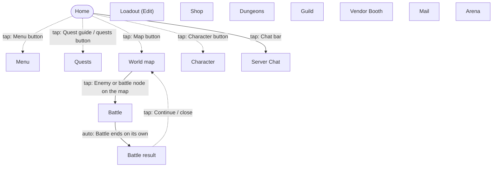

# Navigation graph

> **Last updated**: 2026-11-03
> Generated from `memory-bank/game/nav-graph.json` by `python3 scripts/nav-graph.py render`. Don't edit by hand.

Solid arrows are observed in game; dashed arrows are told or reported and still need confirming.

## Screens

| id | Name | Kind | Confidence | Unlock | Notes |
|---|---|---|---|---|---|
| `home` | Home | hub | observed |  | Main screen after login. The Cart (AFK rewards) is collected here (R-020). |
| `main_menu` | Menu | menu | observed |  | Menu of features opened from Home. |
| `quests` | Quests | menu | observed |  | Quest list; quests can be tracked (R-009). |
| `world_map` | World map | world | observed |  | Overworld with minimap, green dots and mist (R-002, R-004). Areas show exploration % (R-005). |
| `battle` | Battle | battle | observed |  | Plays itself (R-001). |
| `battle_result` | Battle result | popup | observed |  | Shown after a battle ends; being captured by the builder thread. |
| `character` | Character | menu | observed |  | Gear and enhancement; the tutorial's 'enhance your gear' step happens here. |
| `loadout_edit` | Loadout (Edit) | menu | observed |  | Team/loadout edit screen where the tutorial introduces Akane. |
| `server_chat` | Server Chat | overlay | observed |  | Easy to open by accident from Home. Close without typing. Later used by the entertainment agent. |
| `shop` | Shop | menu | reported |  | Free daily stamina, Daily Shop, Vault (Dawnium) (R-017, R-018). |
| `dungeons` | Dungeons | menu | reported |  | Material, Daily and Co-op dungeons (R-015). |
| `guild` | Guild | menu | reported | account level 15 (R-011) | Donations, Farm, Boss, floating-island AFK farm (R-016). |
| `vendor` | Vendor Booth | menu | reported | account level 18 (R-011) | Buy materials, a few refreshes a day. |
| `mail` | Mail | menu | reported |  |  |
| `arena` | Arena | menu | reported |  | Solo Arena and 3v3 Tournament; battles are auto (R-001). |

## Actions

| From | To | Action | Confidence | Notes |
|---|---|---|---|---|
| any screen | previous screen | back Android back key | reported | Assumed to close the top popup or menu, as in most Android games. Confirm per screen; some games ignore it in battle. |
| Home | Menu | tap Menu button | reported | Builder reached this screen; the exact button is not recorded yet. |
| Home | Quests | tap Quest guide / quests button | reported | Exact entry point not recorded yet. |
| Home | World map | tap Map button | reported | Exact entry point not recorded yet. |
| Home | Character | tap Character button | reported | Exact entry point not recorded yet (may be via main_menu). |
| Home | Server Chat | tap Chat bar | observed | Opened by accident during the tutorial. |
| World map | Battle | tap Enemy or battle node on the map | observed |  |
| Battle | Battle result | auto Battle ends on its own | observed | R-001. |
| Battle result | World map | tap Continue / close | reported | Return screen not confirmed. |
